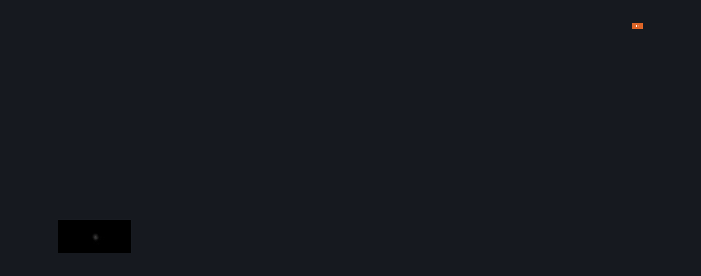
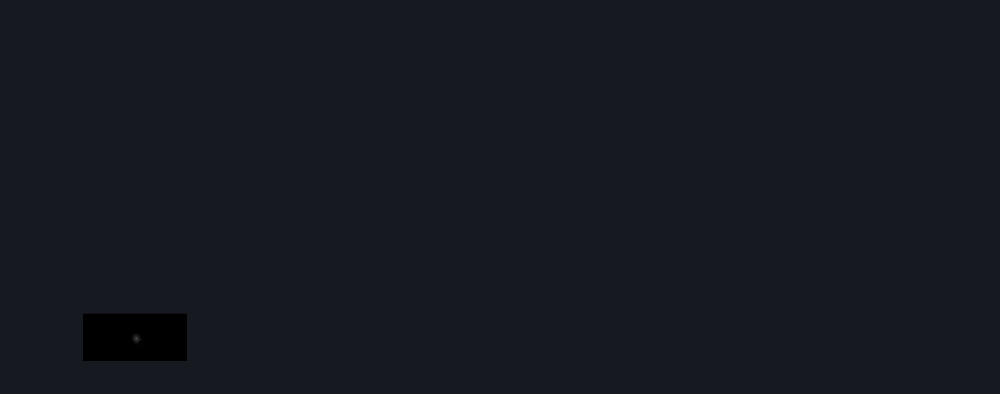

# Last Dive (Last_Dive)

**Game ID:** Last_Dive

**Contributors:** Pyxl

## Subrooms

No subrooms defined.

## Room Transitions

| Alias | Name | From subroom | Destination | Destination alias | Requirements | TODO | Verification | Annotated | Notes |
| --- | --- | --- | --- | --- | --- | --- | --- | --- | --- |
| D | door_cutscenePosition |  | [Abyss Lower Big Room (Abyss_05)](abyss-lower-big-room.md) | DI | None |  | Verified | ✓ |  |
| D2 | door_cutscenePosition2 |  | [Abyss Cocoon (Abyss_Cocoon)](abyss-cocoon.md) | D | None |  | Verified |  |  |

## Subroom Connections

No subroom connections defined.

## Check Locations

No check locations defined.

## Notes

Cut Scene That leads into Lost Lace Boss Arena

## Room Images

### Connections

### Checks

### Scene

