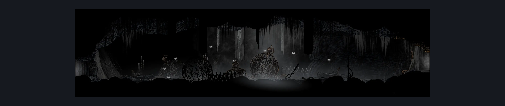

# Act2 Cradle Connector Hallway (Cradle_01)

**Game ID:** Cradle_01

**Contributors:** Pyxl

## Subrooms

No subrooms defined.

## Room Transitions

| Alias | Name | From subroom | Destination | Destination alias | Requirements | TODO | Verification | Annotated | Notes |
| --- | --- | --- | --- | --- | --- | --- | --- | --- | --- |
| L | left1 |  | [Act2 Cradle Left Shaft (Cradle_02)](act2-cradle-left-shaft.md) | LR | None |  | Verified | ✓ |  |
| R | right1 |  | [Terminus Ventrica (Tube_Hub)](terminus-ventrica.md) | ML | None |  | Verified | ✓ |  |

## Subroom Connections

No subroom connections defined.

## Check Locations

No check locations defined.

## Room Images

### Connections

### Checks

### Scene

