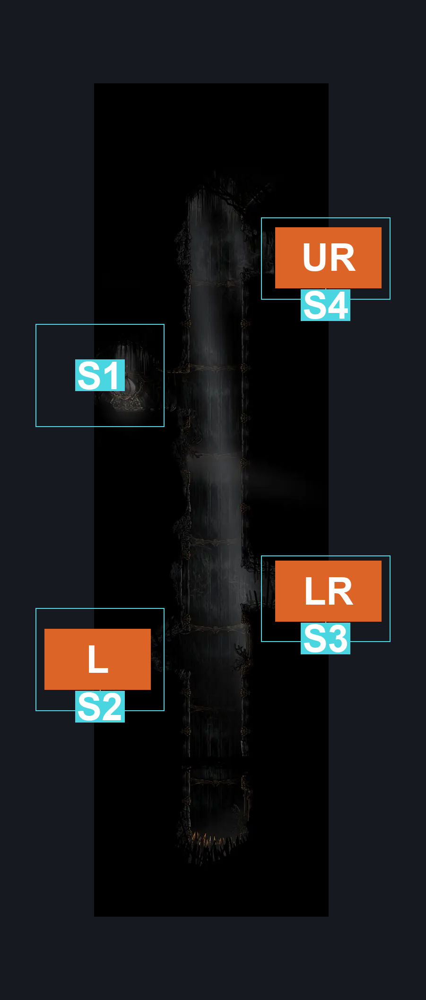
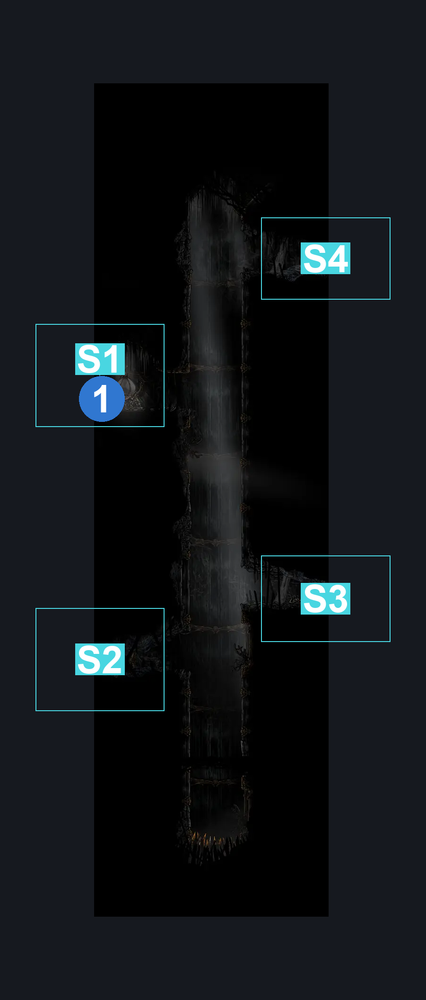
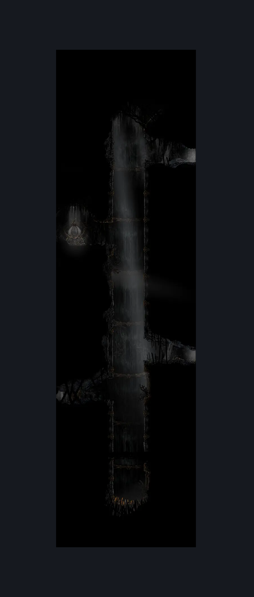

# Act2 Cradle Left Shaft (Cradle_02)

**Game ID:** Cradle_02

**Contributors:** Pyxl

## Subrooms

| No. | Subroom | Annotated |
| --- | --- | --- |
| S1 | Map Ledge | ✓ |
| S2 | Weaver Lore Ledge | ✓ |
| S3 | Lower Right Ledge | ✓ |
| S4 | Upper Right Ledge | ✓ |

## Room Transitions

| Alias | Name | From subroom | Destination | Destination alias | Requirements | TODO | Verification | Annotated | Notes |
| --- | --- | --- | --- | --- | --- | --- | --- | --- | --- |
| UR | right1 | Upper Right Ledge | [ACT2 GMS Arena (Cradle_03)](act2-gms-arena.md) | L | None |  | Verified | ✓ |  |
| L | left2 | Weaver Lore Ledge | [Weaver Jail Lore Room (Cradle_02b)](weaver-jail-lore-room.md) | R | None |  | Verified | ✓ |  |
| LR | right2 | Lower Right Ledge | [Act2 Cradle Connector Hallway (Cradle_01)](act2-cradle-connector-hallway.md) | L | None |  | Verified | ✓ |  |

## Subroom Connections

| Alias | Name | Source | Destination | Requirements | TODO | Verification | Annotated | Notes |
| --- | --- | --- | --- | --- | --- | --- | --- | --- |
| S1 | Lower Shaft | Weaver Lore Ledge | Lower Right Ledge | Faydown Cloak OR Cling Grip  either OR Scuttlebrace OR ( Silk Soar AND proficient movement (Uses that quick map to not fall off edge ) ) |  | Verified |  |  |
| S1 | Lower Shaft | Lower Right Ledge | Weaver Lore Ledge | None |  | Verified |  |  |
| S2 | Central Shaft | Lower Right Ledge | Map Ledge | Cling Grip either OR Scuttlebrace OR ( Silk Soar AND proficient movement (Uses that quick map to not fall off edge ) ) |  | Verified |  |  |
| S2 | Central Shaft | Map Ledge | Lower Right Ledge | None |  | Verified |  |  |
| S3 | Upper Shaft | Map Ledge | Upper Right Ledge | Cling Grip either OR Scuttlebrace OR ( Silk Soar AND proficient movement (Uses that quick map to not fall off edge ) ) |  | Verified |  |  |
| S3 | Upper Shaft | Upper Right Ledge | Map Ledge | None |  | Verified |  |  |

## Check Locations

| No. | Check | Subroom | Requirements | TODO | Verification | Location Type | Annotated | Notes |
| --- | --- | --- | --- | --- | --- | --- | --- | --- |
| 1 | Map: Cradle | Map Ledge | None |  | Verified | collectible | ✓ |  |

## Room Images

### Connections

### Checks

### Scene

