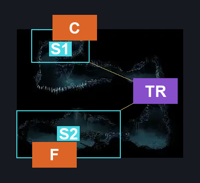
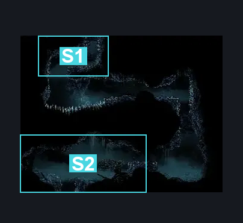
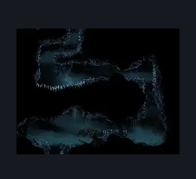

# ACT3 Connection To GMS (Cradle_01_Destroyed)

**Game ID:** Cradle_01_Destroyed

**Contributors:** Pyxl

## Subrooms

| No. | Subroom | Annotated |
| --- | --- | --- |
| S1 | Top | ✓ |
| S2 | Bottom | ✓ |

## Room Transitions

| Alias | Name | From subroom | Destination | Destination alias | Requirements | TODO | Verification | Annotated | Notes |
| --- | --- | --- | --- | --- | --- | --- | --- | --- | --- |
| F | bot1 | Bottom | [ACT3 Lace2 Arena (Song_Tower_Destroyed)](act3-lace2-arena.md) | C | None |  | Verified | ✓ |  |
| C | top1 | Top | [ACT3 GMS Arena (Cradle_03_Destroyed)](act3-gms-arena.md) | F | Cling grip Either OR Faydown Cloak OR Silk Soar OR Scuttlebrace OR easy Shaman Pogo OR Easy Beast Charge OR Easy Architect pogo |  | Verified | ✓ |  |

## Subroom Connections

| Alias | Name | Source | Destination | Requirements | TODO | Verification | Annotated | Notes |
| --- | --- | --- | --- | --- | --- | --- | --- | --- |
| TR | The room | Bottom | Top | ( Cling Grip left OR Scuttlebrace ) AND ( Silk Soar OR Faydown Cloak ) AND ( Spike pogo OR Clawline Left ) |  | Verified | ✓ |  |
| TR | The room | Top | Bottom | Spike pogo OR Clawline Right |  | Verified | ✓ |  |

## Check Locations

No check locations defined.

## Room Images

### Connections

### Checks

### Scene

