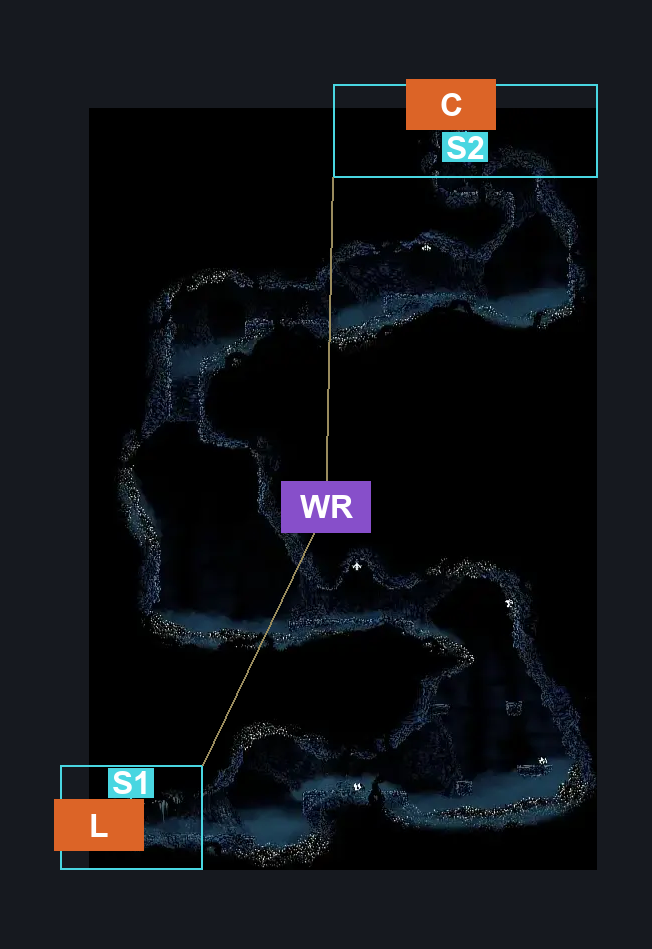
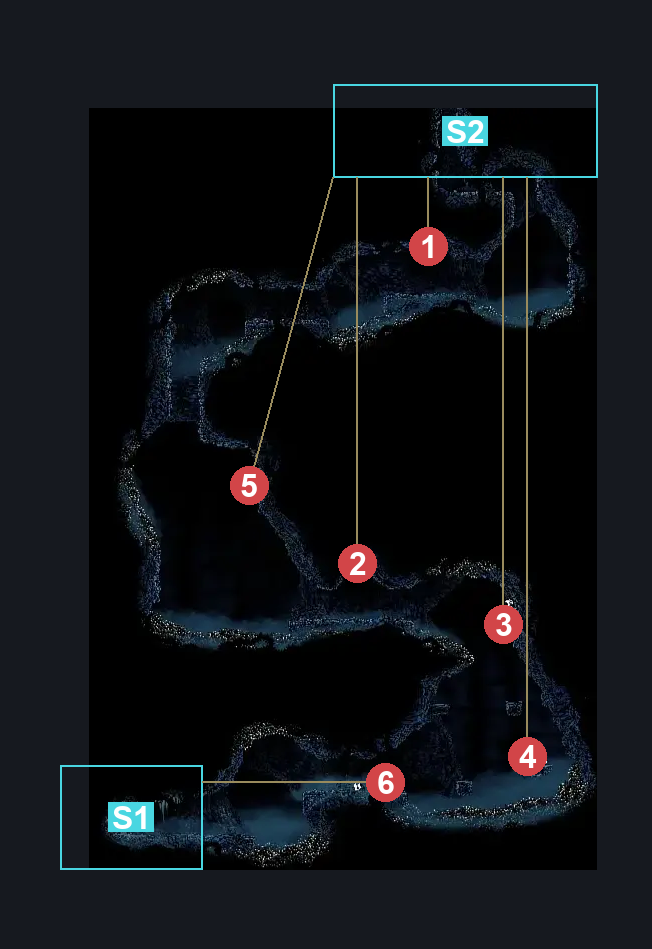

# Cradle Path Of Pain First Room (Cradle_Destroyed_Challenge_02)

**Game ID:** Cradle_Destroyed_Challenge_02

**Contributors:** Pyxl

## Subrooms

| No. | Subroom | Annotated |
| --- | --- | --- |
| S1 | Start | ✓ |
| S2 | End | ✓ |

## Room Transitions

| Alias | Name | From subroom | Destination | Destination alias | Requirements | TODO | Verification | Annotated | Notes |
| --- | --- | --- | --- | --- | --- | --- | --- | --- | --- |
| C | top1 | End | [Path of Pain Bench (Cradle_Destroyed_Challenge_Bench)](path-of-pain-bench.md) | F | Cling Grip either OR Silk Soar OR Scuttlebrace |  | Verified | ✓ |  |
| L | left1 | Start | [ACT3 GMS Arena (Cradle_03_Destroyed)](act3-gms-arena.md) | D | None |  | Verified | ✓ |  |

## Subroom Connections

| Alias | Name | Source | Destination | Requirements | TODO | Verification | Annotated | Notes |
| --- | --- | --- | --- | --- | --- | --- | --- | --- |
| WR | Whole Room | Start | End | Faydown Cloak AND ( ( Silk Soar AND Cling Grip Right AND Proficient movement ) OR ( Cling grip both AND ( Drifters cloak OR ( ( Sprint left OR Clawline Left OR Sharpdart ) AND ( Dash Right OR Clawline Right OR sharpdart  ) ) ) ) ) |  | Verified | ✓ | Not doable with just scuttlebrace until proven wrong, I really tried to make it work - pyxl 23/10 |
| WR | Whole Room | End | Start | Faydown Cloak OR Drifters Cloak OR Clawline both OR Dash Both |  | Verified | ✓ |  |

## Check Locations

| No. | Check | Subroom | Requirements | TODO | Verification | Location Type | Annotated | Notes |
| --- | --- | --- | --- | --- | --- | --- | --- | --- |
| 1 | Pharlid Diver 1 | End | Faydown Cloak OR Drifters Cloak OR Clawline both OR Dash Both |  | Verified | enemy | ✓ |  |
| 2 | Pharlid Diver 2 | End | Faydown Cloak OR Drifters Cloak OR Clawline both OR Dash Both |  | Verified | enemy | ✓ |  |
| 3 | Pharlid 1 | End | Faydown Cloak OR Drifters Cloak OR Clawline both OR Dash Both |  | Verified | enemy | ✓ |  |
| 4 | Pharlid 2 | End | Faydown Cloak OR Drifters Cloak OR Clawline both OR Dash Both |  | Verified | enemy | ✓ |  |
| 5 | Pharlid 3 | End | Faydown Cloak OR Drifters Cloak OR Clawline both OR Dash Both |  | Verified | enemy | ✓ |  |
| 6 | Pharlid 4 | Start | Faydown Cloak OR Scuttlebrace OR ( Cling grip right AND ( Dash Right OR Clawline RIght OR Sharpdart OR Drifters Cloak OR SPrint Right ) ) |  | Verified | enemy | ✓ |  |

## Notes

Needs a map link

## Room Images

### Connections

### Checks

### Scene

