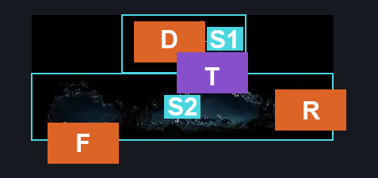

# Path of Pain Bench (Cradle_Destroyed_Challenge_Bench)

**Game ID:** Cradle_Destroyed_Challenge_Bench

**Contributors:** Pyxl

## Subrooms

| No. | Subroom | Annotated |
| --- | --- | --- |
| S1 | Cave | ✓ |
| S2 | Bench | ✓ |

## Room Transitions

| Alias | Name | From subroom | Destination | Destination alias | Requirements | TODO | Verification | Annotated | Notes |
| --- | --- | --- | --- | --- | --- | --- | --- | --- | --- |
| R | right1 | Bench | [Path Of Pain Silksong (Cradle_Destroyed_Challenge_01)](path-of-pain-silksong.md) | L | None |  | Verified | ✓ |  |
| F | bot1 | Bench | [Cradle Path Of Pain First Room (Cradle_Destroyed_Challenge_02)](cradle-path-of-pain-first-room.md) | C | none |  | Verified | ✓ |  |
| D | door1 | Cave | [The Surface (Abandoned_town)](the-surface.md) | D | None |  | Verified | ✓ |  |

## Subroom Connections

| Alias | Name | Source | Destination | Requirements | TODO | Verification | Annotated | Notes |
| --- | --- | --- | --- | --- | --- | --- | --- | --- |
| T | Thorns | Bench | Cave | ( Silk Soar OR ( Faydown Cloak AND Cling grip either ) ) AND Prereq path of pain wall |  | Verified | ✓ |  |
| T | Thorns | Cave | Bench | Prereq path of pain wall |  | Verified | ✓ |  |

## Check Locations

| No. | Check | Subroom | Requirements | TODO | Verification | Location Type | Annotated | Notes |
| --- | --- | --- | --- | --- | --- | --- | --- | --- |
| 1 | Path of Pain Bench | Bench | None |  | Verified | bench |  |  |
| 2 | path of pain wall | Cave | none |  | Verified | blockade |  |  |

## Notes

Needs a map link

## Room Images

### Connections

### Checks

### Scene

