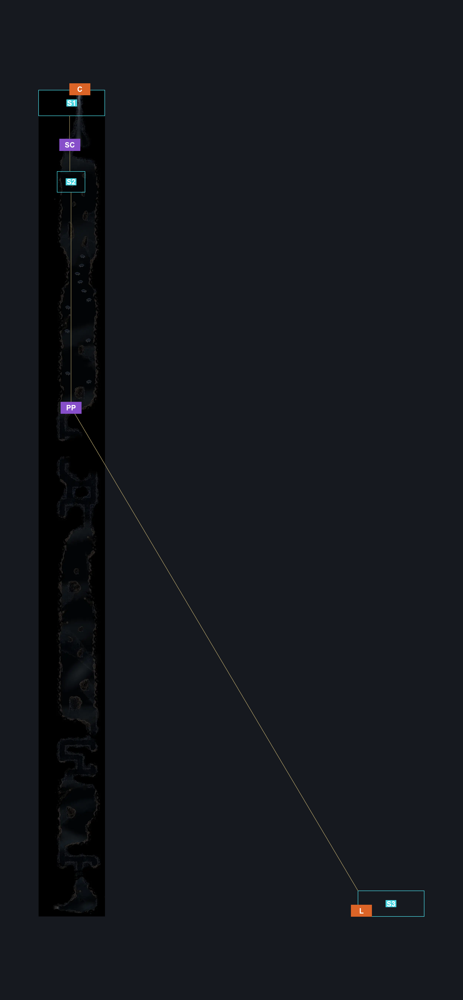
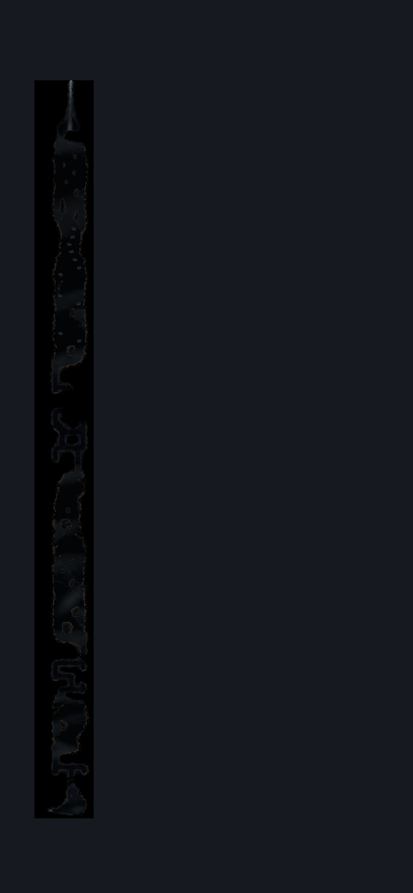

# Path Of Pain Silksong (Cradle_Destroyed_Challenge_01)

**Game ID:** Cradle_Destroyed_Challenge_01

**Contributors:** Pyxl

## Subrooms

| No. | Subroom | Annotated |
| --- | --- | --- |
| S1 | Top | ✓ |
| S2 | Herald Platform | ✓ |
| S3 | Bottom | ✓ |

## Room Transitions

| Alias | Name | From subroom | Destination | Destination alias | Requirements | TODO | Verification | Annotated | Notes |
| --- | --- | --- | --- | --- | --- | --- | --- | --- | --- |
| C | top1 | Top | [The Surface (Abandoned_town)](the-surface.md) | F | None |  | Verified | ✓ |  |
| L | left1 | Bottom | [Path of Pain Bench (Cradle_Destroyed_Challenge_Bench)](path-of-pain-bench.md) | R | None |  | Verified | ✓ |  |

## Subroom Connections

| Alias | Name | Source | Destination | Requirements | TODO | Verification | Annotated | Notes |
| --- | --- | --- | --- | --- | --- | --- | --- | --- |
| PP | path of pain mini | Bottom | Herald Platform | Cling Grip both AND Clawline both AND Faydown Cloak |  | Verified | ✓ |  |
| PP | path of pain mini | Herald Platform | Bottom | None (#good luck) OR Drifters Cloak |  | Verified | ✓ | I think this was the Pyxl said should be Nothing difficulty Medium  yeah, if possible add medium for this fall cause i only could do it on half game speed, but it 100% is possible if you know exactly where to fall |
| SC | to the surface | Herald Platform | Top | ( Faydown Cloak AND Cling Grip left ) OR Silk Soar |  | Verified | ✓ | Silk Soar does not work here. Nice touch, Team Cherry. - hero  Silk soar does work here no clue what your on about - Pyxl |
| SC | to the surface | Top | Herald Platform | None (falling) |  | Verified | ✓ |  |

## Check Locations

| No. | Check | Subroom | Requirements | TODO | Verification | Location Type | Annotated | Notes |
| --- | --- | --- | --- | --- | --- | --- | --- | --- |
| 1 | Mister Mushroom Meeting The Cradle | Herald Platform | after THE Mister Mushroom Meeting Mount Fay AND Needolin |  | Verified | event | ✓ |  |
| 2 | Passing of the Age Wish Granted | Herald Platform | after Mister Mushroom Meeting The Cradle |  | Verified | event |  |  |
| 3 | Imoba 1 | Herald Platform | None |  | Verified | enemy | ✓ |  |
| 4 | Imoba 2 | Herald Platform | None |  | Verified | enemy | ✓ |  |
| 5 | Imoba 3 | Herald Platform | None |  | Verified | enemy | ✓ |  |
| 6 | Imoba 4 | Herald Platform | None |  | Verified | enemy | ✓ |  |
| 7 | Imoba 5 | Herald Platform | None |  | Verified | enemy | ✓ |  |
| 8 | Imoba 6 | Herald Platform | None |  | Verified | enemy | ✓ |  |
| 9 | Imoba 7 | Herald Platform | None |  | Verified | enemy | ✓ |  |
| 10 | Imoba 8 | Herald Platform | None |  | Verified | enemy | ✓ |  |
| 11 | Imoba 9 | Herald Platform | None |  | Verified | enemy | ✓ |  |
| 12 | Imoba 10 | Herald Platform | None |  | Verified | enemy | ✓ |  |
| 13 | Imoba 11 | Herald Platform | None |  | Verified | enemy | ✓ |  |
| 14 | Garpid | Herald Platform | Break Silk Blockade (#other than bell beast kill ) |  | Verified | enemy | ✓ | same kill req as a silk blockade |

## Notes

No map link for this

## Room Images

### Connections

### Checks

### Scene

