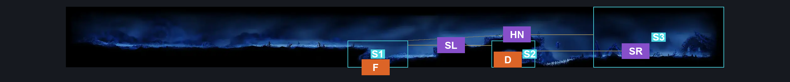
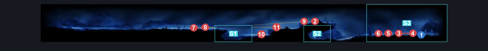
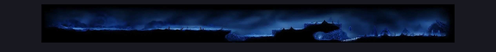

# The Surface (Abandoned_town)

**Game ID:** Abandoned_town

**Contributors:** Pyxl

## Subrooms

| No. | Subroom | Annotated |
| --- | --- | --- |
| S1 | Hole | ✓ |
| S2 | Door | ✓ |
| S3 | Nameless Town | ✓ |

- **Nameless Town:**  Right Side of room cant place box

## Room Transitions

| Alias | Name | From subroom | Destination | Destination alias | Requirements | TODO | Verification | Annotated | Notes |
| --- | --- | --- | --- | --- | --- | --- | --- | --- | --- |
| D | door1 | Door | [Path of Pain Bench (Cradle_Destroyed_Challenge_Bench)](path-of-pain-bench.md) | D | None |  | Verified | ✓ |  |
| F | bot1 | Hole | [Path Of Pain Silksong (Cradle_Destroyed_Challenge_01)](path-of-pain-silksong.md) | C | None |  | Verified | ✓ |  |

## Subroom Connections

| Alias | Name | Source | Destination | Requirements | TODO | Verification | Annotated | Notes |
| --- | --- | --- | --- | --- | --- | --- | --- | --- |
| SL | Surface Left | Hole | Door | None |  | Verified | ✓ |  |
| SL | Surface Left | Door | Hole | Faydown Cloak OR ( Spike Pogo AND ( Ledge grab Left OR Cling Grip Left OR medium Scuttlebrace ) ) |  | Verified | ✓ |  |
| SR | Surface Right | Door | Nameless Town | None |  | Verified | ✓ |  |
| SR | Surface Right | Nameless Town | Door | None |  | Verified | ✓ |  |
| HN | Hole to Nameless Town | Hole | Nameless Town | None |  | Verified | ✓ |  |

## Check Locations

| No. | Check | Subroom | Requirements | TODO | Verification | Location Type | Annotated | Notes |
| --- | --- | --- | --- | --- | --- | --- | --- | --- |
| 1 | Surface Memento | Nameless Town | None |  | Verified | collectible | ✓ |  |
| 2 | Skrill 1 | Hole | None |  | Verified | enemy | ✓ |  |
| 3 | Skrill 2 | Nameless Town | None |  | Verified | enemy | ✓ |  |
| 4 | Skrill 3 | Nameless Town | None |  | Verified | enemy | ✓ |  |
| 5 | Skrill 4 | Nameless Town | None |  | Verified | enemy | ✓ |  |
| 6 | Skrill 5 | Nameless Town | None |  | Verified | enemy | ✓ |  |
| 7 | Skrill 6 | Hole | None |  | Verified | enemy | ✓ |  |
| 8 | Skrill 7 | Hole | None |  | Verified | enemy | ✓ |  |
| 9 | Skrill 8 | Hole | None |  | Verified | enemy | ✓ |  |
| 10 | Skrill 9 | Hole | None |  | Verified | enemy | ✓ |  |
| 11 | Skrill 10 | Hole | None |  | Verified | enemy | ✓ |  |

## Notes

No map link for this

## Room Images

### Connections

### Checks

### Scene

