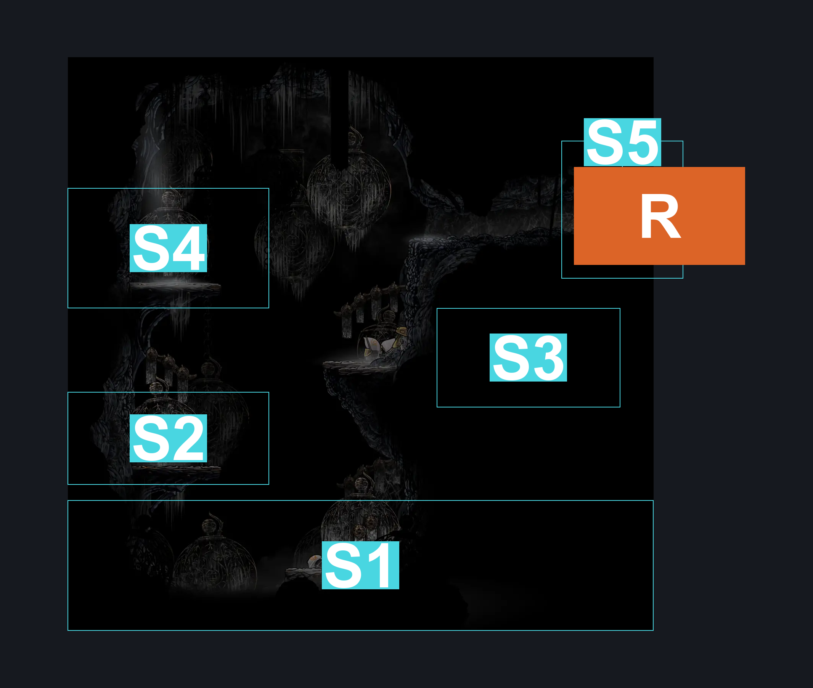
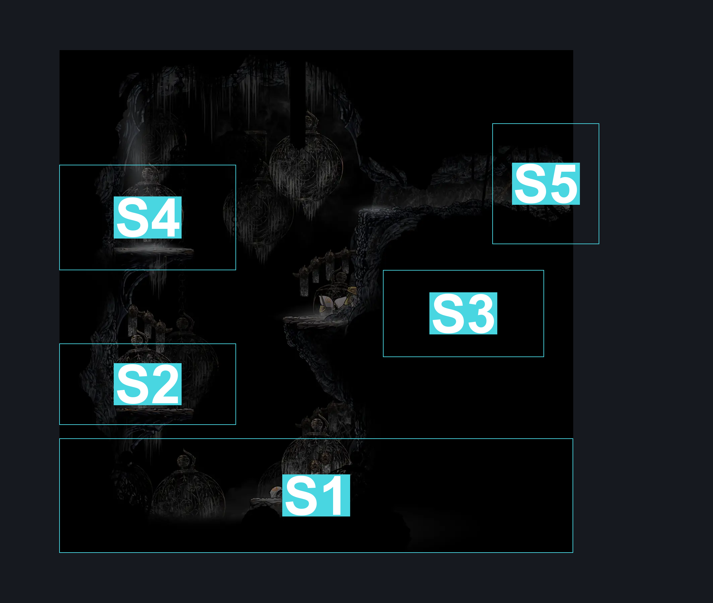
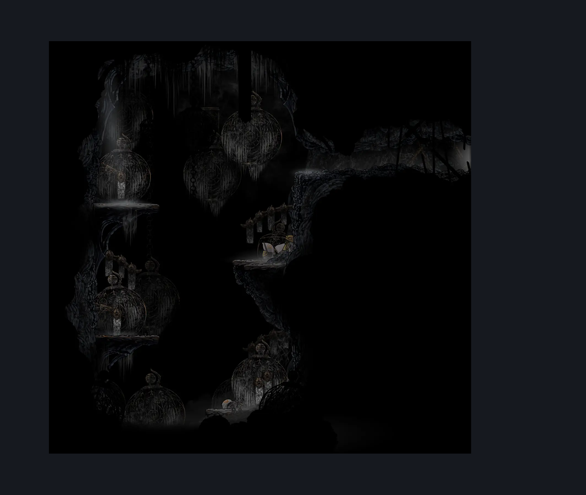

# Weaver Jail Lore Room (Cradle_02b)

**Game ID:** Cradle_02b

**Contributors:** Pyxl

## Subrooms

| No. | Subroom | Annotated |
| --- | --- | --- |
| S1 | Bottom | ✓ |
| S2 | Loreplatform1 | ✓ |
| S3 | Loreplatform2 | ✓ |
| S4 | Loreplatform3 | ✓ |
| S5 | Exit | ✓ |

## Room Transitions

| Alias | Name | From subroom | Destination | Destination alias | Requirements | TODO | Verification | Annotated | Notes |
| --- | --- | --- | --- | --- | --- | --- | --- | --- | --- |
| R | right1 | Exit | [Act2 Cradle Left Shaft (Cradle_02)](act2-cradle-left-shaft.md) | L | None |  | Verified | ✓ |  |

## Subroom Connections

| Alias | Name | Source | Destination | Requirements | TODO | Verification | Annotated | Notes |
| --- | --- | --- | --- | --- | --- | --- | --- | --- |
| B1 | Bottom To Platform 1 | Bottom | Loreplatform1 | Silk Soar OR Faydown Cloak OR ( Cling Grip right AND Clawline left ) |  | Verified |  |  |
| B1 | Bottom To Platform 1 | Loreplatform1 | Bottom | None |  | Verified |  |  |
| P12 | Platform 1 To Platform 2 | Loreplatform1 | Loreplatform2 | Silk Soar OR Faydown Cloak OR ( Cling Grip left AND Clawline right ) |  | Verified |  |  |
| P12 | Platform 1 To Platform 2 | Loreplatform2 | Loreplatform1 | None |  | Verified |  |  |
| P23 | Platform 2 To Platform 3 | Loreplatform2 | Loreplatform3 | Silk Soar OR Faydown Cloak OR ( Cling Grip Right AND Clawline Left ) |  | Verified |  |  |
| P23 | Platform 2 To Platform 3 | Loreplatform3 | Loreplatform2 | None |  | Verified |  |  |
| P3L | Platform 3 To Exit | Loreplatform3 | Exit | Clawline right OR ( Faydown Cloak AND Drifters Cloak ) |  | Verified |  |  |
| P3L | Platform 3 To Exit | Exit | Loreplatform3 | Faydown Cloak OR Drifters Cloak OR Clawline left OR Sprint left OR Dash left |  | Verified |  |  |
| LP2 | Exit To Platform 2 | Exit | Loreplatform2 | None |  | Verified |  |  |
| LP2 | Exit To Platform 2 | Loreplatform2 | Exit | Cling Grip right OR Silk Soar OR Scuttlebrace OR ( Faydown Cloak AND ( Ledge grab right OR easy Shaman Crest pogo OR Clawline both ) ) |  | Verified |  |  |

## Check Locations

| No. | Check | Subroom | Requirements | TODO | Verification | Location Type | Annotated | Notes |
| --- | --- | --- | --- | --- | --- | --- | --- | --- |
| 1 | Lore: Cradle #1 | Bottom | None |  | Verified | lore |  |  |
| 2 | Lore: Cradle #2 | Loreplatform1 | None |  | Verified | lore |  |  |
| 3 | Lore: Cradle #3 | Loreplatform3 | None |  | Verified | lore |  |  |

## Room Images

### Connections

### Checks

### Scene

