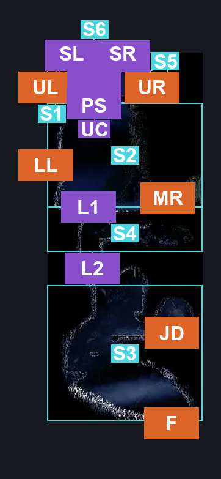
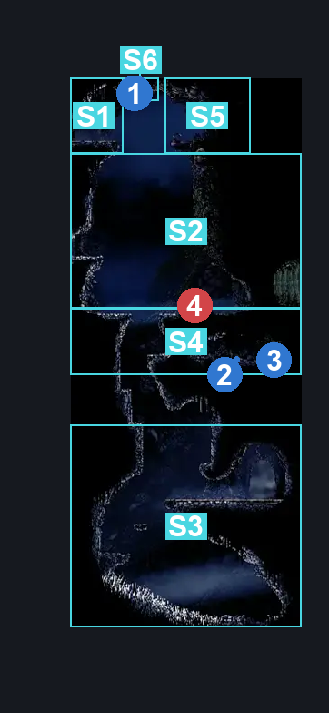
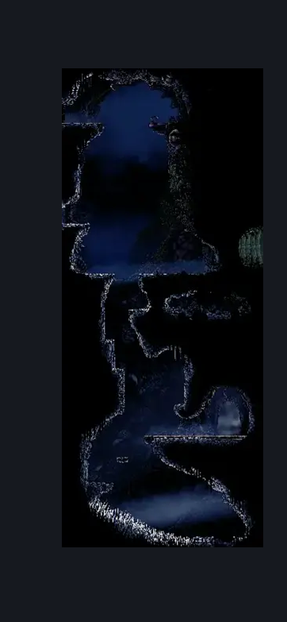

# The Marrow Jail Pathway (Bone_08)

**Game ID:** Bone_08

**Contributors:** herounit

## Subrooms

| No. | Subroom | Annotated |
| --- | --- | --- |
| S1 | upper left area | ✓ |
| S2 | middle area | ✓ |
| S3 | jail area | ✓ |
| S4 | check alcove | ✓ |
| S5 | upper right area | ✓ |
| S6 | upper switch | ✓ |

## Room Transitions

| Alias | Name | From subroom | Destination | Destination alias | Requirements | TODO | Verification | Annotated | Notes |
| --- | --- | --- | --- | --- | --- | --- | --- | --- | --- |
| UL | upper left | upper left area | [The Marrow Lower Pogo (Bone_07)](the-marrow-lower-pogo.md) | UR | none |  | Verified | ✓ |  |
| LL | lower left | middle area | [The Marrow Lower Pogo (Bone_07)](the-marrow-lower-pogo.md) | LR | none |  | Verified | ✓ |  |
| UR | upper right | upper right area | [Bellhart Lower (Belltown_basement_03)](../bellhart/bellhart-lower.md) | L | none |  | Verified | ✓ |  |
| MR | middle right | middle area | [Hunter's March Entrance (Ant_02)](../hunter-s-march/hunter-s-march-entrance.md) | L | none |  | Verified | ✓ |  |
| JD | jail door | jail area | [The Marrow Jail (Bone_12)](the-marrow-jail.md) | L | none |  | Verified | ✓ |  |
| F | floor | jail area | [The Marrow Lava Docks (Bone_09)](the-marrow-lava-docks.md) | C | none |  | Verified | ✓ |  |

## Subroom Connections

| Alias | Name | Source | Destination | Requirements | TODO | Verification | Annotated | Notes |
| --- | --- | --- | --- | --- | --- | --- | --- | --- |
| PS | platform switch | middle area | upper left area | activate platform switch |  | Verified | ✓ |  |
| PS | platform switch | upper left area | middle area | none (falling) |  | Verified | ✓ |  |
| L1 | ledges 1 | check alcove | middle area | ledge grab either OR cling grip either OR faydown OR easy scuttlebrace OR silk soar |  | Verified | ✓ |  |
| L1 | ledges 1 | middle area | check alcove | none (falling) |  | Verified | ✓ |  |
| L2 | ledges 2 | jail area | check alcove | cling grip left OR ( ledge grab left AND ( ledge grab right OR cling grip right ) ) OR faydown OR easy scuttlebrace OR silk soar OR easy shaman pogo |  | Verified | ✓ |  |
| L2 | ledges 2 | check alcove | jail area | none (falling) |  | Verified | ✓ |  |
| SL | switch access left | upper left area | upper switch | none |  | Verified | ✓ |  |
| SR | switch access right | upper right area | upper switch | none |  | Verified | ✓ |  |
| UC | upper crossing | upper left area | upper right area | activate platform switch OR run OR dash right OR drifters OR faydown OR ledge grab right OR clawline right OR sharpdart OR easy [ beast, reaper, hunter, architect ] pogo OR easy [ wanderer ] charge OR flea brew |  | Verified | ✓ | cling grip is really fussy when jumping from this direction. couldn't get it to work - hero, 10/29 |
| UC | upper crossing | upper right area | upper left area | activate platform switch OR run OR dash left OR drifters OR faydown OR ledge grab left OR cling grip right OR clawline left OR sharpdart OR easy [ beast, reaper, hunter, architect ] pogo OR easy [ wanderer ] charge OR flea brew |  | Verified | ✓ | a million stalls probably work across the gap, but it doesn't matter until switch rando |

## Check Locations

| No. | Check | Subroom | Requirements | TODO | Verification | Location Type | Annotated | Notes |
| --- | --- | --- | --- | --- | --- | --- | --- | --- |
| 1 | platform switch | upper switch | none |  | Verified | switch | ✓ |  |
| 2 | the marrow rosary cache 8 | check alcove | none |  | Verified | collectible | ✓ |  |
| 3 | the marrow rosary cache 9 | check alcove | none |  | Verified | collectible | ✓ |  |
| 4 | Spear Skarr 1 | middle area | Black Thread World Spawn |  | Verified | enemy | ✓ |  |

## Room Images

### Connections

### Checks

### Scene

