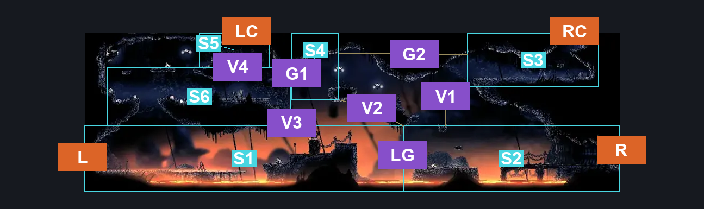
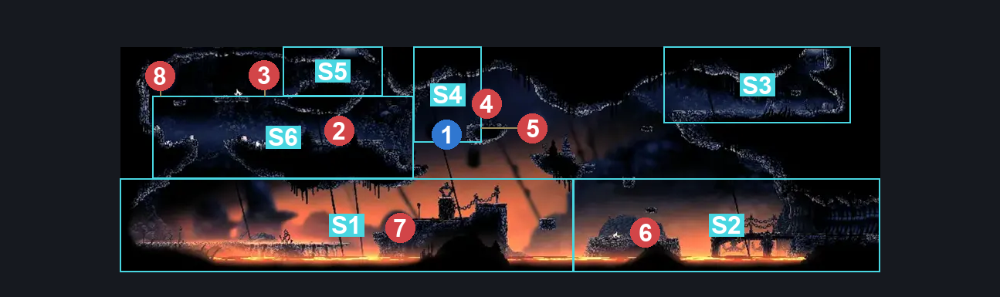
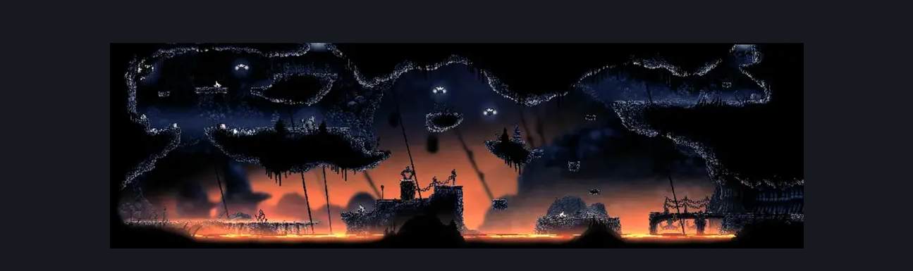

# The Marrow Lava Intro (Bone_02)

**Game ID:** Bone_02

**Contributors:** herounit

## Subrooms

| No. | Subroom | Annotated |
| --- | --- | --- |
| S1 | ground left | ✓ |
| S2 | ground right | ✓ |
| S3 | flea sign platform | ✓ |
| S4 | chain break spot | ✓ |
| S5 | upper left exit | ✓ |
| S6 | left platforms | ✓ |

## Room Transitions

| Alias | Name | From subroom | Destination | Destination alias | Requirements | TODO | Verification | Annotated | Notes |
| --- | --- | --- | --- | --- | --- | --- | --- | --- | --- |
| L | left | ground left | [The Marrow Bell Bench (Bone_01c)](the-marrow-bell-bench.md) | R | none |  | Verified | ✓ |  |
| R | right | ground right | [The Marrow Lava Track (Bone_16)](the-marrow-lava-track.md) | L | none |  | Verified | ✓ |  |
| LC | left ceiling | upper left exit | [The Marrow Shaft (Bone_03)](the-marrow-shaft.md) | F | none |  | Verified | ✓ |  |
| RC | right ceiling | flea sign platform | [The Marrow Flea Caravan (Bone_10)](the-marrow-flea-caravan.md) | F | none |  | Verified | ✓ |  |

## Subroom Connections

| Alias | Name | Source | Destination | Requirements | TODO | Verification | Annotated | Notes |
| --- | --- | --- | --- | --- | --- | --- | --- | --- |
| LG | lava gap | ground left | ground right | none (jump) |  | Verified | ✓ |  |
| LG | lava gap | ground right | ground left | ledge grab left OR cling grip left OR run OR dash left OR drifters OR faydown OR easy scuttlebrace OR silk soar OR clawline left OR sharpdart OR easy shaman pogo OR easy beast pogo |  | Verified | ✓ |  |
| V1 | vertical 1 | ground right | flea sign platform | ledge grab left OR cling grip left OR faydown OR silk soar OR easy shaman pogo |  | Verified | ✓ |  |
| V1 | vertical 1 | flea sign platform | ground right | none (falling) |  | Verified | ✓ |  |
| V2 | vertical 2 | ground right | chain break spot | ledge grab left OR cling grip left OR faydown OR silk soar OR easy shaman pogo |  | Verified | ✓ | can't find a way to make an enemy pogo matter here - hero, 10/29 |
| V2 | vertical 2 | chain break spot | ground right | none (falling) |  | Verified | ✓ |  |
| V3 | vertical 3 | ground left | left platforms | silk soar OR faydown OR ( after chain drop platform AND ( ledge grab left OR cling grip left ) ) |  | Verified | ✓ |  |
| V3 | vertical 3 | left platforms | ground left | none (falling) |  | Verified | ✓ |  |
| V4 | vertical 4 | left platforms | upper left exit | silk soar OR ledge grab right OR cling grip either OR easy enemy pogo off caranid OR faydown OR easy shaman pogo |  | Verified | ✓ |  |
| V4 | vertical 4 | upper left exit | left platforms | none (falling) |  | Verified | ✓ |  |
| G1 | gap 1 | left platforms | chain break spot | clawline right OR sharpdart OR faydown OR ( run AND ( dash right OR easy beast pogo ) ) |  | Verified | ✓ |  |
| G1 | gap 1 | chain break spot | left platforms | none (falling) |  | Verified | ✓ |  |
| G2 | gap 2 | chain break spot | flea sign platform | easy pogo off caranid OR easy damage boost off caranid |  | Verified | ✓ |  |

## Check Locations

| No. | Check | Subroom | Requirements | TODO | Verification | Location Type | Annotated | Notes |
| --- | --- | --- | --- | --- | --- | --- | --- | --- |
| 1 | chain drop platform | chain break spot | none (stand on it) |  | Verified | switch | ✓ |  |
| 2 | Skull Brute 1 | left platforms | None |  | Verified | enemy | ✓ |  |
| 3 | Caranid 1 | left platforms | None |  | Verified | enemy | ✓ | technically in upper left exit but can be activated from lower spot |
| 4 | Caranid 2 | chain break spot | None |  | Verified | enemy | ✓ |  |
| 5 | Caranid 3 | chain break spot | None |  | Verified | enemy | ✓ |  |
| 6 | Skull Scuttler 1 | ground right | None |  | Verified | enemy | ✓ |  |
| 7 | Skull Scuttler 2 | ground left | None |  | Verified | enemy | ✓ |  |
| 8 | Void Mass 1 | left platforms | Black Thread World Spawn |  | Verified | enemy | ✓ | placement seems to allow it to be attacked from here without getting to the upper platforms |

## Notes

no checks

## Room Images

### Connections

### Checks

### Scene

