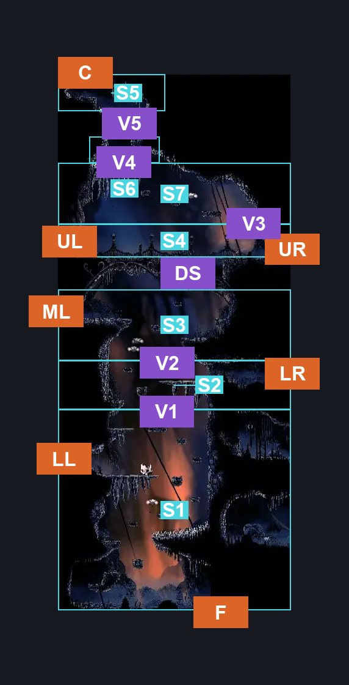
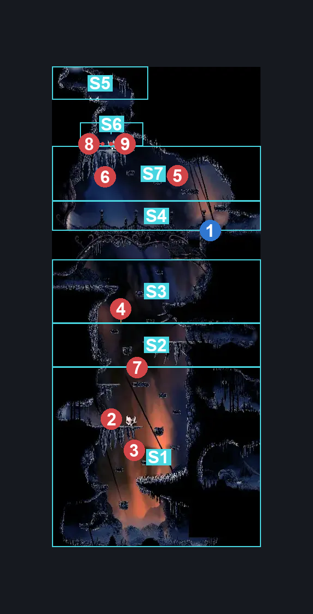
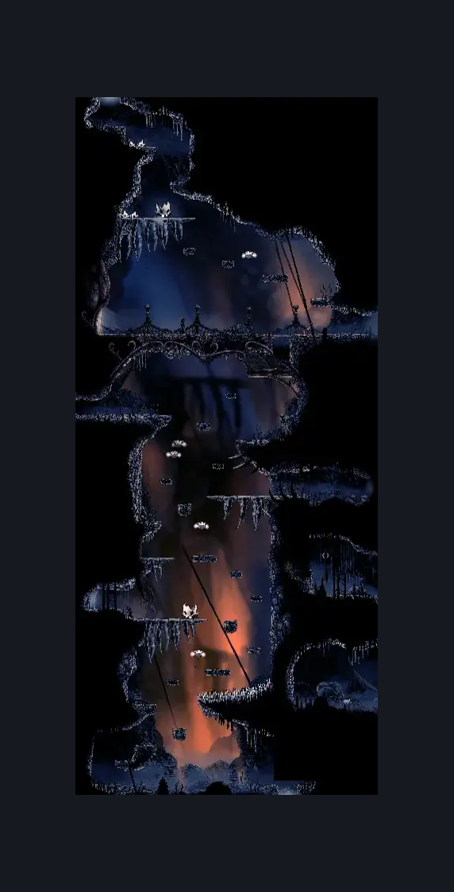

# The Marrow Shaft (Bone_03)

**Game ID:** Bone_03

**Contributors:** herounit

## Subrooms

| No. | Subroom | Annotated |
| --- | --- | --- |
| S1 | bottom shaft | ✓ |
| S2 | lower middle shaft | ✓ |
| S3 | upper middle shaft | ✓ |
| S4 | the bridge | ✓ |
| S5 | ceiling exit area | ✓ |
| S6 | big boy shelf | ✓ |
| S7 | collapsing upper crossing | ✓ |

## Room Transitions

| Alias | Name | From subroom | Destination | Destination alias | Requirements | TODO | Verification | Annotated | Notes |
| --- | --- | --- | --- | --- | --- | --- | --- | --- | --- |
| F | floor | bottom shaft | [The Marrow Lava Intro (Bone_02)](the-marrow-lava-intro.md) | LC | none |  | Verified | ✓ |  |
| LL | lower left | bottom shaft | [The Marrow Shaft Side Room (Bone_17)](the-marrow-shaft-side-room.md) | R | none |  | Verified | ✓ |  |
| ML | middle left | upper middle shaft | [The Marrow Map Shop (Bone_04)](the-marrow-map-shop.md) | R | none |  | Verified | ✓ |  |
| UL | upper left | the bridge | [The Marrow Bellshrine (Bellshrine)](the-marrow-bellshrine.md) | R | ( bellshrinesanity off AND activate bellshrine switch IN the marrow bellshrine )  OR ( bellshrinesanity on AND have bell the marrow ) |  | Verified | ✓ | requirement for inner and outer gate must be maintained in sync |
| LR | lower right | lower middle shaft | [The Marrow Flea Caravan (Bone_10)](the-marrow-flea-caravan.md) | L | none |  | Verified | ✓ |  |
| UR | upper right | the bridge | [The Marrow Mr Burns House (Bone_14)](the-marrow-mr-burns-house.md) | L | none |  | Verified | ✓ |  |
| C | ceiling | ceiling exit area | [The Marrow Skull Wall (Bone_06)](the-marrow-skull-wall.md) | F | none |  | Verified | ✓ |  |

## Subroom Connections

| Alias | Name | Source | Destination | Requirements | TODO | Verification | Annotated | Notes |
| --- | --- | --- | --- | --- | --- | --- | --- | --- |
| DS | door switch | upper middle shaft | the bridge | activate door switch AND (  ( ledge grab right OR cling grip either OR faydown OR silk soar ) OR ( ledge grab left AND ( run OR dash left OR easy [beast, shaman] pogo OR drifters OR faydown OR clawline either OR sharpdart ) ) ) |  | Verified | ✓ |  |
| DS | door switch | the bridge | upper middle shaft | activate door switch |  | Verified | ✓ |  |
| V1 | vertical 1 | bottom shaft | lower middle shaft | ledge grab left OR easy enemy pogo off caranid OR cling grip left OR faydown OR silk soar |  | Verified | ✓ |  |
| V1 | vertical 1 | lower middle shaft | bottom shaft | none (falling) |  | Verified | ✓ |  |
| V2 | vertical 2 | lower middle shaft | upper middle shaft | ledge grab either OR easy pogo off caranid OR run OR dash right OR drifters OR faydown OR cling grip either OR clawline right OR sharpdart OR silk soar OR easy [shaman, hunter, architect, beast] pogo OR easy [wanderer, reaper] charge OR easy [heal, flea brew, flintslate, plasmium, voltvessels] stall |  | Verified | ✓ | a WIDE variety of stalls work here. karma for the bottom section all being one chunk  probably need to test spell stalls - hero, 10/21 |
| V2 | vertical 2 | upper middle shaft | lower middle shaft | none (falling) |  | Verified | ✓ |  |
| V3 | vertical 3 | the bridge | collapsing upper crossing | ledge grab right OR cling grip right OR faydown OR silk soar |  | Verified | ✓ |  |
| V3 | vertical 3 | collapsing upper crossing | the bridge | none (falling) |  | Verified | ✓ |  |
| V4 | vertical 4 | collapsing upper crossing | big boy shelf | ledge grab left OR cling grip left OR faydown OR silk soar OR easy pogo off caranid |  | Verified | ✓ |  |
| V4 | vertical 4 | big boy shelf | collapsing upper crossing | none (falling) |  | Verified | ✓ |  |
| V5 | vertical 5 | big boy shelf | ceiling exit area | ledge grab both OR cling grip either OR ( ledge grab left AND easy pogo off skull brute AND easy [ shaman, reaper, architect ] pogo ) OR faydown OR silk soar OR medium pogo off caranid |  | Verified | ✓ |  |
| V5 | vertical 5 | ceiling exit area | big boy shelf | none (falling) |  | Verified | ✓ |  |

## Check Locations

| No. | Check | Subroom | Requirements | TODO | Verification | Location Type | Annotated | Notes |
| --- | --- | --- | --- | --- | --- | --- | --- | --- |
| 1 | door switch | the bridge | flip switch down |  | Verified | switch | ✓ |  |
| 2 | Skull Brute 1 | bottom shaft | None |  | Verified | enemy | ✓ |  |
| 3 | Caranid 1 | bottom shaft | None |  | Verified | enemy | ✓ |  |
| 4 | Caranid 2 | lower middle shaft | None |  | Verified | enemy | ✓ | can be lured to the lower section |
| 5 | Caranid 3 | collapsing upper crossing | None |  | Verified | enemy | ✓ |  |
| 6 | Caranid 4 | collapsing upper crossing | Normal World Spawn |  | Verified | enemy | ✓ |  |
| 7 | Caranid 5 | lower middle shaft | Normal World Spawn |  | Verified | enemy | ✓ |  |
| 8 | Skull Brute 2 | big boy shelf | Normal World Spawn |  | Verified | enemy | ✓ |  |
| 9 | Skull Brute 3 | big boy shelf | Black Thread World Spawn |  | Verified | enemy | ✓ |  |

## Notes

no checks

## Room Images

### Connections

### Checks

### Scene

