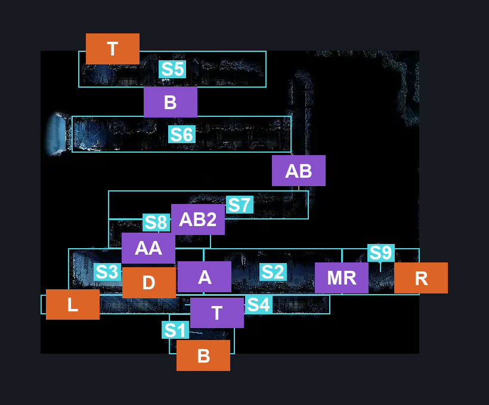
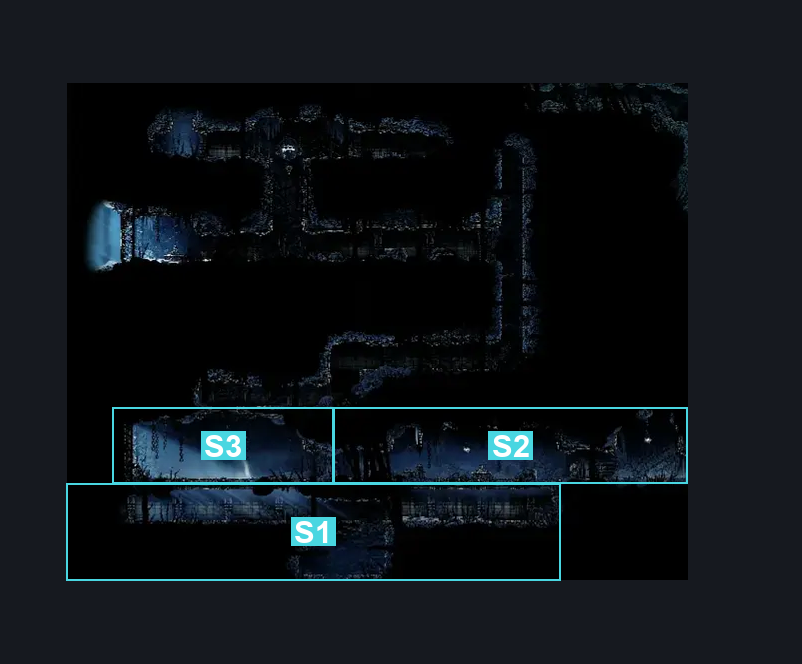
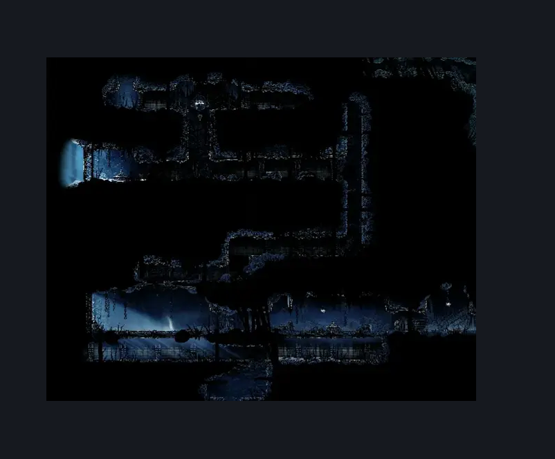

# Slab Arena (Slab_16)

**Game ID:** Slab_16

**Contributors:** MayaXTG

## Subrooms

| No. | Subroom | Annotated |
| --- | --- | --- |
| S1 | Bottom | ✓ |
| S2 | Mid | ✓ |
| S3 | Arena | ✓ |
| S4 | Tunnel | ✓ |
| S5 | Top Entrance | ✓ |
| S6 | Bench | ✓ |
| S7 | Above Arena1 | ✓ |
| S8 | Above Arena2 | ✓ |
| S9 | Right Entrance | ✓ |

## Room Transitions

| Alias | Name | From subroom | Destination | Destination alias | Requirements | TODO | Verification | Annotated | Notes |
| --- | --- | --- | --- | --- | --- | --- | --- | --- | --- |
| D | door1 | Arena | [Slab Broodmother Alcove](slab-broodmother-alcove.md) | U | complete THE The Wailing Mother Wish Promised |  | Verified | ✓ | need the room mapped |
| B | bot1 | Bottom | [Slab Chilly Prison (Slab_15)](slab-chilly-prison.md) | T | none |  | Verified | ✓ |  |
| L | left1 | Tunnel | [Mount Fay Entrance (Peak_01)](../mount-fay/mount-fay-entrance.md) | USR | none |  | Verified | ✓ |  |
| T | top1 | Top Entrance | [Slab Chilly Top (Slab_22)](slab-chilly-top.md) | BL | cling grip OR silk soar OR faydown cloak |  | Verified | ✓ |  |
| R | right1 | Right Entrance | [Slab Cell (Slab_03)](slab-cell.md) | ARN | none |  | Verified | ✓ |  |

## Subroom Connections

| Alias | Name | Source | Destination | Requirements | TODO | Verification | Annotated | Notes |
| --- | --- | --- | --- | --- | --- | --- | --- | --- |
| A | Arena | Arena | Mid | defeat gauntlet fight |  | Verified | ✓ |  |
| A | Arena | Mid | Arena | defeat gauntlet fight |  | Verified | ✓ | gate blockading entrance to arena |
| T | TunnelBottom | Tunnel | Bottom | none (falling) |  | Verified | ✓ |  |
| T | TunnelBottom | Bottom | Tunnel | cling grip right OR faydown cloak OR scuttlebrace OR silk soar |  | Verified | ✓ |  |
| B | Bench | Top Entrance | Bench | none (falling) |  | Verified | ✓ |  |
| B | Bench | Bench | Top Entrance | cling grip OR silk soar OR scuttlebrace |  | Verified | ✓ | any cling grip |
| AB | Above Arena | Bench | Above Arena1 | none (falling) |  | Verified | ✓ |  |
| AB | Above Arena | Above Arena1 | Bench | cling grip OR silk soar OR scuttlebrace |  | Verified | ✓ | any cling grip |
| AB2 | Above Arena 2 | Above Arena1 | Above Arena2 | none (falling) |  | Verified | ✓ |  |
| AB2 | Above Arena 2 | Above Arena2 | Above Arena1 | ledge grab OR cling grip OR faydown cloak OR silk soar OR scuttlebrace OR easy shaman pogo |  | Verified | ✓ |  |
| AA | To Arena | Above Arena2 | Arena | none (falling) |  | Verified | ✓ | one way entrance |
| MR | Mid Right | Mid | Right Entrance | have Key of Heretic |  |  | ✓ |  |
| MR | Mid Right | Right Entrance | Mid | have Key of Heretic |  |  | ✓ |  |

## Check Locations

| No. | Check | Subroom | Requirements | TODO | Verification | Location Type | Annotated | Notes |
| --- | --- | --- | --- | --- | --- | --- | --- | --- |
| 1 | Key of Heretic | Arena | defeat gauntlet fight |  | Verified | collectible | ✓ |  |
| 2 | The Wailing Mother Wish Broodmother Alcove Trigger | Arena | none | TODO | Needs verification | logic-point |  |  |
| 3 | Bench Upper | Bench | none |  | Verified | bench | ✓ |  |
| 4 | Bench Lower | Mid | none |  |  | bench | ✓ |  |
| 5 | Gauntlet Fight | Arena | none |  | Verified | gauntlet |  |  |
| 6 | Wardenfly 1 | Arena | none |  | Verified | enemy | ✓ | FSM Boolean flags: defeatedBroodMother, slab_cloak_battle_completed |
| 7 | Wardenfly 2 | Arena | none |  | Verified | enemy | ✓ | FSM Boolean flags: defeatedBroodMother, slab_cloak_battle_completed |
| 8 | Guardfly 1 | Arena | none |  | Verified | enemy | ✓ | FSM Boolean flags: defeatedBroodMother, slab_cloak_battle_completed |
| 9 | Guardfly 2 | Arena | none |  | Verified | enemy | ✓ | FSM Boolean flags: defeatedBroodMother, slab_cloak_battle_completed |
| 10 | Wardenfly 3 | Arena | none |  | Verified | enemy | ✓ | FSM Boolean flags: defeatedBroodMother, slab_cloak_battle_completed |
| 11 | Guardfly 3 | Arena | none |  | Verified | enemy | ✓ | FSM Boolean flags: defeatedBroodMother, slab_cloak_battle_completed |
| 12 | Scabfly 1 | Arena | none |  | Verified | enemy | ✓ | FSM Boolean flags: defeatedBroodMother, slab_cloak_battle_completed |
| 13 | Guardfly 4 | Arena | none |  | Verified | enemy | ✓ | FSM Boolean flags: defeatedBroodMother, slab_cloak_battle_completed |
| 14 | Scabfly 2 | Arena | none |  | Verified | enemy | ✓ | FSM Boolean flags: defeatedBroodMother, slab_cloak_battle_completed |
| 15 | Scabfly 3 | Arena | none |  | Verified | enemy | ✓ | FSM Boolean flags: defeatedBroodMother, slab_cloak_battle_completed |
| 16 | Scabfly 4 | Arena | none |  | Verified | enemy | ✓ | FSM Boolean flags: defeatedBroodMother, slab_cloak_battle_completed |
| 17 | Guardfly 5 | Arena | none |  | Verified | enemy | ✓ | FSM Boolean flags: defeatedBroodMother, slab_cloak_battle_completed |
| 18 | Scabfly 5 | Arena | none |  | Verified | enemy | ✓ | FSM Boolean flags: defeatedBroodMother, slab_cloak_battle_completed |
| 19 | Scabfly 6 | Arena | none |  | Verified | enemy | ✓ | FSM Boolean flags: defeatedBroodMother, slab_cloak_battle_completed |
| 20 | Scabfly 7 | Arena | none |  | Verified | enemy | ✓ | FSM Boolean flags: defeatedBroodMother, slab_cloak_battle_completed |
| 21 | Scabfly 8 | Arena | none |  | Verified | enemy | ✓ | FSM Boolean flags: defeatedBroodMother, slab_cloak_battle_completed |
| 22 | Guardfly 6 | Arena | none |  | Verified | enemy | ✓ | FSM Boolean flags: defeatedBroodMother, slab_cloak_battle_completed |
| 23 | Wardenfly 4 | Arena | none |  | Verified | enemy | ✓ | FSM Boolean flags: defeatedBroodMother, slab_cloak_battle_completed |
| 24 | Scabfly 9 | Arena | none |  | Verified | enemy | ✓ | FSM Boolean flags: defeatedBroodMother, slab_cloak_battle_completed |
| 25 | Scabfly 10 | Arena | none |  | Verified | enemy | ✓ | FSM Boolean flags: defeatedBroodMother, slab_cloak_battle_completed |
| 26 | Wardenfly 5 | Arena | none |  | Verified | enemy | ✓ | FSM Boolean flags: defeatedBroodMother, slab_cloak_battle_completed |
| 27 | Guardfly 7 | Arena | none |  | Verified | enemy | ✓ | FSM Boolean flags: defeatedBroodMother, slab_cloak_battle_completed |
| 28 | Guardfly 8 | Arena | none |  | Verified | enemy | ✓ | FSM Boolean flags: defeatedBroodMother, slab_cloak_battle_completed |
| 29 | Guardfly 9 | Arena | none |  | Verified | enemy | ✓ | FSM Boolean flags: defeatedBroodMother, slab_cloak_battle_completed |
| 30 | Wardenfly 6 | Arena | none |  | Verified | enemy | ✓ | FSM Boolean flags: defeatedBroodMother, slab_cloak_battle_completed |
| 31 | Wardenfly 7 | Arena | none |  | Verified | enemy | ✓ | FSM Boolean flags: defeatedBroodMother, slab_cloak_battle_completed |
| 32 | Wardenfly 8 | Arena | none |  | Verified | enemy | ✓ | FSM Boolean flags: defeatedBroodMother, slab_cloak_battle_completed |
| 33 | Guardfly 10 | Arena | none |  | Verified | enemy | ✓ | FSM Boolean flags: defeatedBroodMother, slab_cloak_battle_completed |
| 34 | Guardfly 11 | Arena | none |  | Verified | enemy | ✓ | FSM Boolean flags: defeatedBroodMother, slab_cloak_battle_completed |
| 35 | Wardenfly 9 | Arena | none |  | Verified | enemy | ✓ | FSM Boolean flags: defeatedBroodMother, slab_cloak_battle_completed |
| 36 | Guardfly 12 | Arena | none |  | Verified | enemy | ✓ | FSM Boolean flags: defeatedBroodMother, slab_cloak_battle_completed |
| 37 | Guardfly 13 | Arena | none |  | Verified | enemy | ✓ | FSM Boolean flags: defeatedBroodMother, slab_cloak_battle_completed |
| 38 | Scabfly 11 | Arena | none |  | Verified | enemy | ✓ | FSM Boolean flags: defeatedBroodMother, slab_cloak_battle_completed |
| 39 | Scabfly 12 | Arena | none |  | Verified | enemy | ✓ | FSM Boolean flags: defeatedBroodMother, slab_cloak_battle_completed |
| 40 | Scabfly 13 | Arena | none |  | Verified | enemy | ✓ | FSM Boolean flags: defeatedBroodMother, slab_cloak_battle_completed |
| 41 | Scabfly 14 | Arena | none |  | Verified | enemy | ✓ | FSM Boolean flags: defeatedBroodMother, slab_cloak_battle_completed |
| 42 | Wardenfly 10 | Arena | none |  | Verified | enemy | ✓ | FSM Boolean flags: defeatedBroodMother, slab_cloak_battle_completed |
| 43 | Wardenfly 11 | Arena | none |  | Verified | enemy | ✓ | FSM Boolean flags: defeatedBroodMother, slab_cloak_battle_completed |
| 44 | Drapemite 1 | Tunnel | none |  | Verified | enemy | ✓ |  |

## Notes

needs broodmother mapping

## Room Images

### Connections

### Checks

### Scene

