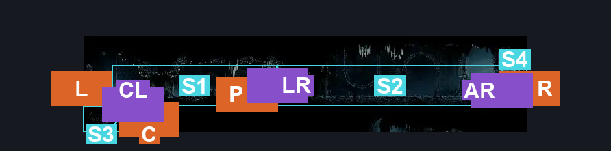
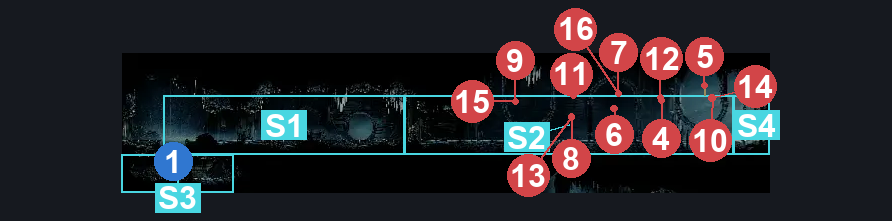
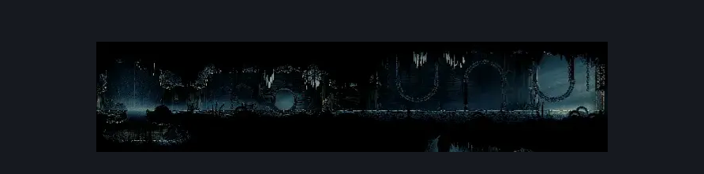

# Slab Cavern Exit (Slab_23)

**Game ID:** Slab_23

**Contributors:** MayaXTG

## Subrooms

| No. | Subroom | Annotated |
| --- | --- | --- |
| S1 | Left | ✓ |
| S2 | Arena | ✓ |
| S3 | Cavern | ✓ |
| S4 | Right | ✓ |

## Room Transitions

| Alias | Name | From subroom | Destination | Destination alias | Requirements | TODO | Verification | Annotated | Notes |
| --- | --- | --- | --- | --- | --- | --- | --- | --- | --- |
| L | left1 | Left | [Slab Cell (Slab_03)](slab-cell.md) | CVN | none |  | Verified | ✓ |  |
| R | right1 | Right | [Slab Shaft (Slab_21)](slab-shaft.md) | B | none |  | Verified | ✓ |  |
| P | door1 | Left | [Slab Penitent Cell (Slab_Cell_Creature)](slab-penitent-cell.md) | L | none |  | Verified | ✓ |  |
| C | door2 | Cavern | [Slab Quiet Cell (Slab_Cell_Quiet)](slab-quiet-cell.md) | T | none |  | Verified | ✓ |  |

## Subroom Connections

| Alias | Name | Source | Destination | Requirements | TODO | Verification | Annotated | Notes |
| --- | --- | --- | --- | --- | --- | --- | --- | --- |
| CL | Cavern Left | Cavern | Left | clear cavern blockade AND (silk soar OR faydown cloak OR ledge grab any OR easy shaman pogo OR cling grip any) |  | Verified | ✓ |  |
| CL | Cavern Left | Left | Cavern | clear cavern blockade |  | Verified | ✓ | falling |
| LR | Left Arena | Left | Arena | unlock indolent door |  | Verified | ✓ |  |
| LR | Left Arena | Arena | Left | unlock indolent door |  | Verified | ✓ |  |
| AR | Arena Right | Arena | Right | clear enemy gauntlet |  | Verified | ✓ |  |
| AR | Arena Right | Right | Arena | clear enemy gauntlet |  | Verified | ✓ |  |

## Check Locations

| No. | Check | Subroom | Requirements | TODO | Verification | Location Type | Annotated | Notes |
| --- | --- | --- | --- | --- | --- | --- | --- | --- |
| 1 | cavern blockade | Cavern | none |  | Verified | blockade | ✓ |  |
| 2 | indolent door | Left | have key of indolent |  | Verified | lock |  |  |
| 3 | enemy gauntlet | Arena | none |  | Verified | gauntlet |  |  |
| 4 | Guardfly 1 | Arena | none |  | Verified | enemy | ✓ |  |
| 5 | Scabfly 1 | Arena | none |  | Verified | enemy | ✓ |  |
| 6 | Scabfly 2 | Arena | none |  | Verified | enemy | ✓ |  |
| 7 | Scabfly 3 | Arena | none |  | Verified | enemy | ✓ |  |
| 8 | Scabfly 4 | Arena | none |  | Verified | enemy | ✓ |  |
| 9 | Scabfly 5 | Arena | none |  | Verified | enemy | ✓ |  |
| 10 | Scabfly 6 | Arena | none |  | Verified | enemy | ✓ |  |
| 11 | Guardfly 2 | Arena | none |  | Verified | enemy | ✓ |  |
| 12 | Guardfly 3 | Arena | none |  | Verified | enemy | ✓ |  |
| 13 | Scabfly 7 | Arena | none |  | Verified | enemy | ✓ |  |
| 14 | Scabfly 8 | Arena | none |  | Verified | enemy | ✓ |  |
| 15 | Scabfly 9 | Arena | none |  | Verified | enemy | ✓ |  |
| 16 | Scabfly 10 | Arena | none |  | Verified | enemy | ✓ |  |

## Room Images

### Connections

### Checks

### Scene

