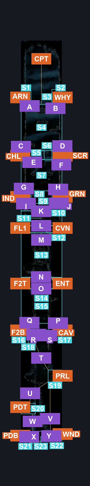
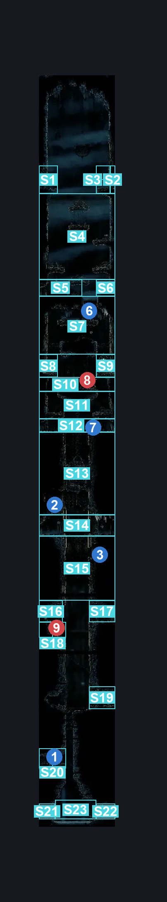
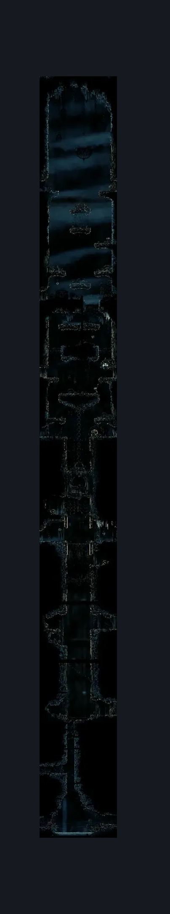

# Slab Cell (Slab_03)

**Game ID:** Slab_03

**Contributors:** MayaXTG

## Subrooms

| No. | Subroom | Annotated |
| --- | --- | --- |
| S1 | Arena | ✓ |
| S2 | Why1 | ✓ |
| S3 | Why2 | ✓ |
| S4 | Upper | ✓ |
| S5 | Chilly | ✓ |
| S6 | Secret | ✓ |
| S7 | Mid | ✓ |
| S8 | Indolent | ✓ |
| S9 | Grindle | ✓ |
| S10 | Before Indolent | ✓ |
| S11 | Before Bridge | ✓ |
| S12 | Bridge Upper | ✓ |
| S13 | Bridge Upper Internal | ✓ |
| S14 | Bridge Center | ✓ |
| S15 | Bridge Center Top | ✓ |
| S16 | Flea2 | ✓ |
| S17 | Cavern | ✓ |
| S18 | Fall1 | ✓ |
| S19 | Prelude | ✓ |
| S20 | Poodle Top | ✓ |
| S21 | Poodle Bottom | ✓ |
| S22 | Window | ✓ |
| S23 | Bottom | ✓ |

- **Why2:** Entering via WHY will block you behind a door you can't open from that side

## Room Transitions

| Alias | Name | From subroom | Destination | Destination alias | Requirements | TODO | Verification | Annotated | Notes |
| --- | --- | --- | --- | --- | --- | --- | --- | --- | --- |
| CPT | door_slabCaged | Upper | [Slab Capture](../fast-travel/slab-capture.md) | CG | invalid |  | Verified | ✓ | one way only |
| ARN | left1 | Arena | [Slab Arena (Slab_16)](slab-arena.md) | R | none |  | Verified | ✓ |  |
| WHY | right1 | Why1 | [Slab Why Room (Slab_17)](slab-why-room.md) | L | none |  | Verified | ✓ | the "lock" is defined in the subroom connection between Why1 and Why2 |
| CHL | left2 | Chilly | [Slab Chilly Prison (Slab_15)](slab-chilly-prison.md) | R | none |  | Verified | ✓ |  |
| SCR | right2 | Secret | [Slab Secret Side Room (Slab_18)](slab-secret-side-room.md) | L | clear Breakable Wall Blockade IN slab secret side room |  | Verified | ✓ | opens from other side mid blockade not necessary |
| IND | left3 | Indolent | [Slab Indolent Room (Slab_14)](slab-indolent-room.md) | R | none |  | Verified | ✓ |  |
| GRN | right3 | Grindle | [Slab Grindle (Slab_20)](slab-grindle.md) | L | none |  | Verified | ✓ |  |
| FL1 | left4 | Bridge Upper | [Slab Flea Prison (Slab_13)](slab-flea-prison.md) | R | none |  | Verified | ✓ |  |
| CVN | right4 | Bridge Upper | [Slab Cavern Exit (Slab_23)](slab-cavern-exit.md) | L | none |  | Verified | ✓ |  |
| F2T | left5 | Bridge Center | [Slab Infleatween Top (Slab_04)](slab-infleatween-top.md) | R | none |  | Verified | ✓ |  |
| ENT | right5 | Bridge Center | [Slab Entrance (Slab_02)](slab-entrance.md) | L | activate slab entrance switch IN slab entrance |  | Verified | ✓ |  |
| F2B | left6 | Flea2 | [Slab Infleatween Bottom (Slab_05)](slab-infleatween-bottom.md) | R | have Key of Apostate |  | Verified | ✓ |  |
| CAV | right8 | Cavern | [Slab Cave Entrance (Slab_08)](slab-cave-entrance.md) | L | none |  | Verified | ✓ |  |
| PRL | right7 | Prelude | [Slab Prelude (Slab_19b)](slab-prelude.md) | L | unlock heretic door first sinner |  | Verified | ✓ |  |
| PDT | left7 | Poodle Top | [Slab Poodle (Slab_07)](slab-poodle.md) | R1 | none |  | Verified | ✓ |  |
| PDB | left8 | Poodle Bottom | [Slab Poodle (Slab_07)](slab-poodle.md) | R2 | none |  | Verified | ✓ |  |
| WND | right9 | Window | [Slab Window (Slab_12)](slab-window.md) | L | break wall right |  | Verified | ✓ | will take damage upon entering |

## Subroom Connections

| Alias | Name | Source | Destination | Requirements | TODO | Verification | Annotated | Notes |
| --- | --- | --- | --- | --- | --- | --- | --- | --- |
| A | ArenaUpper | Arena | Upper | none (falling) |  | Verified | ✓ |  |
| A | ArenaUpper | Upper | Arena | ledge grab left OR cling grip left OR faydown cloak OR silk soar |  | Verified | ✓ |  |
| B | WhyUpper | Why2 | Upper | none (falling) |  | Verified | ✓ |  |
| B | WhyUpper | Upper | Why2 | ledge grab right OR cling grip right OR faydown cloak OR silk soar |  | Verified | ✓ |  |
| WHY | WhyInternal | Why1 | Why2 | unlock apostate door mask shard |  | Verified |  | ping maya for info as to why i did this |
| WHY | WhyInternal | Why2 | Why1 | unlock apostate door mask shard |  | Verified |  |  |
| C | UpperChilly | Upper | Chilly | none (falling) |  | Verified | ✓ |  |
| C | UpperChilly | Chilly | Upper | ledge grab right OR cling grip right OR scuttlebrace OR faydown cloak OR silk soar OR medium shaman pogo OR ((clear Breakable Wall Blockade IN slab secret side room OR clear upper blockade) AND (ledge grab left OR cling grip left)) |  | Verified | ✓ | right side is only available if you remove the blockade inside Mid |
| D | UpperSecret | Upper | Secret | clear Breakable Wall Blockade IN slab secret side room AND clear upper blockade |  | Verified | ✓ |  |
| D | UpperSecret | Secret | Upper | (clear Breakable Wall Blockade IN slab secret side room AND clear upper blockade) AND (ledge grab (either) OR cling grip (either) OR scuttlebrace OR faydown cloak OR silk soar OR medium shaman pogo) |  | Verified | ✓ |  |
| E | ChillyMid | Chilly | Mid | clear Breakable Wall Blockade IN slab secret side room OR clear upper blockade |  | Verified | ✓ | falling |
| E | ChillyMid | Mid | Chilly | (clear Breakable Wall Blockade IN slab secret side room OR clear upper blockade) AND (cling grip (either) OR faydown cloak OR scuttlebrace OR silk soar) |  | Verified | ✓ |  |
| F | SecretMid | Secret | Mid | clear Breakable Wall Blockade IN slab secret side room AND clear upper blockade |  | Verified | ✓ | falling |
| F | SecretMid | Mid | Secret | clear Breakable Wall Blockade IN slab secret side room AND clear upper blockade AND (cling grip (either) OR faydown cloak OR scuttlebrace OR silk soar) |  | Verified | ✓ |  |
| G | MidIndolent | Mid | Indolent | none (falling) |  | Verified | ✓ |  |
| G | MidIndolent | Indolent | Mid | cling grip left OR silk soar OR (faydown cloak AND cling grip right) OR scuttlebrace |  | Verified | ✓ |  |
| H | MidGrindle | Mid | Grindle | none (falling) |  | Verified | ✓ |  |
| H | MidGrindle | Grindle | Mid | cling grip right OR silk soar OR (faydown cloak AND cling grip left) OR scuttlebrace |  | Verified | ✓ |  |
| I | IndolentBefore | Indolent | Before Indolent | none (falling) |  | Verified | ✓ |  |
| I | IndolentBefore | Before Indolent | Indolent | cling grip left OR ledge grab left OR silk soar OR faydown cloak OR medium shaman pogo |  | Verified | ✓ |  |
| J | GrindleBefore | Grindle | Before Indolent | none (falling) |  | Verified | ✓ |  |
| J | GrindleBefore | Before Indolent | Grindle | cling grip right OR ledge grab right OR silk soar OR faydown cloak OR medium shaman pogo |  | Verified | ✓ |  |
| K | IndoBridge | Before Indolent | Before Bridge | none (falling) |  | Verified | ✓ |  |
| K | IndoBridge | Before Bridge | Before Indolent | cling grip (either) OR scuttlebrace OR faydown cloak OR silk soar |  | Verified | ✓ |  |
| L | BeforeUpper | Before Bridge | Bridge Upper | none (falling) |  | Verified | ✓ |  |
| L | BeforeUpper | Bridge Upper | Before Bridge | cling grip (either) OR ledge grab (either) OR faydown cloak OR scuttlebrace OR scuttlebrace |  | Verified | ✓ |  |
| M | UpperInternal | Bridge Upper | Bridge Upper Internal | unlock upper bridge key |  | Verified | ✓ | falling |
| M | UpperInternal | Bridge Upper Internal | Bridge Upper | unlock upper bridge key AND (cling grip (either) OR silk soar OR scuttlebrace) |  | Verified | ✓ |  |
| N | InternalCenter | Bridge Upper Internal | Bridge Center | activate heretic lever upper |  | Verified | ✓ | falling |
| N | InternalCenter | Bridge Center | Bridge Upper Internal | activate heretic lever upper AND (cling grip (either) OR (faydown cloak AND ledge grab left) OR scuttlebrace OR silk soar) |  | Verified | ✓ |  |
| O | CenterTop | Bridge Center | Bridge Center Top | activate heretic lever lower |  | Verified | ✓ | falling |
| O | CenterTop | Bridge Center Top | Bridge Center | activate heretic lever lower AND (cling grip (either) OR scuttlebrace) |  | Verified | ✓ |  |
| P | Center Cavern | Bridge Center Top | Cavern | none (falling) |  | Verified | ✓ |  |
| P | Center Cavern | Cavern | Bridge Center Top | cling grip right OR (faydown cloak AND scuttlebrace) |  | Verified | ✓ |  |
| Q | Flea2 | Flea2 | Bridge Center Top | faydown cloak AND (scuttlebrace OR cling grip left) |  | Verified | ✓ |  |
| Q | Flea2 | Bridge Center Top | Flea2 | faydown cloak OR dash left OR clawline left x 1 OR sharpdart x 1 OR drifters cloak OR medium beast needle strike OR medium beast pogo |  | Verified | ✓ | with no horizontal you miss the platform and land in Fall1 |
| R | FleaFall | Flea2 | Fall1 | none (falling) |  | Verified | ✓ |  |
| R | FleaFall | Fall1 | Flea2 | cling grip left OR ledge grab left OR medium shaman pogo OR scuttlebrace OR faydown cloak OR silk soar |  | Verified | ✓ |  |
| S | CavernFall | Cavern | Fall1 | none (jump) |  | Verified | ✓ |  |
| S | CavernFall | Fall1 | Cavern | faydown cloak OR cling grip right OR scuttlebrace OR (medium beast needle strike AND ledge grab right) |  | Verified | ✓ |  |
| T | FallPrelude | Fall1 | Prelude | none (falling) |  | Verified | ✓ |  |
| T | FallPrelude | Prelude | Fall1 | cling grip right OR scuttlebrace OR (faydown cloak AND cling grip left) OR silk soar |  | Verified | ✓ |  |
| U | PreludePoodle | Prelude | Poodle Top | clear poodle blockade |  | Verified | ✓ |  |
| U | PreludePoodle | Poodle Top | Prelude | clear poodle blockade AND (cling grip (either) OR scuttlebrace) |  | Verified | ✓ |  |
| V | PreludeBottom | Prelude | Bottom | swim |  | Verified | ✓ |  |
| W | PoodleBottom | Poodle Top | Bottom | swim |  | Verified | ✓ |  |
| X | PoodleBB | Poodle Bottom | Bottom | swim |  | Verified | ✓ |  |
| X | PoodleBB | Bottom | Poodle Bottom | swim |  | Verified | ✓ |  |
| Y | BottomWindow | Window | Bottom | swim |  | Verified | ✓ |  |
| Y | BottomWindow | Bottom | Window | swim |  | Verified | ✓ |  |

## Check Locations

| No. | Check | Subroom | Requirements | TODO | Verification | Location Type | Annotated | Notes |
| --- | --- | --- | --- | --- | --- | --- | --- | --- |
| 1 | poodle blockade | Poodle Top | none |  | Verified | blockade | ✓ |  |
| 2 | heretic lever upper | Bridge Upper Internal | none |  | Verified | switch | ✓ |  |
| 3 | heretic lever lower | Bridge Center Top | none |  | Verified | switch | ✓ |  |
| 4 | apostate door mask shard | Why2 | have key of apostate |  | Verified | lock |  |  |
| 5 | heretic door first sinner | Prelude | have key of heretic |  | Verified | lock |  |  |
| 6 | upper blockade | Mid | none |  | Verified | blockade | ✓ |  |
| 7 | upper bridge key | Bridge Upper | have key of heretic |  | Verified | lock | ✓ |  |
| 8 | Guardfly 1 | Before Indolent | none |  | Verified | enemy | ✓ |  |
| 9 | Guardfly 2 | Fall1 | none |  | Verified | enemy | ✓ |  |

## Notes

I'll go over this when I'm more sane

## Room Images

### Connections

### Checks

### Scene

