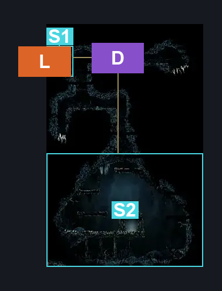
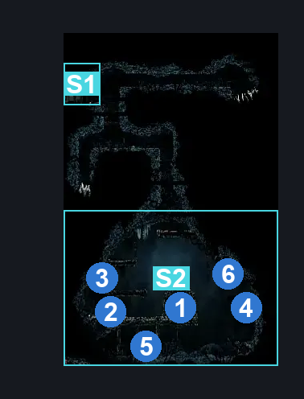
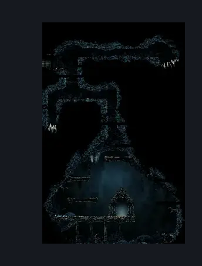

# Slab First Sinner Antechamber (Slab_10c)

**Game ID:** Slab_10c

**Contributors:** samupo, MayaXTG

## Subrooms

| No. | Subroom | Annotated |
| --- | --- | --- |
| S1 | Entrance | ✓ |
| S2 | Antechamber | ✓ |

## Room Transitions

| Alias | Name | From subroom | Destination | Destination alias | Requirements | TODO | Verification | Annotated | Notes |
| --- | --- | --- | --- | --- | --- | --- | --- | --- | --- |
| L | left1 | Entrance | [Slab Prelude (Slab_19b)](slab-prelude.md) | R | none |  | Verified | ✓ |  |
| D | door1 | Antechamber | [Slab First Sinner (slab_10b)](slab-first-sinner.md) | E | unlock door_lock_1 AND unlock door_lock_2 AND unlock door_lock_3 AND unlock door_lock_4 |  | Verified | ✓ | First Sinner boss fight |

## Subroom Connections

| Alias | Name | Source | Destination | Requirements | TODO | Verification | Annotated | Notes |
| --- | --- | --- | --- | --- | --- | --- | --- | --- |
| D | Down | Entrance | Antechamber | none (falling) |  | Verified |  |  |
| D | Down | Antechamber | Entrance | (ledge grab any OR faydown cloak OR silk soar OR cling grip any OR medium shaman pogo OR medium scuttlebrace) AND (cling grip any OR scuttlebrace) |  | Verified |  |  |

## Check Locations

| No. | Check | Subroom | Requirements | TODO | Verification | Location Type | Annotated | Notes |
| --- | --- | --- | --- | --- | --- | --- | --- | --- |
| 1 | The Slab - Weaver Gate Inscription | Antechamber | none |  | Verified | lore | ✓ | missable |
| 2 | Mister Mushroom Meeting The Slab | Antechamber | after THE Mister Mushroom Meeting Greymoor AND Needolin |  | Verified | event | ✓ |  |
| 3 | door_lock_1 | Antechamber | none |  | Verified | lock | ✓ |  |
| 4 | door_lock_2 | Antechamber | none |  | Verified | lock | ✓ |  |
| 5 | door_lock_3 | Antechamber | faydown cloak OR dash left OR ((medium heal stall OR medium plasmium phial stall OR easy shaman pogo) AND ledge grab left) OR clawline left x 1 OR silk soar |  | Verified | lock | ✓ | SPECIFICALLY to get back up onto the platform lmao |
| 6 | door_lock_4 | Antechamber | shaman hit up OR faydown cloak OR silk soar OR clawline right x 1 |  | Verified | lock | ✓ |  |

## Room Images

### Connections

### Checks

### Scene

