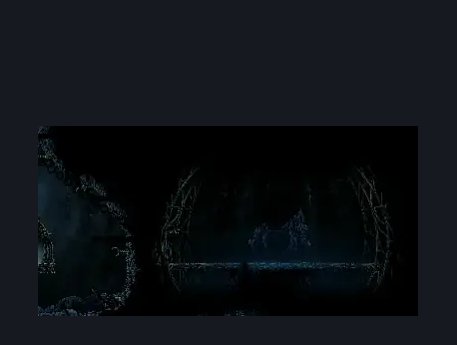

# Slab First Sinner (slab_10b)

**Game ID:** slab_10b

**Contributors:** MayaXTG

## Subrooms

No subrooms defined.

## Room Transitions

| Alias | Name | From subroom | Destination | Destination alias | Requirements | TODO | Verification | Annotated | Notes |
| --- | --- | --- | --- | --- | --- | --- | --- | --- | --- |
| E | Exit |  | [Slab First Sinner Antechamber (Slab_10c)](slab-first-sinner-antechamber.md) | D | none |  | Verified | ✓ |  |

## Subroom Connections

No subroom connections defined.

## Check Locations

| No. | Check | Subroom | Requirements | TODO | Verification | Location Type | Annotated | Notes |
| --- | --- | --- | --- | --- | --- | --- | --- | --- |
| 1 | Rune Rage |  | defeat Boss: First Sinner |  | Verified | collectible | ✓ |  |
| 2 | Boss: First Sinner |  | none |  | Verified | enemy | ✓ | Spawn conditions: hasSilkBomb=false FSM Boolean flags: encounteredFirstWeaver |

## Room Images

### Connections

### Checks

### Scene

