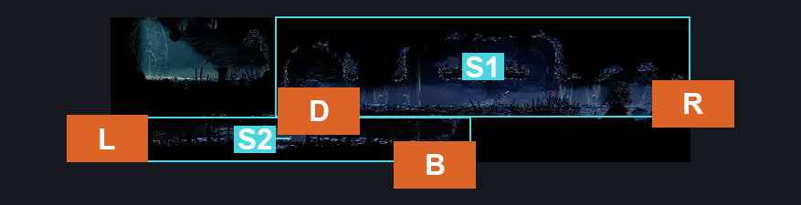
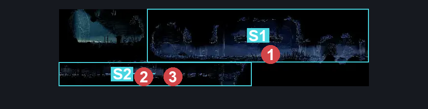

# Slab Flea Prison (Slab_13)

**Game ID:** Slab_13

**Contributors:** MayaXTG

## Subrooms

| No. | Subroom | Annotated |
| --- | --- | --- |
| S1 | Top | ✓ |
| S2 | Secret | ✓ |

## Room Transitions

| Alias | Name | From subroom | Destination | Destination alias | Requirements | TODO | Verification | Annotated | Notes |
| --- | --- | --- | --- | --- | --- | --- | --- | --- | --- |
| L | left1 | Secret | [Mount Fay Entrance (Peak_01)](../mount-fay/mount-fay-entrance.md) | LSR | none |  | Verified | ✓ |  |
| B | bot1 | Secret | [Slab Infleatween Top (Slab_04)](slab-infleatween-top.md) | T | none |  | Verified | ✓ |  |
| R | right1 | Top | [Slab Cell (Slab_03)](slab-cell.md) | FL1 | none |  | Verified | ✓ |  |
| D | door1 | Top | [Slab Flea Cell (Slab_Cell)](slab-flea-cell.md) | L | none |  | Verified | ✓ |  |

## Subroom Connections

No subroom connections defined.

## Check Locations

| No. | Check | Subroom | Requirements | TODO | Verification | Location Type | Annotated | Notes |
| --- | --- | --- | --- | --- | --- | --- | --- | --- |
| 1 | Guardfly 1 | Top | none |  | Verified | enemy | ✓ |  |
| 2 | Drapemite 1 | Secret | none |  | Verified | enemy | ✓ |  |
| 3 | Drapemite 2 | Secret | none |  | Verified | enemy | ✓ |  |

## Room Images

### Connections

### Checks

### Scene

