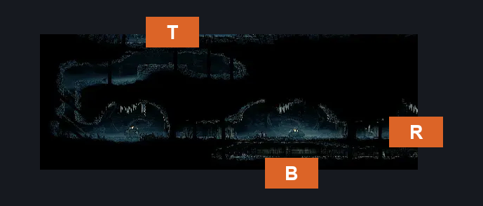
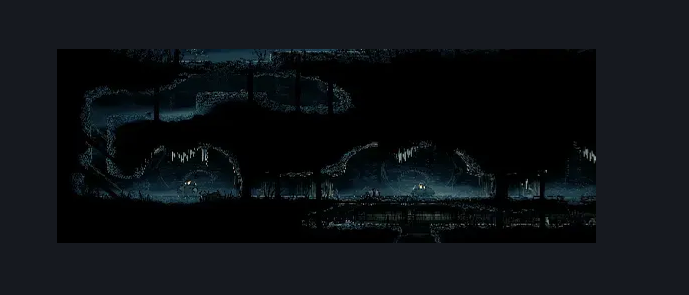
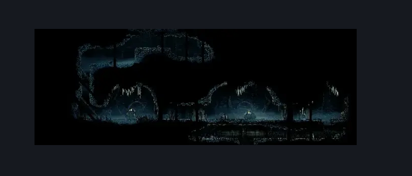

# Slab Infleatween Bottom (Slab_05)

**Game ID:** Slab_05

**Contributors:** MayaXTG

## Subrooms

| No. | Subroom | Annotated |
| --- | --- | --- |
| S1 | Lower | ✓ |
| S2 | Middle | ✓ |
| S3 | Upper | ✓ |

## Room Transitions

| Alias | Name | From subroom | Destination | Destination alias | Requirements | TODO | Verification | Annotated | Notes |
| --- | --- | --- | --- | --- | --- | --- | --- | --- | --- |
| R | Right | Middle | [Slab Cell (Slab_03)](slab-cell.md) | F2B | have key of apostate |  | Verified | ✓ |  |
| U | Upper | Upper | [Slab Infleatween Top (Slab_04)](slab-infleatween-top.md) | B | none |  | Verified | ✓ |  |
| B | Bottom | Lower | [Slab Bellway (Slab_06)](slab-bellway.md) | T | none |  | Verified | ✓ |  |

## Subroom Connections

| Alias | Name | Source | Destination | Requirements | TODO | Verification | Annotated | Notes |
| --- | --- | --- | --- | --- | --- | --- | --- | --- |
| ML | Middle Lower | Middle | Lower | none (falling) |  | Verified | ✓ |  |
| ML | Middle Lower | Lower | Middle | ledge grab (both) OR cling grip (both) OR faydown cloak OR easy shaman pogo OR silk soar |  | Verified | ✓ |  |
| UM | Upper Middle | Upper | Middle | none (falling) |  | Verified | ✓ |  |
| UM | Upper Middle | Middle | Upper | cling grip right OR (faydown cloak AND cling grip left) OR scuttlebrace OR silk soar |  | Verified | ✓ |  |

## Check Locations

| No. | Check | Subroom | Requirements | TODO | Verification | Location Type | Annotated | Notes |
| --- | --- | --- | --- | --- | --- | --- | --- | --- |
| 1 | The Slab - Shell Shard Cache #1 | Upper | none |  | Verified | collectible | ✓ |  |
| 2 | The Slab - Shell Shard Cache #2 | Upper | none |  | Verified | collectible | ✓ |  |
| 3 | The Slab - Shell Shard Cache #3 | Upper | none |  | Verified | collectible | ✓ |  |
| 4 | Penitent 1 | Middle | none |  | Verified | enemy | ✓ |  |
| 5 | Scabfly 1 | Middle | none |  | Verified | enemy | ✓ |  |
| 6 | Scabfly 2 | Middle | none |  | Verified | enemy | ✓ |  |

## Room Images

### Connections

### Checks

### Scene

