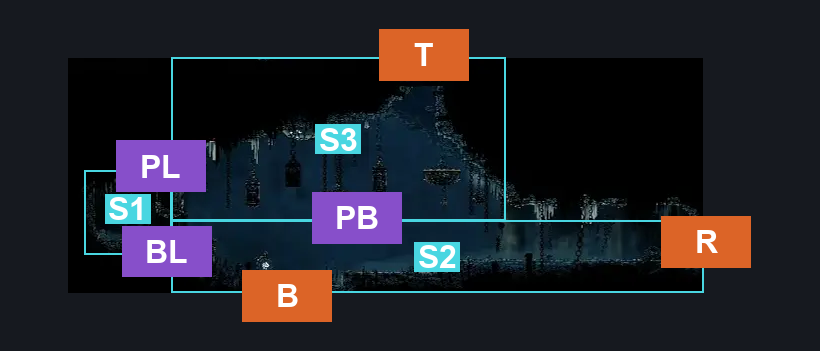
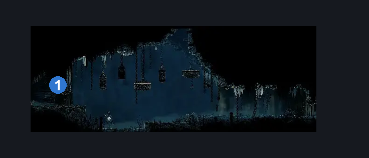
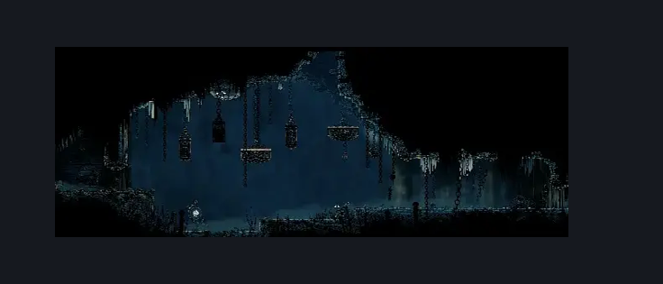

# Slab Infleatween Top (Slab_04)

**Game ID:** Slab_04

**Contributors:** MayaXTG

## Subrooms

| No. | Subroom | Annotated |
| --- | --- | --- |
| S1 | Left | ✓ |
| S2 | Bottom | ✓ |
| S3 | Platforms | ✓ |

## Room Transitions

| Alias | Name | From subroom | Destination | Destination alias | Requirements | TODO | Verification | Annotated | Notes |
| --- | --- | --- | --- | --- | --- | --- | --- | --- | --- |
| R | right1 | Bottom | [Slab Cell (Slab_03)](slab-cell.md) | F2T | none |  | Verified | ✓ |  |
| T | top1 | Platforms | [Slab Flea Prison (Slab_13)](slab-flea-prison.md) | B | silk soar OR cling grip right OR scuttlebrace |  | Verified | ✓ |  |
| B | bot1 | Bottom | [Slab Infleatween Bottom (Slab_05)](slab-infleatween-bottom.md) | U | none |  | Verified | ✓ |  |

## Subroom Connections

| Alias | Name | Source | Destination | Requirements | TODO | Verification | Annotated | Notes |
| --- | --- | --- | --- | --- | --- | --- | --- | --- |
| PB | Platforms Bottom | Platforms | Bottom | none (falling) |  | Verified | ✓ |  |
| PB | Platforms Bottom | Bottom | Platforms | ((faydown cloak OR cling grip any OR ledge grab any) AND medium enemy pogo) OR silk soar |  | Verified | ✓ |  |
| BL | Bottom Left | Left | Bottom | none (falling) |  | Verified | ✓ |  |
| BL | Bottom Left | Bottom | Left | ledge grab left OR easy enemy pogo OR cling grip left OR faydown cloak OR silk soar |  | Verified | ✓ |  |
| PL | Platforms Left | Platforms | Left | none (falling) |  | Verified | ✓ |  |
| PL | Platforms Left | Left | Platforms | cling grip right OR medium enemy pogo OR faydown cloak OR silk soar OR (dash right AND ledge grab right) |  | Verified | ✓ |  |

## Check Locations

| No. | Check | Subroom | Requirements | TODO | Verification | Location Type | Annotated | Notes |
| --- | --- | --- | --- | --- | --- | --- | --- | --- |
| 1 | The Slab - Shard Bundle | Left | none |  | Verified | collectible | ✓ |  |
| 2 | Drapefly 1 | Platforms | none |  | Verified | enemy | ✓ |  |
| 3 | Drapefly 2 | Platforms | none |  | Verified | enemy | ✓ |  |
| 4 | Guardfly 1 | Left | none |  | Verified | enemy | ✓ |  |
| 5 | Guardfly 2 | Bottom | none |  | Verified | enemy | ✓ |  |

## Notes

this room sucks

## Room Images

### Connections

### Checks

### Scene

