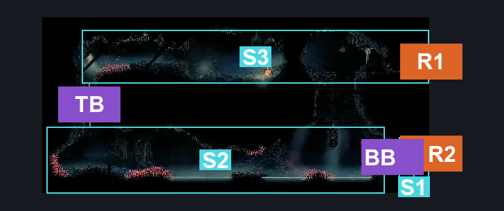
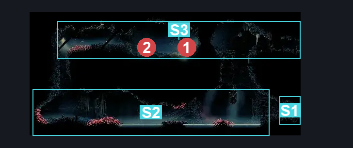
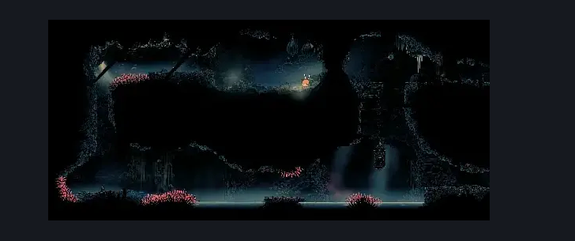

# Slab Poodle (Slab_07)

**Game ID:** Slab_07

**Contributors:** MayaXTG

## Subrooms

| No. | Subroom | Annotated |
| --- | --- | --- |
| S1 | bottom right | ✓ |
| S2 | bottom | ✓ |
| S3 | top | ✓ |

## Room Transitions

| Alias | Name | From subroom | Destination | Destination alias | Requirements | TODO | Verification | Annotated | Notes |
| --- | --- | --- | --- | --- | --- | --- | --- | --- | --- |
| R1 | right1 | top | [Slab Cell (Slab_03)](slab-cell.md) | PDT | none |  | Verified | ✓ |  |
| R2 | right2 | bottom right | [Slab Cell (Slab_03)](slab-cell.md) | PDB | none |  | Verified | ✓ |  |

## Subroom Connections

| Alias | Name | Source | Destination | Requirements | TODO | Verification | Annotated | Notes |
| --- | --- | --- | --- | --- | --- | --- | --- | --- |
| BB | Bottom | bottom right | bottom | swim AND (clawline right x 1 OR sharpdart x 1) AND hit left |  | Verified | ✓ |  |
| BB | Bottom | bottom | bottom right | swim AND (clawline left x 1 OR sharpdart x 1) AND hit right |  | Verified | ✓ |  |
| TB | Top | bottom | top | ((faydown cloak AND (cling grip left OR scuttlebrace)) OR (silk soar AND (clawline right x 1 OR sharpdart x 1))) AND hit up |  | Verified | ✓ |  |
| TB | Top | top | bottom | hit down |  | Verified | ✓ |  |

## Check Locations

| No. | Check | Subroom | Requirements | TODO | Verification | Location Type | Annotated | Notes |
| --- | --- | --- | --- | --- | --- | --- | --- | --- |
| 1 | Snitchfly 1 | top | none |  | Verified | enemy | ✓ |  |
| 2 | Snitchfly 2 | top | none |  | Verified | enemy | ✓ |  |

## Room Images

### Connections

### Checks

### Scene

