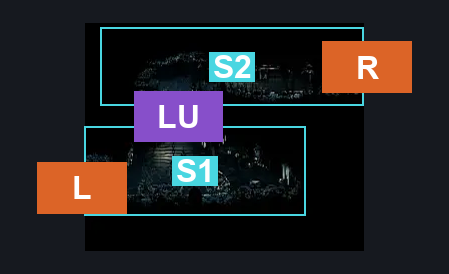
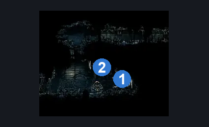
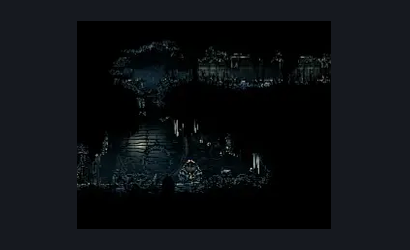

# Slab Prelude (Slab_19b)

**Game ID:** Slab_19b

**Contributors:** MayaXTG

## Subrooms

| No. | Subroom | Annotated |
| --- | --- | --- |
| S1 | lower | ✓ |
| S2 | upper | ✓ |

## Room Transitions

| Alias | Name | From subroom | Destination | Destination alias | Requirements | TODO | Verification | Annotated | Notes |
| --- | --- | --- | --- | --- | --- | --- | --- | --- | --- |
| L | left1 | lower | [Slab Cell (Slab_03)](slab-cell.md) | PRL | unlock heretic door first sinner IN slab cell |  | Verified | ✓ | i set this right as my caffeine wore off so this might be wrong   confirmed against scripters war map - hero, 10/13 |
| R | right1 | upper | [Slab First Sinner Antechamber (Slab_10c)](slab-first-sinner-antechamber.md) | L | none |  | Verified | ✓ |  |

## Subroom Connections

| Alias | Name | Source | Destination | Requirements | TODO | Verification | Annotated | Notes |
| --- | --- | --- | --- | --- | --- | --- | --- | --- |
| LU | Lower Upper | lower | upper | (faydown AND (cling grip (either) OR scuttlebrace)) OR silk soar |  | Verified | ✓ |  |
| LU | Lower Upper | upper | lower | none (falling) |  | Verified | ✓ |  |

## Check Locations

| No. | Check | Subroom | Requirements | TODO | Verification | Location Type | Annotated | Notes |
| --- | --- | --- | --- | --- | --- | --- | --- | --- |
| 1 | The Slab - Rosary Chest | lower | none |  | Verified | collectible | ✓ |  |
| 2 | The Slab - Rosary Cache #2 | lower | none |  | Verified | collectible | ✓ |  |
| 3 | The Slab - Rosary Cache #3 | lower | none |  | Verified | collectible | ✓ |  |
| 4 | The Slab - Rosary Cache #4 | lower | none |  | Verified | collectible | ✓ |  |
| 5 | The Slab - Rosary Cache #5 | lower | none |  | Verified | collectible | ✓ |  |

## Room Images

### Connections

### Checks

### Scene

