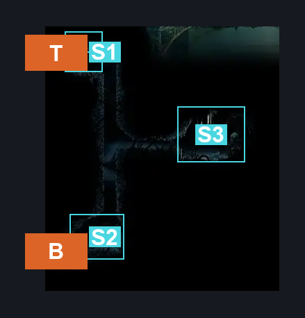
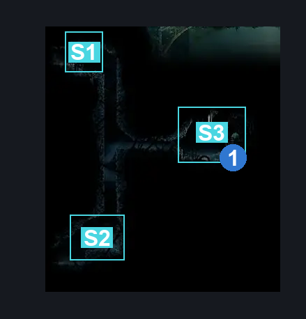
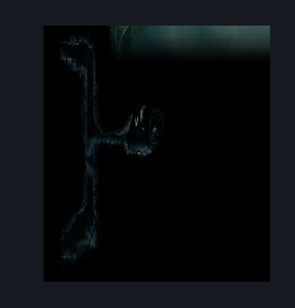

# Slab Quiet Cell (Slab_Cell_Quiet)

**Game ID:** Slab_Cell_Quiet

**Contributors:** MayaXTG

## Subrooms

| No. | Subroom | Annotated |
| --- | --- | --- |
| S1 | Top | ✓ |
| S2 | Bottom | ✓ |
| S3 | Locket | ✓ |

## Room Transitions

| Alias | Name | From subroom | Destination | Destination alias | Requirements | TODO | Verification | Annotated | Notes |
| --- | --- | --- | --- | --- | --- | --- | --- | --- | --- |
| T | left1 | Top | [Slab Cavern Exit (Slab_23)](slab-cavern-exit.md) | C | none |  | Verified | ✓ |  |
| B | left2 | Bottom | [Slab Cave Entrance (Slab_08)](slab-cave-entrance.md) | D | none |  | Verified | ✓ |  |

## Subroom Connections

| Alias | Name | Source | Destination | Requirements | TODO | Verification | Annotated | Notes |
| --- | --- | --- | --- | --- | --- | --- | --- | --- |
| TL | Top Locket | Top | Locket | break wall right |  | Verified | ✓ |  |
| TL | Top Locket | Locket | Top | cling grip (either) OR scuttlebrace |  | Verified | ✓ |  |
| TB | Top Bottom | Top | Bottom | none (falling) |  | Verified | ✓ |  |
| TB | Top Bottom | Bottom | Top | silk soar OR scuttlebrace OR cling grip right OR (faydown cloak AND cling grip left) |  | Verified | ✓ |  |
| BL | Bottom Locket | Bottom | Locket | (scuttlebrace OR silk soar OR cling grip right OR (faydown cloak AND cling grip left)) AND break wall right |  | Verified | ✓ |  |
| BL | Bottom Locket | Locket | Bottom | none (falling) |  | Verified | ✓ |  |

## Check Locations

| No. | Check | Subroom | Requirements | TODO | Verification | Location Type | Annotated | Notes |
| --- | --- | --- | --- | --- | --- | --- | --- | --- |
| 1 | The Slab - Memory Locket | Locket | none |  | Verified | collectible | ✓ |  |

## Room Images

### Connections

### Checks

### Scene

