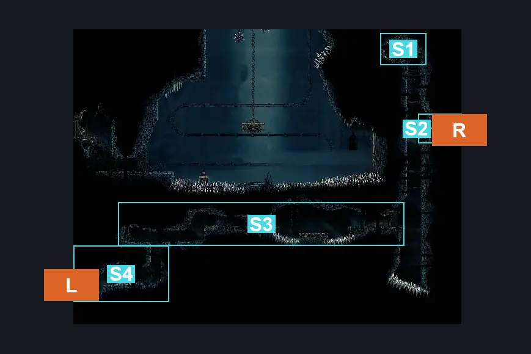
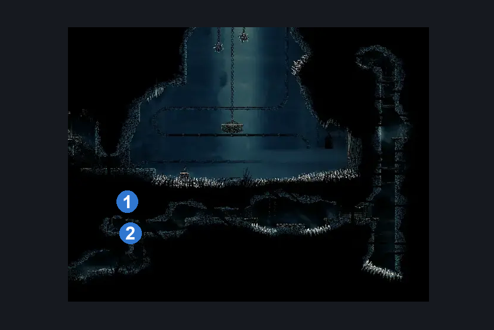
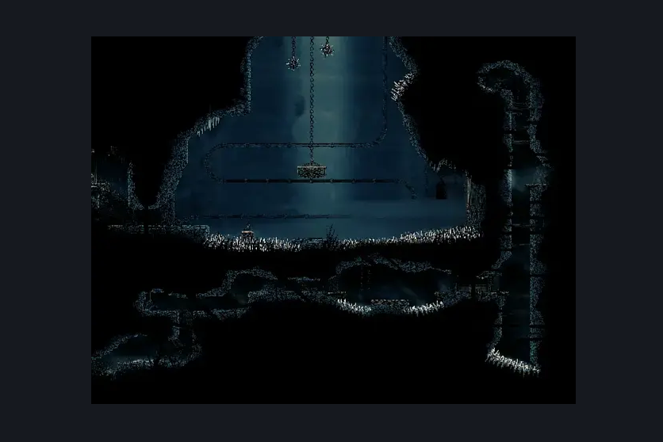

# Slab Secret Side Room (Slab_18)

**Game ID:** Slab_18

**Contributors:** MayaXTG

## Subrooms

| No. | Subroom | Annotated |
| --- | --- | --- |
| S1 | Upper | ✓ |
| S2 | Right | ✓ |
| S3 | Mid | ✓ |
| S4 | Bottom | ✓ |

- **Mid:** entirely traversable with only walking and jumping

## Room Transitions

| Alias | Name | From subroom | Destination | Destination alias | Requirements | TODO | Verification | Annotated | Notes |
| --- | --- | --- | --- | --- | --- | --- | --- | --- | --- |
| R | right1 | Right | [Slab Shaft (Slab_21)](slab-shaft.md) | M | none |  | Verified | ✓ |  |
| L | left1 | Bottom | [Slab Cell (Slab_03)](slab-cell.md) | SCR | clear Breakable Wall Blockade |  | Verified | ✓ |  |

## Subroom Connections

| Alias | Name | Source | Destination | Requirements | TODO | Verification | Annotated | Notes |
| --- | --- | --- | --- | --- | --- | --- | --- | --- |
| RU | Right Upper | Right | Upper | silk soar OR cling grip left OR (cling grip right AND faydown cloak) OR scuttlebrace |  | Verified |  |  |
| RU | Right Upper | Upper | Right | none (falling) |  | Verified |  |  |
| RM | Mid Right | Mid | Right | cling grip right OR (faydown cloak AND (scuttlebrace OR cling grip left)) |  | Verified |  | scuttlebrace on the right does not go high enough |
| RM | Mid Right | Right | Mid | none (falling) |  | Verified |  |  |
| BM | Mid Bottom | Mid | Bottom | none (falling) |  | Verified |  |  |
| BM | Mid Bottom | Bottom | Mid | silk soar OR scuttlebrace OR cling grip any OR (faydown cloak AND ledge grab any) |  | Verified |  |  |

## Check Locations

| No. | Check | Subroom | Requirements | TODO | Verification | Location Type | Annotated | Notes |
| --- | --- | --- | --- | --- | --- | --- | --- | --- |
| 1 | The Slab - Shell Shard Cache #6 | Upper | none |  | Verified | collectible | ✓ |  |
| 2 | The Slab - Shell Shard Cache #7 | Upper | none |  | Verified | collectible | ✓ |  |
| 3 | The Slab - Frayed Rosary String #2 | Mid | none |  | Verified | collectible | ✓ |  |
| 4 | The Slab - Rosary Cache #1 | Mid | none |  | Verified | collectible | ✓ |  |
| 5 | Breakable Wall Blockade | Bottom | break wall left |  | Verified | blockade |  |  |
| 6 | Drapemite 1 | Bottom | none |  | Verified | enemy | ✓ |  |

## Room Images

### Connections

### Checks

### Scene

