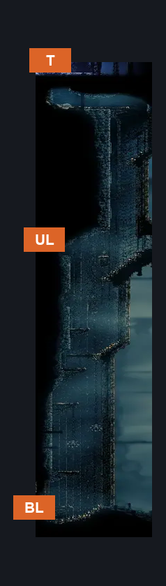
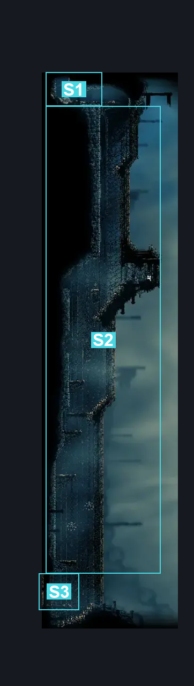
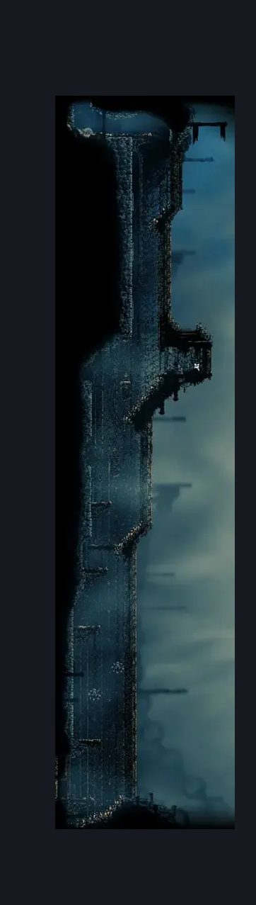

# Slab Shaft (Slab_21)

**Game ID:** Slab_21

**Contributors:** MayaXTG

## Subrooms

| No. | Subroom | Annotated |
| --- | --- | --- |
| S1 | Top | ✓ |
| S2 | Mid | ✓ |
| S3 | Bottom | ✓ |

## Room Transitions

| Alias | Name | From subroom | Destination | Destination alias | Requirements | TODO | Verification | Annotated | Notes |
| --- | --- | --- | --- | --- | --- | --- | --- | --- | --- |
| T | Top | Top | [Slab Chilly Top (Slab_22)](slab-chilly-top.md) | BR | faydown cloak OR scuttlebrace OR cling grip OR silk soar |  | Verified | ✓ |  |
| B | Bottom | Bottom | [Slab Cavern Exit (Slab_23)](slab-cavern-exit.md) | R | none |  | Verified | ✓ |  |
| M | Mid | Mid | [Slab Secret Side Room (Slab_18)](slab-secret-side-room.md) | R | none |  | Verified | ✓ |  |

## Subroom Connections

| Alias | Name | Source | Destination | Requirements | TODO | Verification | Annotated | Notes |
| --- | --- | --- | --- | --- | --- | --- | --- | --- |
| TM | Top Mid | Top | Mid | none (falling) |  | Verified | ✓ |  |
| TM | Top Mid | Mid | Top | cling grip AND (spike pogo OR dash) |  | Verified | ✓ |  |
| MB | Mid Bottom | Mid | Bottom | none (falling) |  | Verified | ✓ |  |
| MB | Mid Bottom | Bottom | Mid | cling grip AND (spike pogo OR dash) |  | Verified | ✓ |  |

## Check Locations

No check locations defined.

## Room Images

### Connections

### Checks

### Scene

