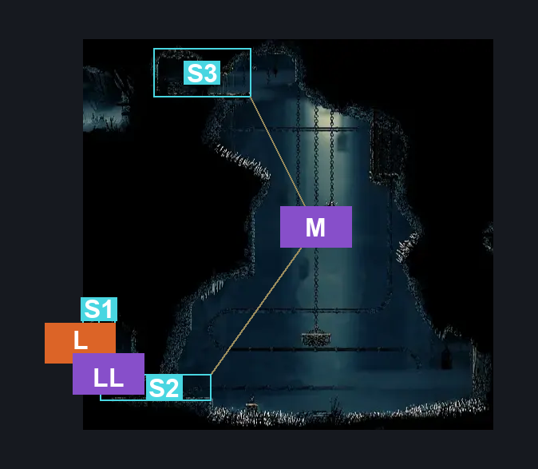
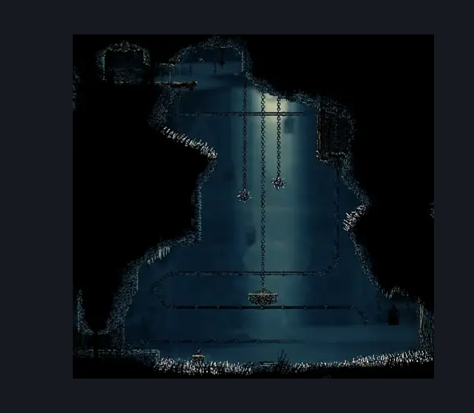

# Slab Why Room (Slab_17)

**Game ID:** Slab_17

**Contributors:** MayaXTG

## Subrooms

| No. | Subroom | Annotated |
| --- | --- | --- |
| S1 | Left | ✓ |
| S2 | Left Lower | ✓ |
| S3 | Mask Shard | ✓ |

## Room Transitions

| Alias | Name | From subroom | Destination | Destination alias | Requirements | TODO | Verification | Annotated | Notes |
| --- | --- | --- | --- | --- | --- | --- | --- | --- | --- |
| L | left1 | Left | [Slab Cell (Slab_03)](slab-cell.md) | WHY | unlock apostate door mask shard IN slab cell |  | Verified | ✓ | apostate is required on other side, not here |

## Subroom Connections

| Alias | Name | Source | Destination | Requirements | TODO | Verification | Annotated | Notes |
| --- | --- | --- | --- | --- | --- | --- | --- | --- |
| LL | Left Lower | Left Lower | Left | faydown cloak OR (cling grip left AND ledge grab left) OR cling grip right OR scuttlebrace OR silk soar |  | Verified | ✓ |  |
| LL | Left Lower | Left | Left Lower | none (falling) |  | Verified | ✓ |  |
| M | Mask Shard | Left Lower | Mask Shard | (easy reaper pogo OR easy beast pogo OR easy shaman pogo OR easy witch pogo OR easy architect pogo OR medium hunter pogo OR medium wanderer pogo) AND faydown cloak AND ((cling grip right AND dash both) OR (ledge grab left AND silk soar)) |  | Verified | ✓ | https://discord.com/channels/731205301247803413/1546349251099893861/1561905793916215448 |

## Check Locations

| No. | Check | Subroom | Requirements | TODO | Verification | Location Type | Annotated | Notes |
| --- | --- | --- | --- | --- | --- | --- | --- | --- |
| 1 | The Slab: Mask Shard | Mask Shard | none |  | Verified | collectible | ✓ |  |

## Room Images

### Connections

### Checks

### Scene

