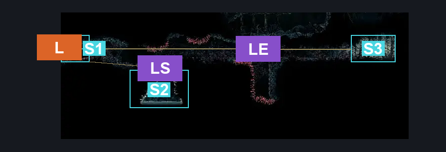
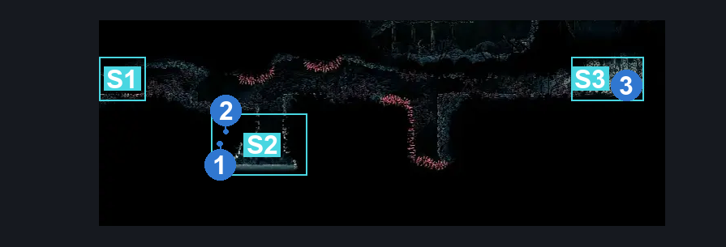
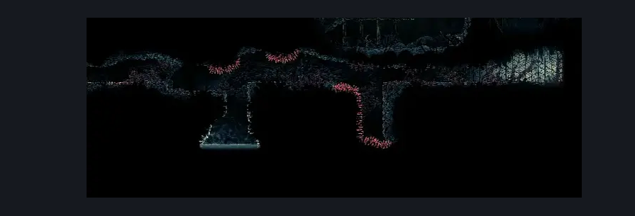

# Slab Window (Slab_12)

**Game ID:** Slab_12

**Contributors:** MayaXTG

## Subrooms

| No. | Subroom | Annotated |
| --- | --- | --- |
| S1 | left | ✓ |
| S2 | shards | ✓ |
| S3 | effigy | ✓ |

## Room Transitions

| Alias | Name | From subroom | Destination | Destination alias | Requirements | TODO | Verification | Annotated | Notes |
| --- | --- | --- | --- | --- | --- | --- | --- | --- | --- |
| L | left1 | left | [Slab Cell (Slab_03)](slab-cell.md) | WND | break wall left |  | Verified | ✓ | you will take damage taking this entrance without breaking the other wall |

## Subroom Connections

| Alias | Name | Source | Destination | Requirements | TODO | Verification | Annotated | Notes |
| --- | --- | --- | --- | --- | --- | --- | --- | --- |
| LS | Shards | left | shards | swim |  | Verified |  |  |
| LS | Shards | shards | left | cling grip right OR scuttlebrace OR (faydown cloak AND cling grip left) |  | Verified |  |  |
| LE | Effigy | left | effigy | hit right AND cling grip right |  | Verified |  | needs ironing |
| LE | Effigy | effigy | left | clawline left x 1 OR sharpdart x 1 |  | Verified |  |  |

## Check Locations

| No. | Check | Subroom | Requirements | TODO | Verification | Location Type | Annotated | Notes |
| --- | --- | --- | --- | --- | --- | --- | --- | --- |
| 1 | The Slab - Shell Shard Cache #4 | shards | none |  | Verified | collectible | ✓ |  |
| 2 | The Slab - Shell Shard Cache #5 | shards | none |  | Verified | collectible | ✓ |  |
| 3 | Relic: Weaver Effigy (Atla, The Slab) | effigy | none |  | Verified | collectible | ✓ |  |

## Room Images

### Connections

### Checks

### Scene

