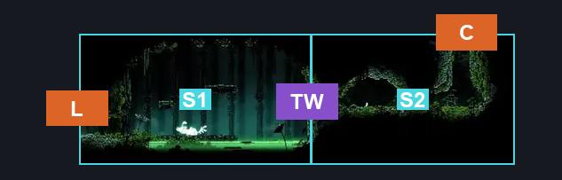
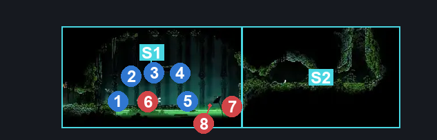
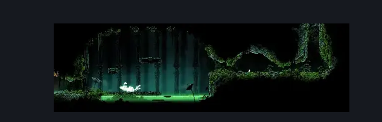

# Palestag (Clover_19)

**Game ID:** Clover_19

**Contributors:** Pyxl

## Subrooms

| No. | Subroom | Annotated |
| --- | --- | --- |
| S1 | Arena | ✓ |
| S2 | Top Right | ✓ |

## Room Transitions

| Alias | Name | From subroom | Destination | Destination alias | Requirements | TODO | Verification | Annotated | Notes |
| --- | --- | --- | --- | --- | --- | --- | --- | --- | --- |
| C | top1 | Top Right | [Verdania Top Room (Clover_06)](verdania-top-room.md) | RF | Cling Grip left  OR Silk Soar OR ( Faydown cloak AND Cling Grip right ) OR Scuttlebrace |  | Verified | ✓ |  |
| L | left1 | Arena | [Verdania Left Side Tall Room (Clover_05c)](verdania-left-side-tall-room.md) | UR | None |  | Verified | ✓ |  |

## Subroom Connections

| Alias | Name | Source | Destination | Requirements | TODO | Verification | Annotated | Notes |
| --- | --- | --- | --- | --- | --- | --- | --- | --- |
| TW | THE WALL | Top Right | Arena | None |  | Verified | ✓ |  |
| TW | THE WALL | Arena | Top Right | prereq palestag AND ( Faydown Cloak OR Cling Grip Right OR Ledge Grab Right ) |  | Verified | ✓ |  |

## Check Locations

| No. | Check | Subroom | Requirements | TODO | Verification | Location Type | Annotated | Notes |
| --- | --- | --- | --- | --- | --- | --- | --- | --- |
| 1 | Verdania Essence 3 | Arena | prereq palestag |  | Verified | collectible | ✓ |  |
| 2 | Verdania Essence 4 | Arena | prereq palestag |  | Verified | collectible | ✓ |  |
| 3 | Verdania Essence 5 | Arena | prereq palestag |  | Verified | collectible | ✓ |  |
| 4 | Verdania Essence 6 | Arena | prereq palestag |  | Verified | collectible | ✓ |  |
| 5 | Verdania Essence 7 | Arena | prereq palestag |  | Verified | collectible | ✓ |  |
| 6 | Palestag | Arena | None |  | Verified | boss | ✓ |  |
| 7 | Nuphar 1 | Arena | Invalid |  | Verified | enemy | ✓ | never killable |
| 8 | Nuphar 2 | Arena | invalid |  | Verified | enemy | ✓ | never killable |

## Room Images

### Connections

### Checks

### Scene

