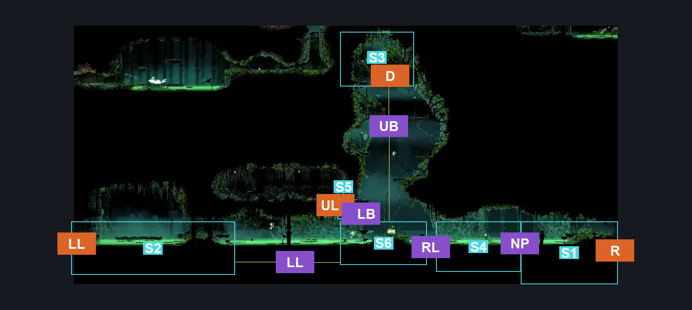
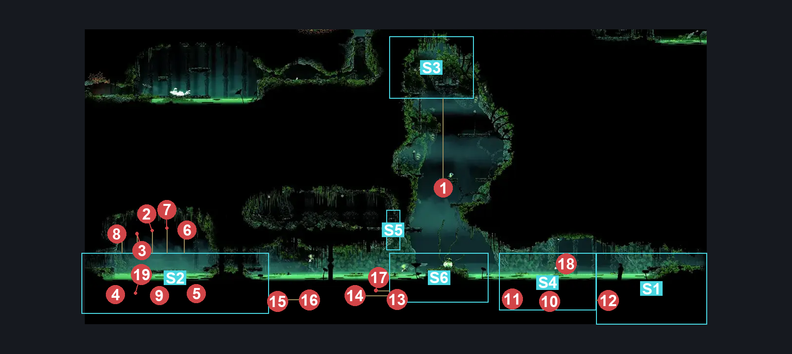
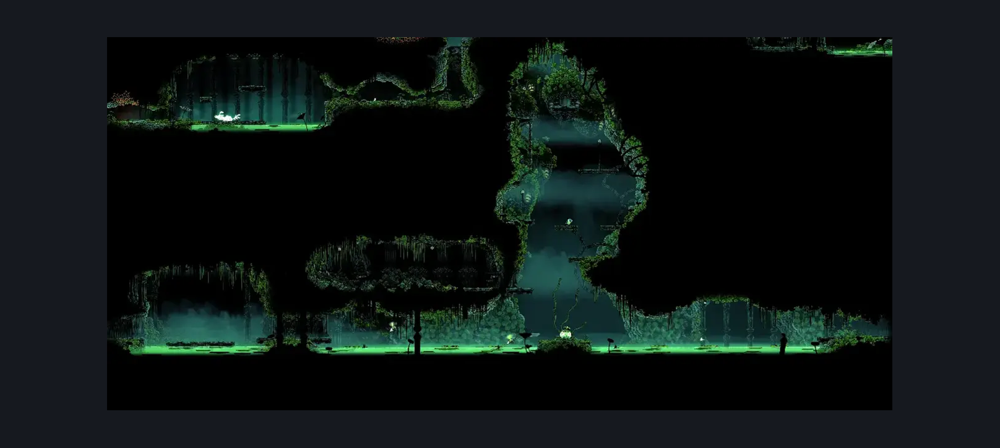

# Verdania Capital (Clover_04b)

**Game ID:** Clover_04b

**Contributors:** Pyxl

## Subrooms

| No. | Subroom | Annotated |
| --- | --- | --- |
| S1 | Right Transition | ✓ |
| S2 | Left Arena | ✓ |
| S3 | The door | ✓ |
| S4 | Lilypads | ✓ |
| S5 | Ledge Transition | ✓ |
| S6 | Centre Bulb | ✓ |

## Room Transitions

| Alias | Name | From subroom | Destination | Destination alias | Requirements | TODO | Verification | Annotated | Notes |
| --- | --- | --- | --- | --- | --- | --- | --- | --- | --- |
| R | right1 | Right Transition | [Verdania Right Side Tall Room (Clover_03)](verdania-right-side-tall-room.md) | UL | None |  | Verified | ✓ |  |
| D | door1 | The door | [Clover Dancers (Clover_10)](clover-dancers.md) | L | ( get 5 Verdania Shards AND Prereq Palestag IN Palestag ) OR ( Get 12 verdania shards ) |  | Verified | ✓ |  |
| UL | left1 | Ledge Transition | [Verdania Kindanir Egg Room (Clover_11)](verdania-kindanir-egg-room.md) | R | None |  | Verified | ✓ |  |
| LL | left2 | Left Arena | [Verdania Left Side Tall Room (Clover_05c)](verdania-left-side-tall-room.md) | MR | None |  | Verified | ✓ |  |

## Subroom Connections

| Alias | Name | Source | Destination | Requirements | TODO | Verification | Annotated | Notes |
| --- | --- | --- | --- | --- | --- | --- | --- | --- |
| NP | Nuphar Gap | Right Transition | Lilypads | Swim OR ( easy pogo off nuphar AND ( Sprint left OR Clawline Left OR Sharpdart OR Faydown Cloak OR Drifters Cloak ) ) |  | Verified | ✓ |  |
| NP | Nuphar Gap | Lilypads | Right Transition | Swim OR ( easy pogo off nuphar AND ( Sprint right OR Clawline right OR Sharpdart OR Faydown Cloak OR Drifters Cloak ) ) |  | Verified | ✓ |  |
| RL | Right Lake | Lilypads | Centre Bulb | Swim OR clawline left OR Sharpdart OR Drifters Cloak OR ( ( Sprint Left OR Dash Left OR Faydown Cloak ) AND ( Sprint Left OR Dash Left OR Faydown Cloak ) ) |  | Verified | ✓ |  |
| RL | Right Lake | Centre Bulb | Lilypads | Swim OR clawline Right OR Sharpdart OR Drifters Cloak OR ( ( Sprint Right OR Dash RIght OR Faydown Cloak ) AND ( Sprint RIght OR Dash Right OR Faydown Cloak ) ) |  | Verified | ✓ |  |
| LL | Left Lake | Centre Bulb | Left Arena | Swim OR ( Easy pogo off Nuphar AND ( ( Easy Beast Crest Pogo AND Easy pogo off Nuphar AND Easy Pogo off Pendra ) OR Clawline Left OR ( Sharpdart AND ( Dash left OR Drifters Cloak OR Faydown Cloak OR Sprint left OR Easy Beast Crest Pogo OR Easy Reaper Pogo OR  Easy Shaman Pogo ) ) OR ( Sprint Left AND ( Faydown Cloak OR Drifters Cloak ) ) ) ) |  | Verified | ✓ |  |
| LL | Left Lake | Left Arena | Centre Bulb | Swim OR ( Easy pogo off Nuphar AND ( ( Easy Beast Crest Pogo AND Easy pogo off Nuphar AND Easy Pogo off Pendra ) OR Clawline Right OR ( Sharpdart AND ( Dash Right OR Drifters Cloak OR Faydown Cloak OR Sprint Right OR Easy Beast Crest Pogo OR Easy Reaper Pogo OR  Easy Shaman Pogo ) ) OR ( Sprint Right AND ( Faydown Cloak OR Drifters Cloak ) ) ) ) |  | Verified | ✓ |  |
| LB | Lower BUlbing | Centre Bulb | Ledge Transition | Easy Shaman Pogo OR Easy Reaper Pogo OR ( ( Ledge Grab Left OR Cling Grip Left ) AND ( Easy Witch Pogo OR Medium Beast Crest Pogo OR Easy Wanderer Pogo OR Easy Hunter Pogo OR Clawline Left ) ) OR Faydown Cloak OR Silk Soar |  | Verified | ✓ |  |
| LB | Lower BUlbing | Ledge Transition | Centre Bulb | None |  | Verified | ✓ |  |
| UB | Upper Bulbing | Centre Bulb | The door | Silk Soar OR ( Faydown Cloak AND Cling Grip ) |  | Verified | ✓ |  |
| UB | Upper Bulbing | The door | Centre Bulb | None |  | Verified | ✓ |  |

## Check Locations

| No. | Check | Subroom | Requirements | TODO | Verification | Location Type | Annotated | Notes |
| --- | --- | --- | --- | --- | --- | --- | --- | --- |
| 1 | Verdanir 1 | The door | ( get 5 Verdania Shards AND Prereq Palestag IN Palestag ) OR ( Get 12 verdania shards ) |  | Verified | enemy | ✓ |  |
| 2 | Verdanir 2 | Left Arena | None |  | Verified | enemy | ✓ | Doesnt Respawn |
| 3 | Verdanir 3 | Left Arena | None |  | Verified | enemy | ✓ | Doesnt Respawn |
| 4 | Kindanir 1 | Left Arena | None |  | Verified | enemy | ✓ | Doesnt Respawn |
| 5 | Kindanir 2 | Left Arena | None |  | Verified | enemy | ✓ | Doesnt Respawn |
| 6 | Escalion 1 | Left Arena | None |  | Verified | enemy | ✓ | Doesnt Respawn |
| 7 | Escalion 2 | Left Arena | None |  | Verified | enemy | ✓ | Doesnt Respawn |
| 8 | Verdanir 4 | Left Arena | None |  | Verified | enemy | ✓ | Doesnt Respawn |
| 9 | Verdanir 5 | Left Arena | None |  | Verified | enemy | ✓ | Doesnt Respawn |
| 10 | Nuphar 1 | Lilypads | None |  | Verified | enemy | ✓ | Nuphar jank included |
| 11 | Nuphar 2 | Lilypads | None |  | Verified | enemy | ✓ |  |
| 12 | Nuphar 3 | Lilypads | None |  | Verified | enemy | ✓ |  |
| 13 | Nuphar 4 | Centre Bulb | None |  | Verified | enemy | ✓ |  |
| 14 | Nuphar 5 | Centre Bulb | None |  | Verified | enemy | ✓ |  |
| 15 | Nuphar 6 | Left Arena | None |  | Verified | enemy | ✓ |  |
| 16 | Pendra 1 | Left Arena | None |  | Verified | enemy | ✓ |  |
| 17 | Pendra 2 | Centre Bulb | None |  | Verified | enemy | ✓ |  |
| 18 | Escalion 3 | Lilypads | None |  | Verified | enemy | ✓ |  |
| 19 | Verdanir Arena | Left Arena | Combat Requirements |  | Verified | gauntlet | ✓ |  |

## Room Images

### Connections

### Checks

### Scene

