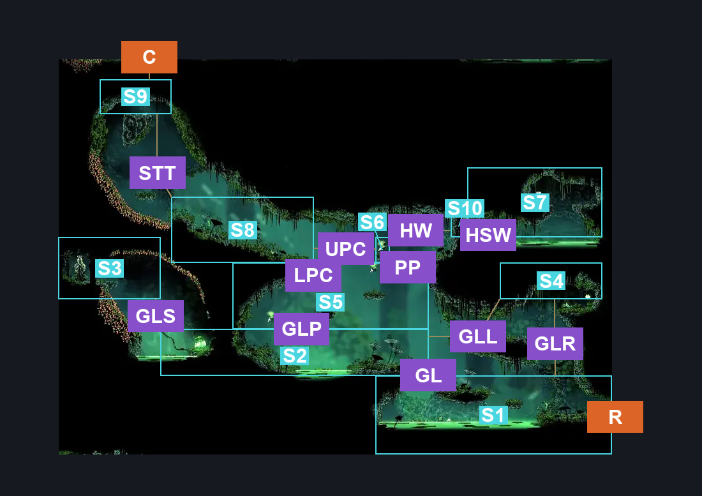
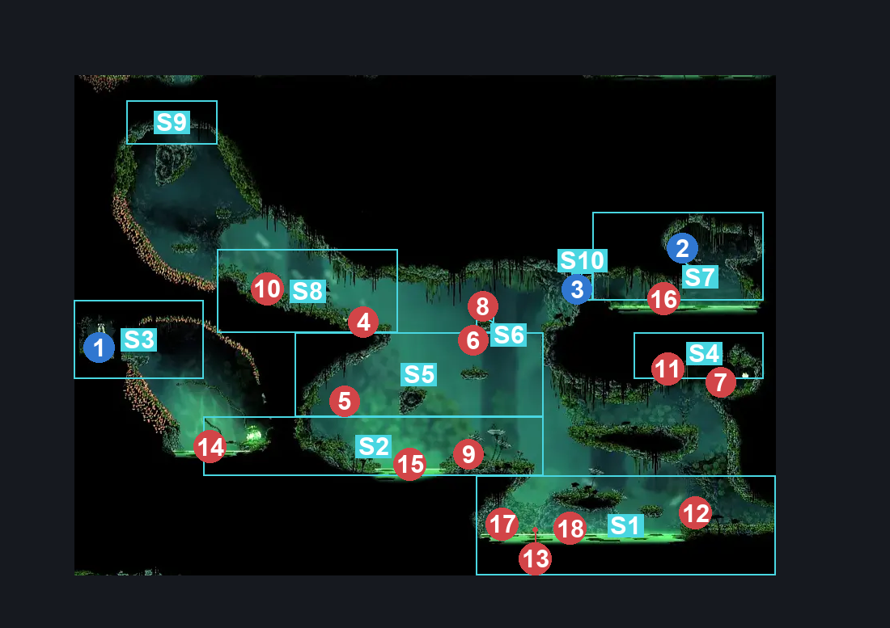
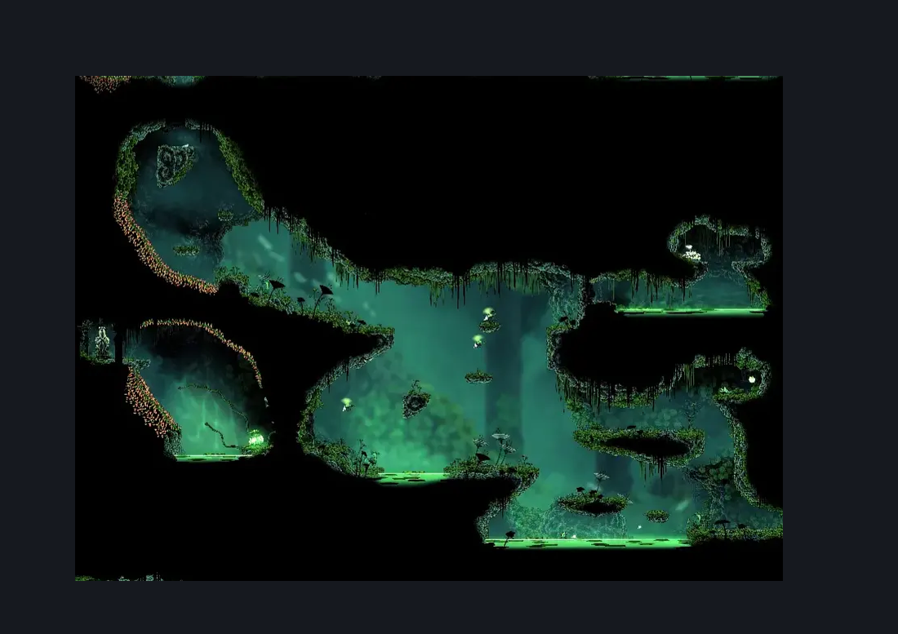

# Verdania Cloverstag Steps (Clover_16)

**Game ID:** Clover_16

**Contributors:** Pyxl

## Subrooms

| No. | Subroom | Annotated |
| --- | --- | --- |
| S1 | Ground Level Right | ✓ |
| S2 | Ground Level Left | ✓ |
| S3 | Essence Shrine | ✓ |
| S4 | Leaf Roller Platform | ✓ |
| S5 | Lower Pendra Plaforms | ✓ |
| S6 | Upper Pendra Platform | ✓ |
| S7 | Hidden Room | ✓ |
| S8 | Upper Cloverstag Steps | ✓ |
| S9 | Top Exit | ✓ |
| S10 | Cloverstag Wall | ✓ |

- **Cloverstag Wall:** Why on earth did i need to make this its own subroom team cherry

## Room Transitions

| Alias | Name | From subroom | Destination | Destination alias | Requirements | TODO | Verification | Annotated | Notes |
| --- | --- | --- | --- | --- | --- | --- | --- | --- | --- |
| R | right1 | Ground Level Right | [Verdania Left Side Tall Room (Clover_05c)](verdania-left-side-tall-room.md) | UL | None |  | Verified | ✓ |  |
| C | top1 | Top Exit | [Verdania Top Room (Clover_06)](verdania-top-room.md) | LF | None |  | Verified | ✓ |  |

## Subroom Connections

| Alias | Name | Source | Destination | Requirements | TODO | Verification | Annotated | Notes |
| --- | --- | --- | --- | --- | --- | --- | --- | --- |
| GL | Ground Level | Ground Level Right | Ground Level Left | Ledge Grab Left OR Cling Grip Left OR Dash Left OR Faydown Cloak OR Silk Soar OR Easy beast charge OR Easy Shaman Pogo OR ( medium heal stall AND Easy Beast pogo ) OR Easy pogo off cloverstag |  | Verified | ✓ |  |
| GL | Ground Level | Ground Level Left | Ground Level Right | None |  | Verified | ✓ |  |
| GLR | Ground Right To Roller | Ground Level Right | Leaf Roller Platform | Silk Soar OR ( ( Cling Grip Right OR Scuttlebrace ) AND ( Faydown Cloak OR Clawline Right OR Medium pogo off cloverstag ) ) |  | Verified | ✓ |  |
| GLR | Ground Right To Roller | Leaf Roller Platform | Ground Level Right | None |  | Verified | ✓ |  |
| GLL | Ground Left To Roller | Ground Level Left | Leaf Roller Platform | Faydown Cloak OR ( ( Dash Right OR Clawline Right OR Sharpdart OR Easy Beast Charge OR Drifters Cloak ) AND ( Ledge grab right OR Cling Grip Right ) ) |  | Verified | ✓ |  |
| GLL | Ground Left To Roller | Leaf Roller Platform | Ground Level Left | None |  | Verified | ✓ |  |
| GLS | Ground Left To Shrine | Ground Level Left | Essence Shrine | Easy Shaman Pogo OR ( ( Ledge Grab Left OR Cling Grip left ) AND ( Easy Reaper Pogo OR Easy Wanderer Pogo OR Clawline Left ) ) OR Faydown Cloak |  | Verified | ✓ |  |
| GLS | Ground Left To Shrine | Essence Shrine | Ground Level Left | None |  | Verified | ✓ |  |
| GLP | Ground Left To Lower Pendra | Ground Level Left | Lower Pendra Plaforms | Silk Soar OR ( Cling Grip Right AND ( Clawline Right OR Faydown Cloak ) ) OR ( medium pogo off pendra AND ( Faydown Cloak OR Clawline RIght OR Drifters Cloak ) ) |  | Verified | ✓ |  |
| GLP | Ground Left To Lower Pendra | Lower Pendra Plaforms | Ground Level Left | None |  | Verified | ✓ |  |
| PP | Pendra Platforms | Lower Pendra Plaforms | Upper Pendra Platform | easy pogo off pendra OR ( Faydown Cloak AND ( Ledge Grab Left OR Ledge Grab Right OR Cling Grip Right OR Cling Grip Left OR Easy Shaman pogo OR Easy heal stall OR Easy beast charge ) ) OR Silk Soar OR ( Cling Grip Right AND ( Dash OR Sprint OR Clawline OR Sharpdart OR Drifters Cloak OR Easy beast charge ) ) |  | Verified | ✓ |  |
| PP | Pendra Platforms | Upper Pendra Platform | Lower Pendra Plaforms | None |  | Verified | ✓ |  |
| HW | Hidden Wall | Upper Pendra Platform | Cloverstag Wall | Clawline right OR Dash Right OR Sprint Right OR Faydown Cloak OR Sharpdart OR Cling Grip Right OR Scuttlebrace OR Easy Beast pogo OR easy beast charge OR drifters cloak OR Easy heal stall OR Easy hunter pogo OR easy Reaper Pogo OR Easy wanderer charge OR Hard Witch pogo OR Easy Architect pogo OR Easy Shaman Pogo |  | Verified | ✓ |  |
| HW | Hidden Wall | Cloverstag Wall | Upper Pendra Platform | Clawline right OR Dash Right OR Sprint Right OR Faydown Cloak OR Sharpdart OR Cling Grip Right OR Scuttlebrace OR Easy Beast pogo OR easy beast charge OR drifters cloak OR Easy heal stall OR Easy hunter pogo OR easy Reaper Pogo OR Easy wanderer charge OR Easy Architect pogo OR Easy Shaman Pogo |  | Verified | ✓ |  |
| UPC | Upper Pendra To Steps | Upper Pendra Platform | Upper Cloverstag Steps | Clawline left OR sharpdart OR Drifters cloak OR ( faydown cloak AND Easy pogo off pendra ) |  | Verified | ✓ |  |
| UPC | Upper Pendra To Steps | Upper Cloverstag Steps | Upper Pendra Platform | Clawline right OR sharpdart OR Drifters cloak OR ( faydown cloak AND Easy pogo off pendra ) |  | Verified | ✓ |  |
| LPC | Lower Pendra To Steps | Lower Pendra Plaforms | Upper Cloverstag Steps | Silk Soar OR ( Faydown Cloak AND ( Cling Grip Left OR Scuttlebrace ) ) |  | Verified | ✓ |  |
| LPC | Lower Pendra To Steps | Upper Cloverstag Steps | Lower Pendra Plaforms | None |  | Verified | ✓ |  |
| STT | Steps To Top | Upper Cloverstag Steps | Top Exit | Silk Soar OR ( Faydown Cloak AND ( Cling Grip Right OR Scuttlebrace ) AND ( Clawline Left OR Sharpdart ) ) |  | Verified | ✓ |  |
| STT | Steps To Top | Top Exit | Upper Cloverstag Steps | None |  | Verified | ✓ |  |
| HSW | Hidden Stag Wall | Cloverstag Wall | Hidden Room | Prereq cloverstag wall |  | Verified | ✓ |  |
| HSW | Hidden Stag Wall | Hidden Room | Cloverstag Wall | prereq cloverstag wall |  | Verified | ✓ |  |

## Check Locations

| No. | Check | Subroom | Requirements | TODO | Verification | Location Type | Annotated | Notes |
| --- | --- | --- | --- | --- | --- | --- | --- | --- |
| 1 | Verdania Essence 9 | Essence Shrine | easy pogo off nuphar OR Faydown Cloak OR Swim OR Clawline Right |  | Verified | collectible | ✓ |  |
| 2 | Verdania Essence 10 | Hidden Room | Swim AND ( Silk Soar OR Faydown Cloak ) |  | Verified | collectible | ✓ |  |
| 3 | Cloverstag Wall | Cloverstag Wall | Needle down OR Needle up OR needle Right |  | Verified | blockade | ✓ |  |
| 4 | Leaf Roller 1 | Upper Cloverstag Steps | None |  | Verified | enemy | ✓ |  |
| 5 | Pendra 1 | Lower Pendra Plaforms | None |  | Verified | enemy | ✓ |  |
| 6 | Pendra 2 | Lower Pendra Plaforms | None |  | Verified | enemy | ✓ |  |
| 7 | Leaf Roller 2 | Leaf Roller Platform | None |  | Verified | enemy | ✓ |  |
| 8 | Pendra 3 | Upper Pendra Platform | None |  | Verified | enemy | ✓ |  |
| 9 | Cloverstag 1 | Ground Level Left | None |  | Verified | enemy | ✓ | Seems to kill itself often before player can |
| 10 | Cloverstag 2 | Upper Cloverstag Steps | None |  | Verified | enemy | ✓ |  |
| 11 | Cloverstag 3 | Leaf Roller Platform | Invalid |  | Verified | enemy | ✓ | Just doesnt exist even on several reloads to check rng |
| 12 | Cloverstag 4 | Ground Level Right | None |  | Verified | enemy | ✓ |  |
| 13 | Nuphar 1 | Ground Level Right | None |  | Verified | enemy | ✓ |  |
| 14 | Nuphar 2 | Ground Level Left | None |  | Verified | enemy | ✓ |  |
| 15 | Nuphar 3 | Ground Level Left | None |  | Verified | enemy | ✓ |  |
| 16 | Nuphar 4 | Hidden Room | None |  | Verified | enemy | ✓ | think this one is scripted not to be hostile |
| 17 | Leaf Glider 1 | Ground Level Right | None |  | Verified | enemy | ✓ |  |
| 18 | Leaf Glider 2 | Ground Level Right | None |  | Verified | enemy | ✓ |  |

## Room Images

### Connections

### Checks

### Scene

