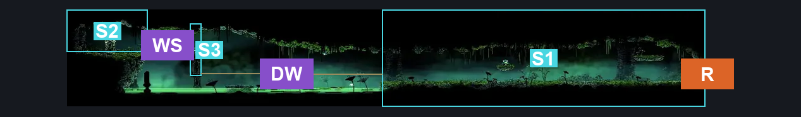
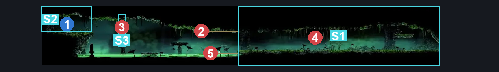
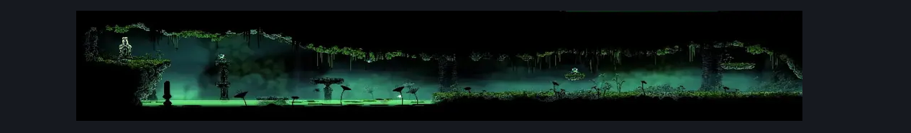

# Verdania Left Side Essence Shrine (Clover_21)

**Game ID:** Clover_21

**Contributors:** Pyxl

## Subrooms

| No. | Subroom | Annotated |
| --- | --- | --- |
| S1 | Dry Ground | ✓ |
| S2 | Shrine | ✓ |
| S3 | Wet | ✓ |

## Room Transitions

| Alias | Name | From subroom | Destination | Destination alias | Requirements | TODO | Verification | Annotated | Notes |
| --- | --- | --- | --- | --- | --- | --- | --- | --- | --- |
| R | right1 | Dry Ground | [Verdania Left Side Tall Room (Clover_05c)](verdania-left-side-tall-room.md) | LL | None |  | Verified | ✓ |  |

## Subroom Connections

| Alias | Name | Source | Destination | Requirements | TODO | Verification | Annotated | Notes |
| --- | --- | --- | --- | --- | --- | --- | --- | --- |
| DW | Dry to Wet | Dry Ground | Wet | ( Dash left OR Dash Right OR ledge Grab Right OR Ledge Grab Left OR Faydown Cloak OR Cling Grip Right OR Cling Grip Left OR ( Silk Soar AND Proficient Movement ) ) AND ( Swim OR Sharpdart OR Clawline Left ) |  | Verified | ✓ |  |
| DW | Dry to Wet | Wet | Dry Ground | Clawline Right OR Drifters Cloak OR Faydown CLoak OR ( easy pogo off nuphar AND ( dash right OR Sprint Right ) ) OR Swim |  | Verified | ✓ |  |
| WS | Wet to Shrine | Wet | Shrine | Sprint left OR Dash Left OR Clawline Left OR Sharpdart OR Faydown Cloak OR Drifters cloak OR Easy Beast pogo |  | Verified | ✓ |  |
| WS | Wet to Shrine | Shrine | Wet | Sprint Right OR Dash Right OR Clawline Right OR Sharpdart OR Faydown Cloak OR Drifters cloak OR Easy Beast pogo |  | Verified | ✓ |  |

## Check Locations

| No. | Check | Subroom | Requirements | TODO | Verification | Location Type | Annotated | Notes |
| --- | --- | --- | --- | --- | --- | --- | --- | --- |
| 1 | Verdania essence 11 | Shrine | Clawline Right OR ( Swim AND ( Faydown Cloak OR Dash Right OR Drifters Cloak ) ) |  | Verified | collectible | ✓ |  |
| 2 | Escalion 1 | Dry Ground | None |  | Verified | enemy | ✓ |  |
| 3 | Verdanir 1 | Wet | None |  | Verified | enemy | ✓ |  |
| 4 | Verdanir 2 | Dry Ground | None |  | Verified | enemy | ✓ |  |
| 5 | Nuphar 1 | Dry Ground | None |  | Verified | enemy | ✓ | Dont think this one can be hostile |

## Room Images

### Connections

### Checks

### Scene

