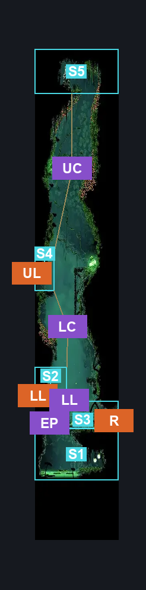
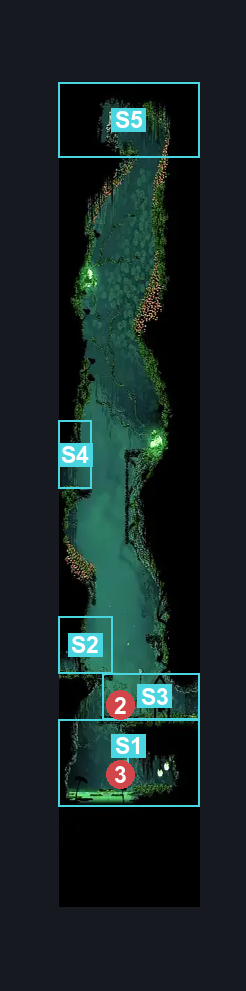
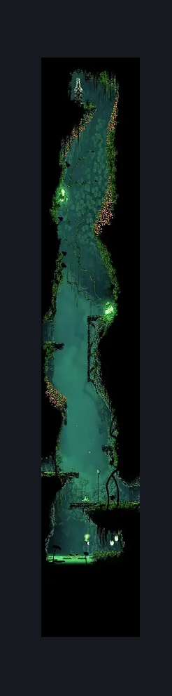

# Verdania Right Side Tall Room (Clover_03)

**Game ID:** Clover_03

**Contributors:** Pyxl

## Subrooms

| No. | Subroom | Annotated |
| --- | --- | --- |
| S1 | Lower Enemy Pool | ✓ |
| S2 | Lower Left Entrance | ✓ |
| S3 | Lower Right Transition | ✓ |
| S4 | Upper Left Transtions | ✓ |
| S5 | Statue | ✓ |

## Room Transitions

| Alias | Name | From subroom | Destination | Destination alias | Requirements | TODO | Verification | Annotated | Notes |
| --- | --- | --- | --- | --- | --- | --- | --- | --- | --- |
| UL | left1 | Upper Left Transtions | [Verdania Capital (Clover_04b)](verdania-capital.md) | R | None |  | Verified | ✓ |  |
| LL | left2 | Lower Left Entrance | [Verdania Big Room (Clover_02c)](verdania-big-room.md) | R | None |  | Verified | ✓ |  |
| R | right1 | Lower Right Transition | [Verdania Big Button Room (Clover_18)](verdania-big-button-room.md) | L | None |  | Verified | ✓ |  |

## Subroom Connections

| Alias | Name | Source | Destination | Requirements | TODO | Verification | Annotated | Notes |
| --- | --- | --- | --- | --- | --- | --- | --- | --- |
| LL | Lower Ledge | Lower Left Entrance | Lower Right Transition | None |  | Verified | ✓ |  |
| LL | Lower Ledge | Lower Right Transition | Lower Left Entrance | Ledge Grab Left OR Cling Grip Left OR Faydown Cloak OR Silk Soar |  | Verified | ✓ |  |
| EP | Enemy Pool | Lower Right Transition | Lower Enemy Pool | None |  | Verified | ✓ |  |
| EP | Enemy Pool | Lower Enemy Pool | Lower Right Transition | ( Swim AND Silk Soar ) OR Cling Grip left OR ( Faydown Cloak AND ( Easy Enemy pogo OR Ledge Grab Right OR Scuttlebrace ) ) |  | Verified | ✓ |  |
| LC | Lower Climb | Lower Left Entrance | Upper Left Transtions | Silk Soar OR ( Cling Grip AND ( Faydown Cloak OR ( Hard Shaman Crest Pogo AND ( clawline OR Sharpdart ) ) ) ) |  | Verified | ✓ |  |
| LC | Lower Climb | Upper Left Transtions | Lower Left Entrance | None |  | Verified | ✓ |  |
| UC | Upper Climb | Upper Left Transtions | Statue | Faydown Cloak OR ( Cling Grip left AND ( Hard Shaman Pogo OR Dash right OR Clawline right OR Sharpdart ) ) |  | Verified | ✓ |  |
| UC | Upper Climb | Statue | Upper Left Transtions | None |  | Verified | ✓ |  |

## Check Locations

| No. | Check | Subroom | Requirements | TODO | Verification | Location Type | Annotated | Notes |
| --- | --- | --- | --- | --- | --- | --- | --- | --- |
| 1 | Verdania Essence 2 | Statue | None |  | Verified | collectible |  |  |
| 2 | Leaf Roller 1 | Lower Right Transition | None |  | Verified | enemy | ✓ |  |
| 3 | Pendra 1 | Lower Enemy Pool | None |  | Verified | enemy | ✓ |  |

## Room Images

### Connections

### Checks

### Scene

