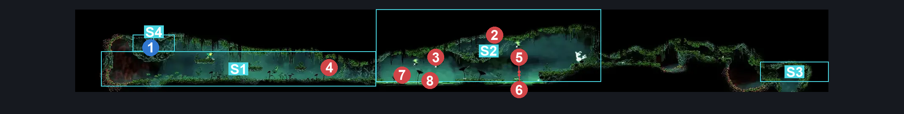

# Verdania Top Room (Clover_06)

**Game ID:** Clover_06

**Contributors:** Pyxl

## Subrooms

| No. | Subroom | Annotated |
| --- | --- | --- |
| S1 | Dry land | ✓ |
| S2 | Lilypads rng | ✓ |
| S3 | Right exit tunnel | ✓ |
| S4 | Shrine | ✓ |

## Room Transitions

| Alias | Name | From subroom | Destination | Destination alias | Requirements | TODO | Verification | Annotated | Notes |
| --- | --- | --- | --- | --- | --- | --- | --- | --- | --- |
| RF | bot2 | Right exit tunnel | [Palestag (Clover_19)](palestag.md) | C | None |  | Verified | ✓ |  |
| LF | bot1 | Dry land | [Verdania Cloverstag Steps (Clover_16)](verdania-cloverstag-steps.md) | C | None |  | Verified | ✓ |  |

## Subroom Connections

| Alias | Name | Source | Destination | Requirements | TODO | Verification | Annotated | Notes |
| --- | --- | --- | --- | --- | --- | --- | --- | --- |
| VE | Shrine | Dry land | Shrine | Silk Soar OR Clawline Left OR Faydown Cloak OR Drifters Cloak OR Sprint left OR Dash Left OR Sharpdart OR Easy Beast pogo |  | Verified | ✓ |  |
| VE | Shrine | Shrine | Dry land | None |  | Verified | ✓ |  |
| WE | Wet | Dry land | Lilypads rng | easy pogo off nuphar OR Swim OR Clawline RIght OR ( Faydown cloak AND Drifters cloak AND ( Dash Right OR Sprint Right OR Easy beast pogo ) ) |  | Verified | ✓ | fuck lilypad rng, only reason this entire subroom exists |
| WE | Wet | Lilypads rng | Dry land | easy pogo off nuphar OR Swim OR Clawline Left OR ( Faydown cloak AND Drifters cloak AND ( Dash Left OR Sprint Left OR Easy beast pogo ) ) |  | Verified | ✓ |  |
| TU | Tunnel | Lilypads rng | Right exit tunnel | Faydown Cloak OR ( ( Cling Grip Right OR Scuttlebrace ) AND ( Dash Right OR Clawline Right OR Drifters Cloak OR Sharpdart OR Easy Beast Pogo ) ) |  | Verified | ✓ |  |
| TU | Tunnel | Right exit tunnel | Lilypads rng | Faydown cloak AND ( Sprint Left OR ( clawline left AND Cling Grip Left ) ) |  | Verified | ✓ |  |

## Check Locations

| No. | Check | Subroom | Requirements | TODO | Verification | Location Type | Annotated | Notes |
| --- | --- | --- | --- | --- | --- | --- | --- | --- |
| 1 | Verdania Essence 12 | Shrine | Cling Grip Left AND Faydown Cloak |  | Verified | collectible | ✓ |  |
| 2 | Pendra 1 | Lilypads rng | None |  | Verified | enemy | ✓ |  |
| 3 | Pendra 2 | Lilypads rng | None |  | Verified | enemy | ✓ |  |
| 4 | Cloverstag 1 | Dry land | None |  | Verified | enemy | ✓ |  |
| 5 | Leaf Glider 1 | Lilypads rng | None |  | Verified | enemy | ✓ |  |
| 6 | Nuphar 1 | Lilypads rng | None |  | Verified | enemy | ✓ |  |
| 7 | Nuphar 2 | Lilypads rng | None |  | Verified | enemy | ✓ |  |
| 8 | Nuphar 3 | Lilypads rng | None |  | Verified | enemy | ✓ |  |

## Room Images

### Connections

### Checks

### Scene

