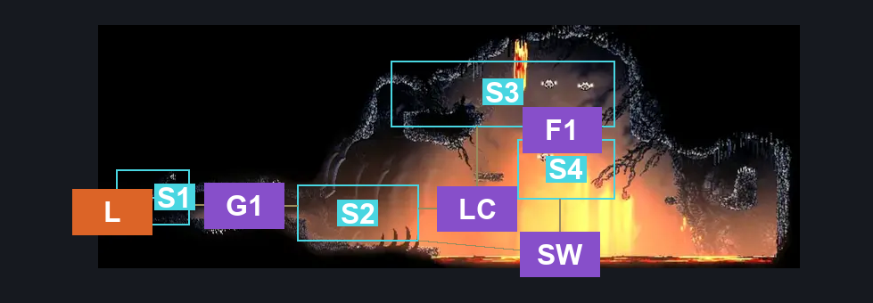
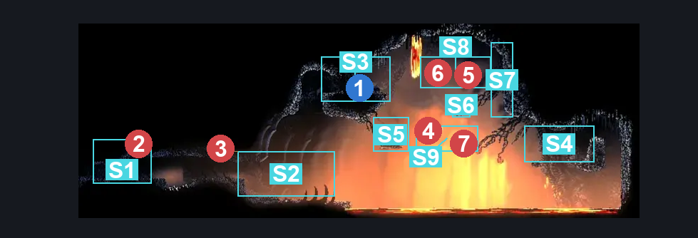
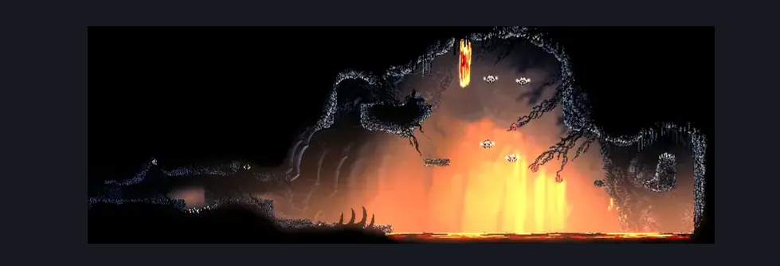

# Weavenest Atla Mask Shard (Weave_05b)

**Game ID:** Weave_05b

**Contributors:** herounit

## Subrooms

| No. | Subroom | Annotated |
| --- | --- | --- |
| S1 | left exit area | ✓ |
| S2 | starting line | ✓ |
| S3 | mask shard spot | ✓ |
| S4 | first checkpoint | ✓ |
| S5 | second checkpoint | ✓ |
| S6 | lone pogo fruit | ✓ |
| S7 | cling wall | ✓ |
| S8 | upper skullwings | ✓ |
| S9 | lower skullwings | ✓ |

## Room Transitions

| Alias | Name | From subroom | Destination | Destination alias | Requirements | TODO | Verification | Annotated | Notes |
| --- | --- | --- | --- | --- | --- | --- | --- | --- | --- |
| L | left | left exit area | [Weavenest Atla Lore (Weave_08)](weavenest-atla-lore.md) | R | none |  | Verified | ✓ |  |

## Subroom Connections

| Alias | Name | Source | Destination | Requirements | TODO | Verification | Annotated | Notes |
| --- | --- | --- | --- | --- | --- | --- | --- | --- |
| SG | spike gap | left exit area | starting line | spike pogo  OR run  OR dash right OR drifters  OR faydown  OR cling grip right OR clawline right OR sharpdart OR flea brew |  | Verified | ✓ |  |
| SG | spike gap | starting line | left exit area | spike pogo  OR run  OR dash left  OR drifters  OR faydown  OR cling grip left  OR clawline left  OR sharpdart OR flea brew |  | Verified | ✓ |  |
| CC | cheese cheater | starting line | mask shard spot | silk soar |  | Verified | ✓ |  |
| CC | cheese cheater | mask shard spot | starting line | none (falling) |  | Verified | ✓ |  |
| LP | lava platforms | starting line | first checkpoint | ( run OR dash right OR drifters OR faydown OR sharpdart  OR clawline right OR flea brew OR easy [beast, hunter, architect] pogo OR easy [architect] charge OR medium [wanderer] charge (high fall penalty) ) AND ( ( cling grip right ) OR ( faydown AND cling grip left ) ) |  | Verified | ✓ |  |
| LG | lower gap | first checkpoint | second checkpoint | intended pogo off skullwing OR clawline left OR ( sharpdart AND dash left )  OR ( faydown AND ( dash left OR sharpdart OR drifters ) ) OR ( dash left AND drifters AND ( ledge grab left OR cling grip left ) ) |  | Verified | ✓ | to test: - stalls - needle strikes |
| FD1 | faydown is overpowered 1 | first checkpoint | lone pogo fruit | faydown |  | Verified | ✓ |  |
| MGL | middle gap left | second checkpoint | lone pogo fruit | intended pogo off skullwing OR faydown OR clawline right OR easy beast pogo |  | Verified | ✓ | just getting from the small platform to the pogo fruit with or without souls |
| FD2 | faydown is overpowered 2 | mask shard spot | second checkpoint | none (falling) |  | Verified | ✓ |  |
| FD2 | faydown is overpowered 2 | second checkpoint | mask shard spot | silk soar OR ( faydown AND cling grip left ) |  | Verified | ✓ |  |
| MGR | middle gap right | lone pogo fruit | cling wall | ( easy shaman pogo (off fruit) AND intended pogo off skullwing (upper level ones) ) OR ( cling grip right AND (  faydown  OR drifters  OR dash right  OR clawline right  OR sharpdart  OR easy [ flea brew ] stall  OR medium [ reaper ] pogo  OR ( flea brew AND medium [ wanderer, witch ] pogo )  ) ) |  | Verified | ✓ | shaman allows you to bypass the need for cling grip by pogoing from the fruit to the upper level skullwings  ironically beast pogo doesn't work here with cling grip |
| UG | upper gap | cling wall | mask shard spot | clawline left x 2 OR ( faydown AND ( drifters OR sharpdart OR clawline left OR ( dash left AND medium [ architect, hunter ] pogo ) ) ) OR ( intended pogo off skullwing AND ( dash left OR sharpdart OR clawline left OR faydown OR drifters OR ( flea brew AND ( ledge grab left OR cling grip left ) ) ) ) |  | Verified | ✓ | need to test a wide variety of stalls here |
| LSR | lower skullwing access right | first checkpoint | lower skullwings | none |  | Verified | ✓ | just for skullwing enemy journal access |
| LSL | lower skullwing access left | second checkpoint | lower skullwings | none |  | Verified | ✓ | just for skullwing enemy journal access |
| USR | upper skullwing access right | cling wall | upper skullwings | none |  | Verified | ✓ | just for skullwing enemy journal access |
| USL | upper skullwing access left | mask shard spot | upper skullwings | dash right OR clawline right OR sharpdart |  | Verified | ✓ | just for skullwing enemy journal access |

## Check Locations

| No. | Check | Subroom | Requirements | TODO | Verification | Location Type | Annotated | Notes |
| --- | --- | --- | --- | --- | --- | --- | --- | --- |
| 1 | weavenest alta mask shard | mask shard spot | none |  | Verified | collectible | ✓ |  |
| 2 | Pharlid Diver 1 | left exit area | None |  | Verified | enemy | ✓ |  |
| 3 | Pharlid Diver 2 | starting line | None |  | Verified | enemy | ✓ |  |
| 4 | Skullwing 1 | lower skullwings | None |  | Verified | enemy | ✓ |  |
| 5 | Skullwing 2 | upper skullwings | None |  | Verified | enemy | ✓ |  |
| 6 | Skullwing 3 | upper skullwings | None |  | Verified | enemy | ✓ |  |
| 7 | Skullwing 4 | lower skullwings | None |  | Verified | enemy | ✓ | can be accessed if you can reach the mask shard spot for the most part |

## Room Images

### Connections

### Checks

### Scene

