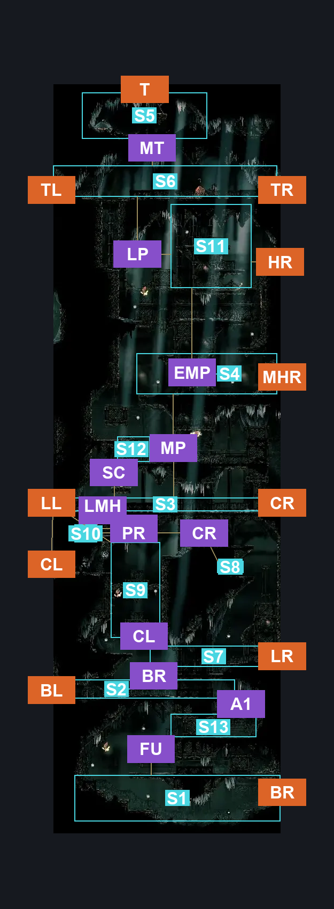
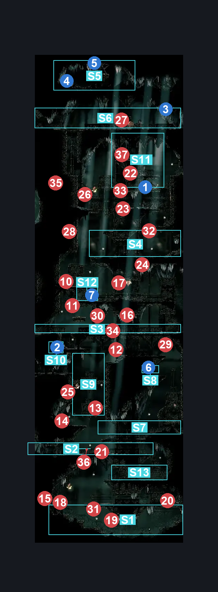
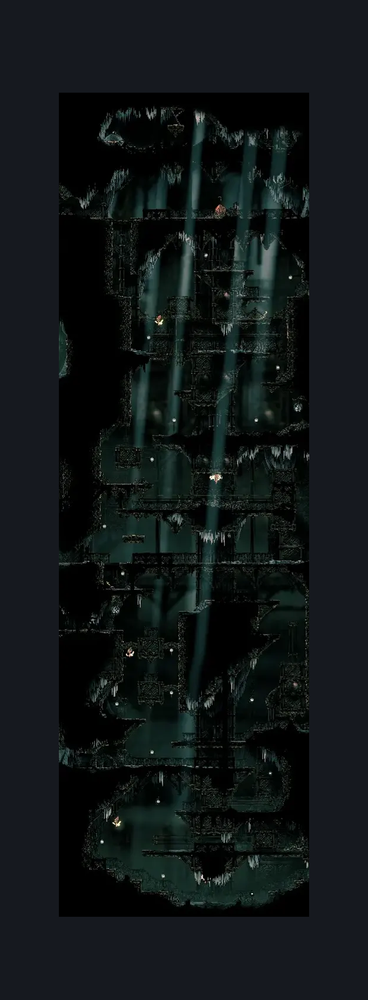

# Whispering Vaults Hell (Library_04)

**Game ID:** Library_04

**Contributors:** Rebel

## Subrooms

| No. | Subroom | Annotated |
| --- | --- | --- |
| S1 | Ground | ✓ |
| S2 | Lowest Hallway | ✓ |
| S3 | Middle Hallway | ✓ |
| S4 | Upper Platform | ✓ |
| S5 | Map Room | ✓ |
| S6 | Top Hallway | ✓ |
| S7 | Upper Low Hallway | ✓ |
| S8 | Rosary Dish | ✓ |
| S9 | Left Side Shaft | ✓ |
| S10 | Lever | ✓ |
| S11 | Distant Platform | ✓ |
| S12 | Shortcut Box | ✓ |
| S13 | This Fucking Thing | ✓ |

## Room Transitions

| Alias | Name | From subroom | Destination | Destination alias | Requirements | TODO | Verification | Annotated | Notes |
| --- | --- | --- | --- | --- | --- | --- | --- | --- | --- |
| T | Top | Map Room | [Songclave (Song_Enclave)](../choral-chambers/songclave.md) | B | Nothing |  | Verified | ✓ |  |
| HR | High Right | Distant Platform | [Whispering Vaults Silkeater (Library_14)](whispering-vaults-silkeater.md) | L | Nothing |  | Verified | ✓ |  |
| CR | Center Right | Middle Hallway | [Whispering Vaults East To West (Library_05)](whispering-vaults-east-to-west.md) | TL | Nothing |  | Verified | ✓ |  |
| BL | Bottom Left | Lowest Hallway | [Whispering Vaults Music Box (Library_16)](whispering-vaults-music-box.md) | R | Nothing |  | Verified | ✓ |  |
| CL | Center Left | Middle Hallway | [Trobbio Entrance (Library_13b)](trobbio-entrance.md) | R | Nothing |  | Verified | ✓ |  |
| LL | Low Left | Left Side Shaft | [Whispering Vaults Flea Shaft (Library_01)](whispering-vaults-flea-shaft.md) | BR | Nothing |  | Verified | ✓ |  |
| LR | Low Right | Upper Low Hallway | [Whispering Vaults East To West (Library_05)](whispering-vaults-east-to-west.md) | BL | Nothing |  | Verified | ✓ |  |
| TR | Top Right | Top Hallway | [Whispering Vaults Jumps (Library_09)](whispering-vaults-jumps.md) | L | Activate Whispering Vaults: Flip Switch #6 IN Whispering Vaults Jumps |  | Verified | ✓ |  |
| TL | Top Left | Top Hallway | [Whispering Vaults Flea Shaft (Library_01)](whispering-vaults-flea-shaft.md) | TR | Nothing |  | Verified | ✓ |  |
| BR | Bottom Right | Ground | [Vaultkeeper Cauldron Entrance (Library_10)](vaultkeeper-cauldron-entrance.md) | L | Nothing |  | Verified | ✓ |  |
| MHR | Mid High Right | Upper Platform | [Whispering Vaults Bench (Library_08)](whispering-vaults-bench.md) | L | Nothing |  | Verified | ✓ |  |

## Subroom Connections

| Alias | Name | Source | Destination | Requirements | TODO | Verification | Annotated | Notes |
| --- | --- | --- | --- | --- | --- | --- | --- | --- |
| A1 | Ascent 1 | This Fucking Thing | Lowest Hallway | (Activate Fuckass Shortcut Box I Forgot About AND (Silk Soar OR Ledge Grab OR Clawline OR Faydown Cloak OR Cling Grip)) |  | Verified | ✓ |  |
| A1 | Ascent 1 | Lowest Hallway | This Fucking Thing | Activate Fuckass Shortcut Box I Forgot About |  | Verified | ✓ |  |
| BR | BL to LR | Lowest Hallway | Upper Low Hallway | Silk Soar OR Easy Enemy Pogo OR Clawline OR Ledge Grab OR Faydown Cloak OR Sprint OR Cling Grip OR Scuttlebrace |  | Verified | ✓ |  |
| BR | BL to LR | Upper Low Hallway | Lowest Hallway | Nothing (Fall) |  | Verified | ✓ |  |
| CL | Climbing | Upper Low Hallway | Left Side Shaft | Silk Soar OR Cling Grip Both OR (Faydown Cloak AND (Cling Grip Either OR Scuttlebrace OR Ledge Grab Both)) |  | Verified | ✓ |  |
| CL | Climbing | Left Side Shaft | Upper Low Hallway | Nothing (Fall) |  | Verified | ✓ |  |
| PR | Progresion! | Left Side Shaft | Lever | Silk Soar OR Cling Grip OR Scuttlebrace |  | Verified | ✓ |  |
| PR | Progresion! | Lever | Left Side Shaft | Nothing (Fall) |  | Verified | ✓ |  |
| CR | Collect Rosaries | Lever | Rosary Dish | Sprint OR Dash OR Clawline OR Drifter's Cloak OR Faydown Cloak OR Cling Grip OR Scuttlebrace OR Sharpdart OR Easy Beast Crest Pogo OR Easy Architect Crest Pogo OR Easy Needle Strike Stall (Beast OR Architect) |  | Verified | ✓ |  |
| CR | Collect Rosaries | Rosary Dish | Lever | Sprint OR Dash OR Clawline OR Drifter's Cloak OR Faydown Cloak OR Cling Grip OR Scuttlebrace OR Sharpdart OR Easy Beast Crest Pogo OR Easy Architect Crest Pogo OR Easy Needle Strike Stall (Beast OR Architect) |  | Verified | ✓ |  |
| LMH | Lever <> Middle Hallway | Lever | Middle Hallway | ledge Grab OR Cling Grip OR Faydown Cloak OR Silk Soar OR Scuttlebrace |  | Verified | ✓ |  |
| LMH | Lever <> Middle Hallway | Middle Hallway | Lever | Nothing (Fall) |  | Verified | ✓ |  |
| MP | More Progression! | Middle Hallway | Upper Platform | (Silk Soar OR Cling Grip OR Scuttlebrace OR (Activate Whispering Vaults: Flip Switch #8 AND Faydown Cloak AND (Ledge Grab OR Easy Shaman Crest Pogo))) |  | Verified | ✓ |  |
| MP | More Progression! | Upper Platform | Middle Hallway | Silk Soar OR Cling Grip OR Scuttlebrace |  | Verified | ✓ | accounting for the fact the player may not have activated the shortcut |
| EMP | Even More Progression! | Upper Platform | Distant Platform | Silk Soar OR ((Cling Grip OR Scuttlebrace) AND (Faydown Cloak OR (Clawline AND (Sprint OR Dash OR Drifter's Cloak) AND Ledge Grab))) |  | Verified | ✓ |  |
| EMP | Even More Progression! | Distant Platform | Upper Platform | Activate Whispering Vaults: Flip Switch #7 |  | Verified | ✓ |  |
| LP | Last Push! | Distant Platform | Top Hallway | Silk Soar OR Cling Grip OR Scuttlebrace |  | Verified | ✓ |  |
| LP | Last Push! | Top Hallway | Distant Platform | Nothing (Fall) |  | Verified | ✓ |  |
| MT | Map Time! | Top Hallway | Map Room | Activate Whispering Vaults: Flip Switch #9 AND (Silk Soar OR Cling Grip OR (Scuttlebrace AND (Easy Enemy Pogo/ OR Faydown Cloak))) |  | Verified | ✓ |  |
| MT | Map Time! | Map Room | Top Hallway | Nothing (fall) |  | Verified | ✓ |  |
| SC | Shortcut | Middle Hallway | Shortcut Box | Activate Hell Room Box Shortcut Thing AND (Ledge Grab OR Cling Grip OR Scuttlebrace OR Faydown Cloak OR Clawline) |  | Verified | ✓ | Opens Shortcut |
| SC | Shortcut | Shortcut Box | Middle Hallway | Activate Hell Room Box Shortcut Thing |  | Verified | ✓ |  |
| FU | IHATEYOUIHATEYOUIHATEYOU | Ground | This Fucking Thing | Silk Soar OR (Faydown Cloak AND (Ledge Grab Right OR Cling Grip Right)) OR (((Easy Pogo OFF [Vaultborn] OR Easy Pogo OFF [Vaultkeeper]) AND Easy Pogo OFF [Lampbearer]) AND Ledge Grab Right) OR ((Sprint Right OR Dash Right OR Clawline Right OR Easy [Shaman, Beast] Pogo OR Easy [Beast, Architect] Charge OR easy [Voltvessels, Flea Brew] Stall OR Flea Brew OR Ledge Grab Right) AND Activate Optional Fuckass Shortcut Box) |  | Verified | ✓ |  |
| FU | IHATEYOUIHATEYOUIHATEYOU | This Fucking Thing | Ground | Activate Fuckass Shortcut Box I Forgot About |  | Verified | ✓ |  |

## Check Locations

| No. | Check | Subroom | Requirements | TODO | Verification | Location Type | Annotated | Notes |
| --- | --- | --- | --- | --- | --- | --- | --- | --- |
| 1 | Whispering Vaults: Flip Switch #7 | Distant Platform | flip Switch Left |  | Verified | switch | ✓ |  |
| 2 | Whispering Vaults: Flip Switch #8 | Lever | Nothing |  | Verified | switch | ✓ |  |
| 3 | Whispering Vaults: Flip Switch #9 | Top Hallway | Nothing |  | Verified | switch | ✓ |  |
| 4 | Map: Whispering Vaults | Map Room | Nothing |  | Verified | collectible | ✓ |  |
| 5 | Whispering Vaults: Break Wall #5 Up | Map Room | Nothing |  | Verified | blockade | ✓ |  |
| 6 | Whispering Vaults: Rosary Dish #3 | Rosary Dish | Nothing |  | Verified | resource | ✓ |  |
| 7 | Hell Room Box Shortcut thing. | Shortcut Box | Break Wall Right |  | Verified | logic-point | ✓ | not a proper check, for logic documentation only. |
| 8 | Fuckass Shortcut Box I Forgot About | Ground | Attack Right |  | Verified | logic-point |  | documentation only |
| 9 | Optional Fuckass Shortcut Box | Ground | Attack Left |  | Verified | logic-point |  | documentation only, needed for the other box logic. |
| 10 | Vaultborn 1 |  |  | TODO |  | enemy | ✓ | FSM Boolean flags: scholarAcolytesReleased |
| 11 | Vaultborn 2 |  |  |  |  | enemy | ✓ | FSM Boolean flags: scholarAcolytesReleased |
| 12 | Vaultborn 3 |  |  | TODO |  | enemy | ✓ | FSM Boolean flags: scholarAcolytesReleased |
| 13 | Vaultborn 4 |  |  | TODO |  | enemy | ✓ | FSM Boolean flags: scholarAcolytesReleased |
| 14 | Vaultborn 5 |  |  | TODO |  | enemy | ✓ | FSM Boolean flags: scholarAcolytesReleased |
| 15 | Vaultborn 6 |  |  | TODO |  | enemy | ✓ | FSM Boolean flags: scholarAcolytesReleased |
| 16 | Drapefly 1 |  |  | TODO |  | enemy | ✓ |  |
| 17 | Vaultkeeper 1 |  |  | TODO |  | enemy | ✓ | FSM Boolean flags: encounteredLibraryEntryBattle |
| 18 | Lampbearer 1 |  |  | TODO |  | enemy | ✓ |  |
| 19 | Vaultkeeper 2 |  |  | TODO |  | enemy | ✓ | FSM Boolean flags: encounteredLibraryEntryBattle |
| 20 | Drapemite 1 |  |  | TODO |  | enemy | ✓ |  |
| 21 | Drapemite 2 |  |  | TODO |  | enemy | ✓ |  |
| 22 | Drapemite 3 |  |  | TODO |  | enemy | ✓ |  |
| 23 | Drapemite 4 |  |  | TODO |  | enemy | ✓ |  |
| 24 | Drapefly 2 |  | Normal World Spawn | TODO |  | enemy | ✓ |  |
| 25 | Lampbearer 2 |  | Normal World Spawn | TODO |  | enemy | ✓ |  |
| 26 | Lampbearer 3 |  | Normal World Spawn | TODO |  | enemy | ✓ |  |
| 27 | Scrollreader 1 |  | Normal World Spawn | TODO |  | enemy | ✓ |  |
| 28 | Void Mass 1 |  | Black Thread World Spawn | TODO |  | enemy | ✓ |  |
| 29 | Void Mass 2 |  | Black Thread World Spawn | TODO |  | enemy | ✓ |  |
| 30 | Lampbearer 4 |  | Black Thread World Spawn | TODO |  | enemy | ✓ |  |
| 31 | Vaultborn 7 |  |  | TODO |  | enemy | ✓ |  |
| 32 | Vaultborn 8 |  |  | TODO |  | enemy | ✓ |  |
| 33 | Vaultborn 9 |  |  | TODO |  | enemy | ✓ |  |
| 34 | Vaultborn 10 |  |  | TODO |  | enemy | ✓ |  |
| 35 | Vaultborn 11 |  |  | TODO |  | enemy | ✓ |  |
| 36 | Vaultborn 12 |  |  | TODO |  | enemy | ✓ |  |
| 37 | Vaultborn 13 |  |  | TODO |  | enemy | ✓ |  |

## Notes

this room needs revisions, connections are not final.
i hate. this fucking. room. die.

## Room Images

### Connections

### Checks

### Scene

