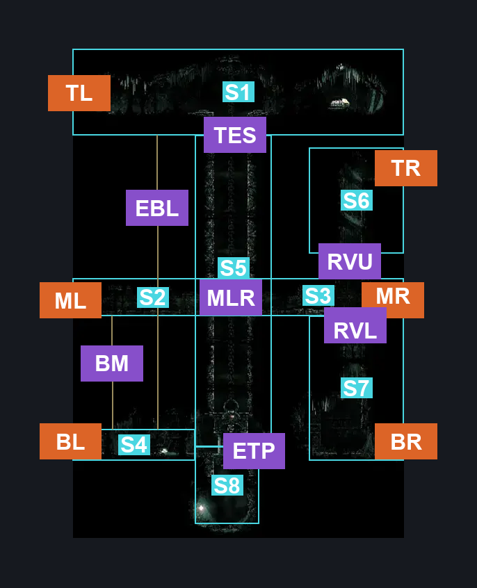
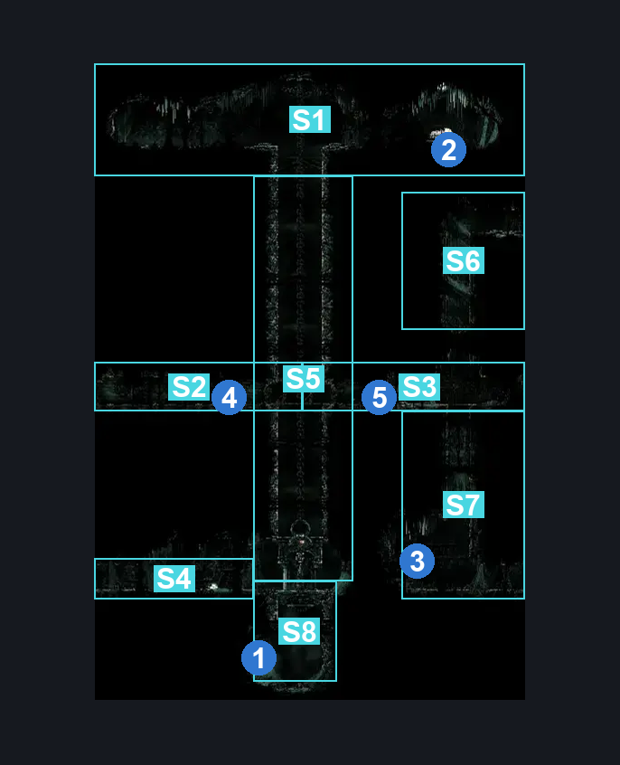
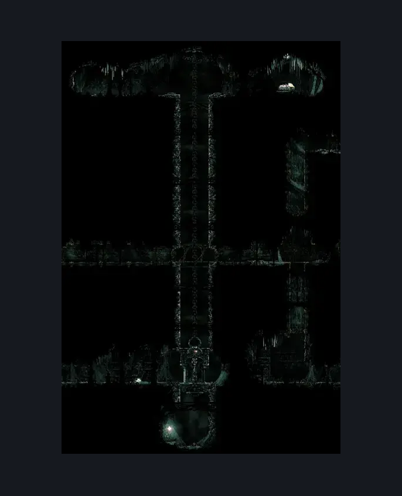

# Whiteward Entrance (Ward_01)

**Game ID:** Ward_01

**Contributors:** skai, Gallos

## Subrooms

| No. | Subroom | Annotated |
| --- | --- | --- |
| S1 | Top Third | ✓ |
| S2 | Middle Third (Left) | ✓ |
| S3 | Middle Third (Right) | ✓ |
| S4 | Bottom Third (Left) | ✓ |
| S5 | Elevator Shaft | ✓ |
| S6 | Vertical Shaft (Upper) | ✓ |
| S7 | Vertical Shaft (Lower) | ✓ |
| S8 | Pit | ✓ |

## Room Transitions

| Alias | Name | From subroom | Destination | Destination alias | Requirements | TODO | Verification | Annotated | Notes |
| --- | --- | --- | --- | --- | --- | --- | --- | --- | --- |
| TL | Top Left | Top Third | [Choral Chambers Eastern Shaft (Song_05)](../choral-chambers/choral-chambers-eastern-shaft.md) | R1 | Nothing |  | Verified | ✓ |  |
| TR | Top Right | Vertical Shaft (Upper) | [Whiteward Long Horizontal (Ward_05)](whiteward-long-horizontal.md) | L | Nothing |  | Verified | ✓ |  |
| ML | Middle Left | Middle Third (Left) | [Whiteward Tunnel Room (Ward_02b)](whiteward-tunnel-room.md) | R | Nothing |  | Verified | ✓ |  |
| MR | Middle Right | Middle Third (Right) | [Whiteward Silkeater (Ward_04)](whiteward-silkeater.md) | L | Break Wall right |  | Verified | ✓ |  |
| BL | Bottom Left | Bottom Third (Left) | [Whiteward Unravelled Arena Room (Ward_02)](whiteward-unravelled-arena-room.md) | R | Nothing |  | Verified | ✓ |  |
| BR | Bottom Right | Vertical Shaft (Lower) | [Whiteward Descent Connection (Ward_03)](whiteward-descent-connection.md) | L | Nothing |  | Verified | ✓ |  |

## Subroom Connections

| Alias | Name | Source | Destination | Requirements | TODO | Verification | Annotated | Notes |
| --- | --- | --- | --- | --- | --- | --- | --- | --- |
| TES | Top to Elevator Shaft | Top Third | Elevator Shaft | Have White Key |  | Verified | ✓ |  |
| TES | Top to Elevator Shaft | Elevator Shaft | Top Third | Have White Key |  | Verified | ✓ |  |
| EBL | Elevator to Bottom Left | Top Third | Bottom Third (Left) | Have White Key |  | Verified | ✓ |  |
| EBL | Elevator to Bottom Left | Bottom Third (Left) | Top Third | Have White Key |  | Verified | ✓ |  |
| MLR | Middle Left to Right | Middle Third (Left) | Middle Third (Right) | activate Switch Entrance Left OR activate Switch Entrance Right |  | Verified | ✓ |  |
| MLR | Middle Left to Right | Middle Third (Right) | Middle Third (Left) | Nothing (Jump) |  | Verified | ✓ |  |
| RVL | Right to Vertical Lower | Middle Third (Right) | Vertical Shaft (Lower) | Nothing (Fall) |  | Verified | ✓ |  |
| RVL | Right to Vertical Lower | Vertical Shaft (Lower) | Middle Third (Right) | Cling Grip right OR (Scuttlebrace AND (easy shaman pogo OR Medium Flea Brew Stall OR Medium Heal Stall OR Faydown)) OR Silk Soar OR (cling grip left AND faydown cloak AND (sharpdart OR clawline right OR rune rage OR easy heal stall OR easy plasmium stall OR easy flea brew stall OR easy flintslate stall )) |  | Verified | ✓ |  |
| RVU | Right to Vertical Upper | Middle Third (Right) | Vertical Shaft (Upper) | Silk Soar OR (Faydown AND Cling Grip either AND (Proficient Movement OR rune rage OR easy flea brew stall OR easy plasmium stall OR easy flintslate stall )) |  | Verified | ✓ |  |
| RVU | Right to Vertical Upper | Vertical Shaft (Upper) | Middle Third (Right) | Nothing (Fall) |  | Verified | ✓ |  |
| ETP | Elevator to Pit | Elevator Shaft | Pit | (Have white key AND ((activate Switch Entrance Left OR  activate Switch Entrance right) OR (clawline either AND elite ball knowledge)))  OR prereq Entrance Randomizer Bottom Third Left Access |  | Verified | ✓ | falling free if ER |
| ETP | Elevator to Pit | Pit | Elevator Shaft | Cling Grip right OR Scuttlebrace OR Silk Soar OR (faydown cloak AND cling grip left) |  | Verified | ✓ | Or F4 |
| BM | Bottom to Mid | Bottom Third (Left) | Middle Third (Left) | (activate Switch Entrance Left OR activate Switch Entrance right) AND (cling grip right OR (faydown cloak AND (scuttlebrace OR cling grip left)) OR silk soar) |  | Verified | ✓ |  |
| BM | Bottom to Mid | Middle Third (Left) | Bottom Third (Left) | none |  | Verified | ✓ | falling |

## Check Locations

| No. | Check | Subroom | Requirements | TODO | Verification | Location Type | Annotated | Notes |
| --- | --- | --- | --- | --- | --- | --- | --- | --- |
| 1 | Whiteward - Spool Fragment | Pit | Nothing |  | Verified | collectible | ✓ |  |
| 2 | Whiteward Bench | Top Third | Have White Key |  | Verified | bench | ✓ |  |
| 3 | Whiteward - Map Purchase | Vertical Shaft (Lower) | spend 70 rosaries |  | Verified | collectible | ✓ |  |
| 4 | Switch Entrance Left | Middle Third (Left) | none |  | Verified | switch | ✓ | also activates right switch |
| 5 | Switch Entrance Right | Middle Third (Right) | none |  | Verified | switch | ✓ | also activates left switch |
| 6 | Entrance Randomizer Bottom Third Left Access | Bottom Third (Left) | entrance randomizer on |  | Verified | logic-point |  |  |

## Room Images

### Connections

### Checks

### Scene

