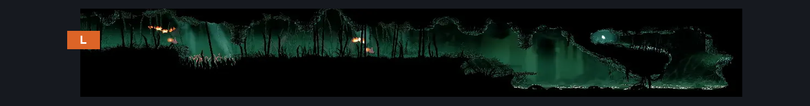
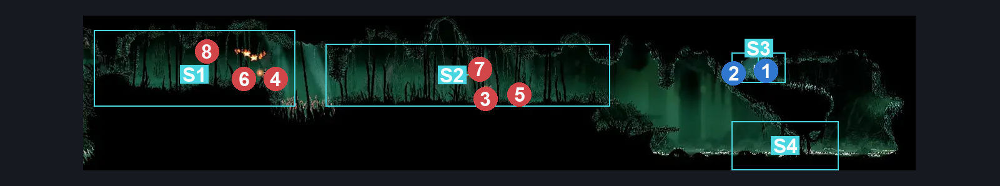
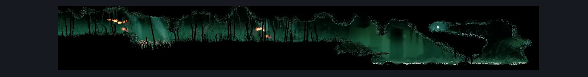

# Eastern Wisp Thicket (Wisp_07)

**Game ID:** Wisp_07

**Contributors:** samupo and Isssma

## Subrooms

| No. | Subroom | Annotated |
| --- | --- | --- |
| S1 | left section | ✓ |
| S2 | middle section | ✓ |
| S3 | goodies room | ✓ |
| S4 | unstable platforms | ✓ |

## Room Transitions

| Alias | Name | From subroom | Destination | Destination alias | Requirements | TODO | Verification | Annotated | Notes |
| --- | --- | --- | --- | --- | --- | --- | --- | --- | --- |
| L | left1 | left section | [Wisp Thicket Shaft (Wisp_08)](wisp-thicket-shaft.md) | R | none |  | Verified | ✓ |  |

## Subroom Connections

| Alias | Name | Source | Destination | Requirements | TODO | Verification | Annotated | Notes |
| --- | --- | --- | --- | --- | --- | --- | --- | --- |
| SP | spike pit | left section | middle section | progressive swift step 1 OR drifters cloak OR spike pogo OR faydown cloak OR clawline right x 1 OR sharpdart x 1 |  | Verified | ✓ |  |
| SP | spike pit | middle section | left section | progressive swift step 2 left OR clawline left x 1 OR sharpdart x 1 OR faydown cloak OR easy shaman pogo OR ((spike pogo OR progressive swift step 1 OR drifters cloak) AND ledge grab left) OR (progressive swift step 1 AND (drifters cloak OR easy beast pogo)) |  | Verified | ✓ |  |
| MP | muckmaggot parkour | middle section | unstable platforms | ((swim OR (clawline right x 3 OR (clawline right x 2 AND (progressive swift step 2 right OR easy [beast, hunter, architect] pogo OR drifters cloak OR faydown cloak)) OR (clawline right x 1 AND (drifters cloak OR (progressive swift step 1 AND flea brew AND faydown cloak) OR (progressive swift step 2 AND faydown cloak)))))) |  | Verified | ✓ |  |
| MP | muckmaggot parkour | unstable platforms | middle section | ((swim OR (clawline left x 2 AND (progressive swift step 2 left OR drifters cloak OR easy beast pogo))) AND (silk soar OR faydown cloak OR ledge grab left)) OR (clawline left x 2 AND faydown cloak) |  | Verified | ✓ |  |
| BGU | big gap upper | middle section | goodies room | (clear stone wall AND silk soar AND (clawline right x 1 OR sharpdart x 1 OR (progressive swift step 2 left AND (faydown cloak OR drifters cloak)) OR (faydown cloak AND (drifters cloak OR easy beast pogo)) OR (drifters cloak AND (ledge grab right OR easy beast pogo)))) |  | Verified | ✓ |  |
| BGU | big gap upper | goodies room | middle section | faydown cloak OR ((swim OR drifters cloak OR clawline left x 1 OR easy [hunter, reaper, beast, architect, witch, shaman] pogo OR easy wanderer needle strike OR sharpdart OR progressive swift step 1 OR sharpdart x 1) AND (silk soar OR ledge grab left OR cling grip left)) |  | Verified | ✓ |  |
| VC | vertical climb | unstable platforms | goodies room | (cling grip right AND ((faydown cloak AND (spike pogo OR clawline left x 1 OR sharpdart x 1)) OR (clawline right x 1 AND (clawline left x 1 OR (drifters cloak AND cling grip left)) AND spike pogo))) OR (faydown cloak AND spike pogo AND medium beast pogo) |  | Verified | ✓ |  |
| VC | vertical climb | goodies room | unstable platforms | drifters cloak OR progressive swift step 2 right OR clawline right x 1 OR sharpdart x 1 OR spike pogo OR (progressive swift step 1 AND faydown cloak) |  | Verified | ✓ |  |

## Check Locations

| No. | Check | Subroom | Requirements | TODO | Verification | Location Type | Annotated | Notes |
| --- | --- | --- | --- | --- | --- | --- | --- | --- |
| 1 | Mask Shard: Wisp Thicket | goodies room | nothing |  | Verified | collectible | ✓ |  |
| 2 | stone wall | goodies room | break wall left OR break wall up |  | Verified | blockade | ✓ |  |
| 3 | Burning Bug 1 | middle section | nothing |  | Verified | enemy | ✓ | Spawn conditions: defeatedWispPyreEffigy=false |
| 4 | Burning Bug 2 | left section | nothing |  | Verified | enemy | ✓ | Spawn conditions: defeatedWispPyreEffigy=false |
| 5 | Farmer Wisp Immolater Variant 1 | middle section | defeat Boss: Father of the Flame IN father of the flame gamer cave |  | Verified | enemy | ✓ | Spawn conditions: defeatedWispPyreEffigy=true |
| 6 | Farmer Wisp Immolater Variant (1) 1 | left section | defeat Boss: Father of the Flame IN father of the flame gamer cave |  | Verified | enemy | ✓ | Spawn conditions: defeatedWispPyreEffigy=true |
| 7 | Wisp Lantern | middle section | nothing |  | Verified | enemy | ✓ |  |
| 8 | Wisp Summon | left section | prereq Burning Bug 1 |  | Verified | enemy | ✓ |  |

## Room Images

### Connections

### Checks

### Scene

