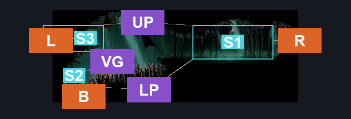
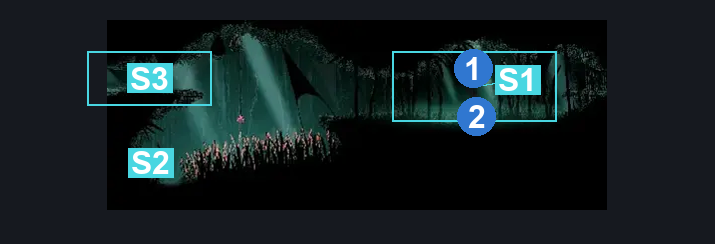
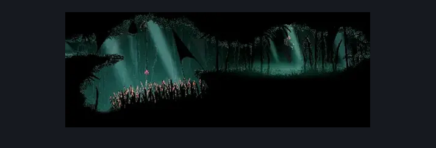

# Wisp Thicket Bench (Wisp_04)

**Game ID:** Wisp_04

**Contributors:** samupo and Isssma

## Subrooms

| No. | Subroom | Annotated |
| --- | --- | --- |
| S1 | Bench | ✓ |
| S2 | Bottom | ✓ |
| S3 | Left | ✓ |

## Room Transitions

| Alias | Name | From subroom | Destination | Destination alias | Requirements | TODO | Verification | Annotated | Notes |
| --- | --- | --- | --- | --- | --- | --- | --- | --- | --- |
| L | left1 | Left | [Wisp Thicket Grounds (Wisp_02)](wisp-thicket-grounds.md) | R | none |  | Verified | ✓ |  |
| R | right1 | Bench | [Wisp Thicket Shaft (Wisp_08)](wisp-thicket-shaft.md) | L | none |  | Verified | ✓ |  |
| B | bot1 | Bottom | [Greymoor Western Tower (Greymoor_06)](../greymoor/greymoor-western-tower.md) | T | none |  | Verified | ✓ |  |

## Subroom Connections

| Alias | Name | Source | Destination | Requirements | TODO | Verification | Annotated | Notes |
| --- | --- | --- | --- | --- | --- | --- | --- | --- |
| LP | lower path | Bottom | Bench | spike pogo OR (faydown cloak AND clawline right x 1) |  | Verified | ✓ |  |
| LP | lower path | Bench | Bottom | drifter's cloak OR spike pogo OR clawline left x 1 OR dash left OR ((progressive swift step 1 AND (sharpdart x 1 OR faydown cloak))) OR (sharpdart x 1 AND faydown cloak) |  | Verified | ✓ | dash left  clawline left x 1 (change to x 2 and add as alternative in faydown and progressive swift step 1) |
| VG | vertical gap | Bottom | Left | (spike pogo AND ((ledge grab left AND proficient movement) OR faydown cloak))  OR (clawline right x 1 AND faydown cloak) |  | Verified | ✓ | added proficient movement since you need to be precise with the pogo and the object used to pogo off moves away from the platform with each hit |
| VG | vertical gap | Left | Bottom | spike pogo OR drifter's cloak OR clawline left x 1 OR sharpdart x 1 OR easy [beast, hunter, architect] pogo OR dash left OR easy wanderer needle strike |  | Verified | ✓ | hunter pogo (add ledge grab left to reach platform)   wanderer needle strike |
| UP | upper path | Left | Bench | clawline right x 1  OR dash right OR spike pogo OR drifter's cloak OR (progressive swift step 1 AND (faydown cloak OR easy [beast, architect, hunter] pogo OR (easy reaper pogo AND ledge grab right))) OR (faydown cloak AND (easy [beast, architect, hunter] pogo OR (easy reaper pogo AND ledge grab right))) |  | Verified | ✓ |  |
| UP | upper path | Bench | Left | (intended [hunter, wanderer, reaper, beast, architect, witch, shaman] pogo AND (progressive swift step 2 OR clawline left x 2 OR sharpdart x 2 OR faydown cloak OR (ledge grab left AND (progressive swift step 1 OR clawline left x 1 OR sharpdart x 1 OR drifters cloak OR spike pogo)))) OR (medium [hunter, wanderer, reaper, beast, shaman, witch] pogo AND ((progressive swift step 1 OR clawline left x 1 OR sharpdart x 1 OR drifters cloak OR spike pogo))) |  | Verified | ✓ | intended when hitting the red ball once skip when hitting ball like 3 or more times to move it and skip the ledge grab |

## Check Locations

| No. | Check | Subroom | Requirements | TODO | Verification | Location Type | Annotated | Notes |
| --- | --- | --- | --- | --- | --- | --- | --- | --- |
| 1 | Bench | Bench | none |  | Verified | bench | ✓ |  |
| 2 | Craw Summons | Bench | Craw Summons Ready |  | Verified | collectible | ✓ |  |

## Notes

some of the reqs to the bath of bottom subroom fall into the room transition instead of the platform, since its the only point of interest in that place i decided it was fine but added as comment the reqs that are like this and if its possible an alternative req for them to reach the platform

## Room Images

### Connections

### Checks

### Scene

