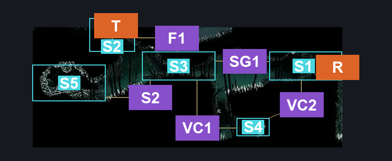
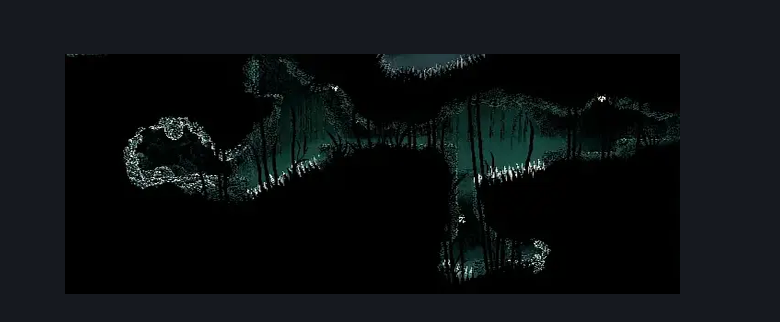
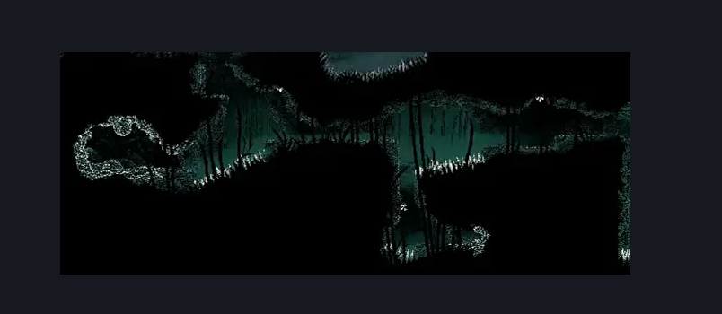

# Wisp Thicket Cave (Wisp_09)

**Game ID:** Wisp_09

**Contributors:** samupo and Isssma

## Subrooms

| No. | Subroom | Annotated |
| --- | --- | --- |
| S1 | right section | ✓ |
| S2 | top platform | ✓ |
| S3 | middle platform | ✓ |
| S4 | lower platform | ✓ |
| S5 | silver room | ✓ |
| S6 | why 2 rooms can reach this | ✓ |

## Room Transitions

| Alias | Name | From subroom | Destination | Destination alias | Requirements | TODO | Verification | Annotated | Notes |
| --- | --- | --- | --- | --- | --- | --- | --- | --- | --- |
| R | right1 | right section | [Wisp Thicket Secret Path (Wisp_05)](wisp-thicket-secret-path.md) | L | nothing |  | Verified | ✓ |  |
| T | top1 | top platform | [Underworks Wisp Thicket Passage (Under_23)](../underworks/underworks-wisp-thicket-passage.md) | B | nothing |  | Verified | ✓ |  |

## Subroom Connections

| Alias | Name | Source | Destination | Requirements | TODO | Verification | Annotated | Notes |
| --- | --- | --- | --- | --- | --- | --- | --- | --- |
| SG1 | spike gap 1 | right section | middle platform | progressive swift step 2 left OR clawline left x 1 OR sharpdart x 1 OR drifters cloak OR (ledge grab left AND (faydown cloak OR spike pogo)) OR ((faydown cloak OR medium pogo off pharlid) AND spike pogo) |  | Verified | ✓ |  |
| SG1 | spike gap 1 | middle platform | right section | clawline right x 1 OR sharpdart x 1 OR drifters cloak OR progressive swift step 2 right OR spike pogo OR (progressive swift step 1 AND (faydown cloak OR (easy naked pogo AND ledge grab right))) |  | Verified | ✓ |  |
| F1 | fall 1 | top platform | middle platform | nothing |  | Verified | ✓ |  |
| F1 | fall 1 | middle platform | top platform | faydown cloak |  | Verified | ✓ |  |
| S2 | spike 2 | middle platform | silver room | clear silver room wall AND (progressive swift step 2 left OR drifters cloak OR spike pogo OR clawline left x 1 OR sharpdart x 1 OR faydown cloak OR (progressive swift step 1 AND easy naked pogo) OR easy [hunter, beast, architect] pogo OR easy wanderer needle strike (if they are in a weird no spike run or something)) |  | Verified | ✓ |  |
| S2 | spike 2 | silver room | middle platform | spike pogo OR clawline right x 1  OR sharpdart x 1 OR faydown cloak OR progressive swift step 2 OR (progressive swift step 1 AND ledge grab right) OR (drifters cloak AND cling grip right AND proficient movement) |  | Verified | ✓ |  |
| VC1 | vertical climb 1 | middle platform | why 2 rooms can reach this | nothing |  | Verified | ✓ |  |
| VC1 | vertical climb 1 | why 2 rooms can reach this | middle platform | cling grip left |  | Verified | ✓ |  |
| VC2 | vertical climb 2 | right section | why 2 rooms can reach this | progressive swift step 1 left OR clawline left x 1 OR sharpdart x 1 OR drifters cloak OR spike pogo OR faydown cloak OR easy [hunter, beast, architect] pogo (if they are in a weird no spike run or something) |  | Verified | ✓ | "1 way" since you need cling grip to get out you end up in middle platform subroom so i wanto to avoid some redundancy since all it changes is the removval of progressive swift step 1 options |
| W | wall | why 2 rooms can reach this | lower platform | clear stone wall low |  | Verified | ✓ |  |
| W | wall | lower platform | why 2 rooms can reach this | clear stone wall low |  | Verified | ✓ |  |

## Check Locations

| No. | Check | Subroom | Requirements | TODO | Verification | Location Type | Annotated | Notes |
| --- | --- | --- | --- | --- | --- | --- | --- | --- |
| 1 | Wisp Thicket - Shell shard Cache that is a bit shy hidden from the others | lower platform | nothing |  | Verified | collectible | ✓ |  |
| 2 | Wisp Thicket - Shell shard Cache doesnt respect shy cache space | lower platform | nothing |  | Verified | collectible | ✓ |  |
| 3 | wisp Thicket - Tc thgouth it was funny and added many in this silver room | silver room | nothing |  | Verified | collectible | ✓ |  |
| 4 | wisp Thicket - The other shellshard cache | silver room | nothing |  | Verified | collectible | ✓ |  |
| 5 | wisp Thicket - The other other shellshard cache | silver room | nothing |  | Verified | collectible | ✓ |  |
| 6 | wisp Thicket - The other other other shellshard cache | silver room | nothing |  | Verified | collectible | ✓ |  |
| 7 | wisp Thicket - The other other other other shellshard cache | silver room | nothing |  | Verified | collectible | ✓ |  |
| 8 | silver room wall | middle platform | break wall up OR break wall left |  | Verified | blockade | ✓ |  |
| 9 | stone wall low | why 2 rooms can reach this | break wall up OR break wall right |  | Verified | blockade | ✓ |  |
| 10 | Pharlid Diver 1 | middle platform | nothing |  | Verified | enemy | ✓ |  |
| 11 | Pharlid Diver 2 | right section | nothing |  | Verified | enemy | ✓ |  |
| 12 | Pharlid 1 | why 2 rooms can reach this | nada |  | Verified | enemy | ✓ |  |

## Room Images

### Connections

### Checks

### Scene

