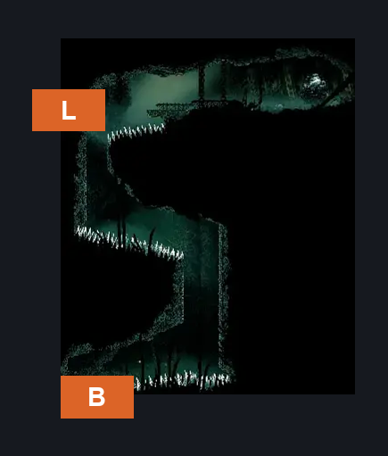
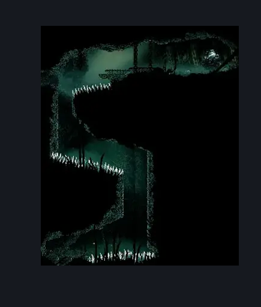
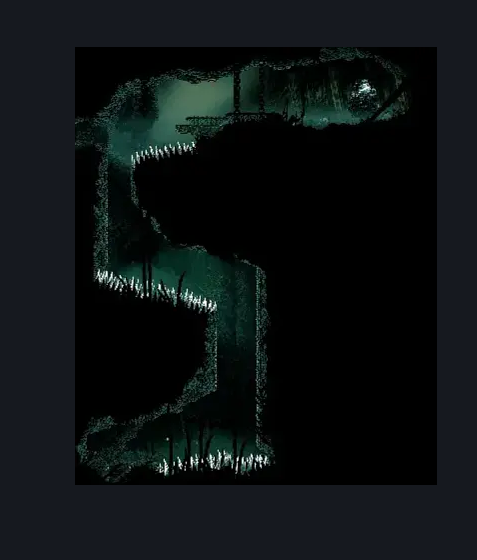

# Wisp Thicket Secret Path (Wisp_05)

**Game ID:** Wisp_05

**Contributors:** samupo and Isssma

## Subrooms

| No. | Subroom | Annotated |
| --- | --- | --- |
| S1 | Top | ✓ |
| S2 | Bottom | ✓ |
| S3 | behind hidden wall | ✓ |

## Room Transitions

| Alias | Name | From subroom | Destination | Destination alias | Requirements | TODO | Verification | Annotated | Notes |
| --- | --- | --- | --- | --- | --- | --- | --- | --- | --- |
| B | bot1 | Bottom | [Wisp Thicket Grounds (Wisp_02)](wisp-thicket-grounds.md) | T | none |  | Verified | ✓ |  |
| L | left1 | behind hidden wall | [Wisp Thicket Cave (Wisp_09)](wisp-thicket-cave.md) | R | none |  | Verified | ✓ |  |

## Subroom Connections

| Alias | Name | Source | Destination | Requirements | TODO | Verification | Annotated | Notes |
| --- | --- | --- | --- | --- | --- | --- | --- | --- |
| V | Vertical | Bottom | Top | cling grip both AND (spike pogo OR (faydown cloak AND (clawline left x 1 OR sharpdart x 1 OR (progressive swift step 2 left AND drifters cloak))) OR (clawline left x 1 AND progressive swift step 2 left AND (drifters cloak OR progressive swift step 2 right OR clawline right x 1))) |  | Verified | ✓ |  |
| V | Vertical | Top | Bottom | spike pogo OR drifter's cloak OR (cling grip both AND ((faydown cloak AND (progressive swift step 2 right OR clawline right x 1 OR sharpdart x 1)))) OR  (clawline right x 1 AND (clawline left x 1 OR progressive swift step 2 left)) |  | Verified | ✓ |  |
| W | pared aka wall | Bottom | behind hidden wall | (break wall left) AND (cling grip both AND (spike pogo OR (faydown cloak AND (clawline left x 1 OR sharpdart x 1 OR (progressive swift step 2 left AND drifters cloak))) OR (clawline left x 1 AND progressive swift step 2 left))) |  | Verified | ✓ |  |
| W | pared aka wall | behind hidden wall | Bottom | break wall right AND (spike pogo OR drifter's cloak OR (cling grip both AND ((faydown cloak AND (progressive swift step 2 right OR clawline right x 1 OR sharpdart x 1)))) OR  (clawline right x 1 AND (clawline left x 1 OR progressive swift step 2 left))) |  | Verified | ✓ |  |
| WU | pared upper aka wall upper | Top | behind hidden wall | break wall right AND (progressive swift step 2 left OR cling grip left OR faydown cloak OR spike pogo OR drifters cloak OR sharpdart x 1 OR clawline left x 1 OR easy beast pogo OR (easy [hunter, architect] pogo AND ledge grab left)) |  | Verified | ✓ |  |
| WU | pared upper aka wall upper | behind hidden wall | Top | break wall right AND (progressive swift step 2 right OR sharpdart x 1 OR clawline right x 2 OR drifters cloak OR faydown cloak OR spike pogo OR easy beast pogo) |  | Verified | ✓ |  |

## Check Locations

| No. | Check | Subroom | Requirements | TODO | Verification | Location Type | Annotated | Notes |
| --- | --- | --- | --- | --- | --- | --- | --- | --- |
| 1 | Craftmetal: Wisp Thicket | Top | nothing |  | Verified | collectible | ✓ |  |

## Room Images

### Connections

### Checks

### Scene

