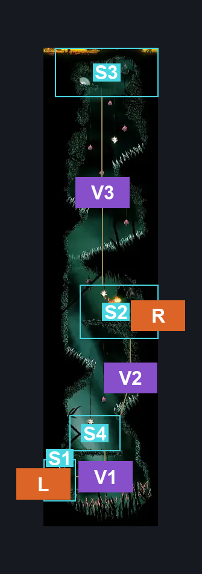
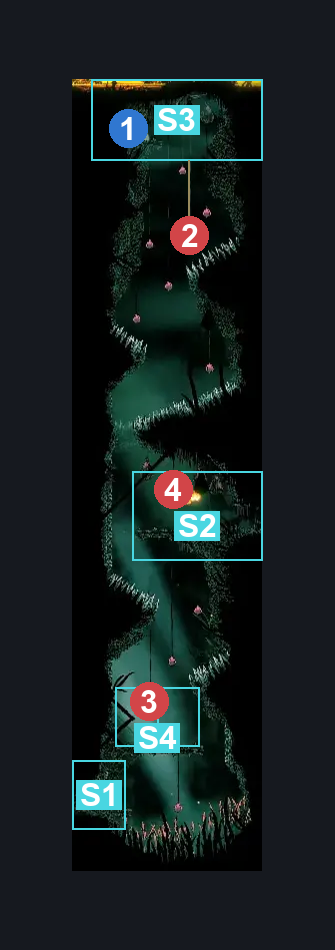
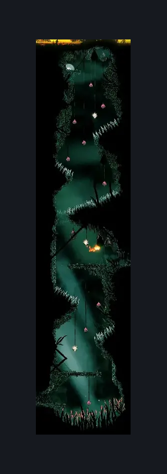

# Wisp Thicket Shaft (Wisp_08)

**Game ID:** Wisp_08

**Contributors:** samupo and Isssma

## Subrooms

| No. | Subroom | Annotated |
| --- | --- | --- |
| S1 | Bottom | ✓ |
| S2 | middle wisp platform | ✓ |
| S3 | Top | ✓ |
| S4 | low wisp platform | ✓ |

## Room Transitions

| Alias | Name | From subroom | Destination | Destination alias | Requirements | TODO | Verification | Annotated | Notes |
| --- | --- | --- | --- | --- | --- | --- | --- | --- | --- |
| L | left1 | Bottom | [Wisp Thicket Bench (Wisp_04)](wisp-thicket-bench.md) | R | none |  | Verified | ✓ |  |
| R | right1 | middle wisp platform | [Eastern Wisp Thicket (Wisp_07)](eastern-wisp-thicket.md) | L | none |  | Verified | ✓ |  |

## Subroom Connections

| Alias | Name | Source | Destination | Requirements | TODO | Verification | Annotated | Notes |
| --- | --- | --- | --- | --- | --- | --- | --- | --- |
| V1 | vertical 1 | low wisp platform | Bottom | spike pogo OR drifters cloak OR clawline left x 1 OR sharpdart x 1 OR (faydown cloak  AND progressive swift step 2 left) |  | Verified | ✓ |  |
| V1 | vertical 1 | Bottom | low wisp platform | ((faydown cloak OR easy [wanderer, shaman] pogo OR medium reaper pogo) AND cling grip right) OR (faydown cloak AND (ledge grab left OR easy hazard respawn OR easy [beast, shaman, architect] pogo )) |  | Verified | ✓ |  |
| V2 | vertical 2 | low wisp platform | middle wisp platform | spike pogo OR drifters cloak OR progressive swift step 2 right OR faydown cloak OR clawline right x 1 OR sharpdart x 1 |  | Verified | ✓ |  |
| V2 | vertical 2 | middle wisp platform | low wisp platform | (cling grip left AND (faydown cloak OR cbt damage boost off wisp) AND (spike pogo OR clawline left x 1 OR sharpdart x 1 OR progressive swift step 2 left)) OR (silk soar AND cling grip left AND (clawline left x 1 OR sharpdart x 1 OR drifters cloak OR (progressive swift step 2 left AND faydown cloak))) OR (faydown cloak AND spike pogo) |  | Verified | ✓ | the dmamage boost refers to the nuclear explosion from the summoned wisp by the lantern |
| V3 | vertical hell 3 | Top | middle wisp platform | progressive swift step 2 left OR clawline left x 1 OR sharpdart x 1 OR drifters cloak OR faydown cloak |  | Verified | ✓ |  |
| V3 | vertical hell 3 | middle wisp platform | Top | (cling grip left AND (faydown cloak OR (spike pogo AND (clawline left x 1 OR sharpdart OR ((easy beast pogo AND ledge grab AND cbt damage boost off wisp) OR medium shaman pogo))))) OR (faydown cloak AND silk soar) |  | Verified | ✓ |  |

## Check Locations

| No. | Check | Subroom | Requirements | TODO | Verification | Location Type | Annotated | Notes |
| --- | --- | --- | --- | --- | --- | --- | --- | --- |
| 1 | Relic: Bone Scroll (Wisp Thicket) | Top | none |  | Verified | collectible | ✓ |  |
| 2 | Wisp 1 | Top | cling grip left AND (faydown cloak OR (spike pogo AND (clawline left x 1 OR sharpdart OR easy beast pogo OR medium shaman pogo))) |  | Verified | enemy | ✓ | wisp lantern |
| 3 | Wisp 2 | low wisp platform | nothing |  | Verified | enemy | ✓ | wisp lantern |
| 4 | Wisp 3 | middle wisp platform | nothing |  | Verified | enemy | ✓ | wisp lantern |

## Room Images

### Connections

### Checks

### Scene

