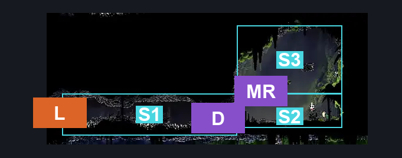
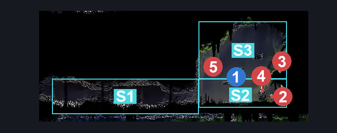
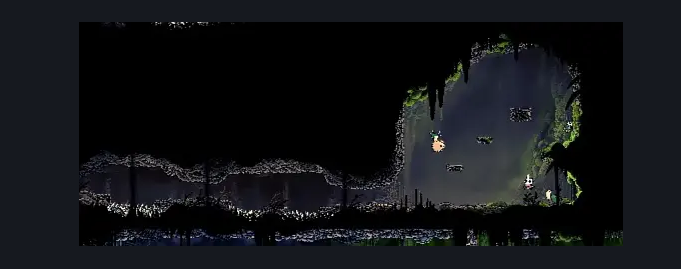

# Wormways Flea Rescue (Crawl_06)

**Game ID:** Crawl_06

**Contributors:** herounit, cry

## Subrooms

| No. | Subroom | Annotated |
| --- | --- | --- |
| S1 | entrance | ✓ |
| S2 | main floor | ✓ |
| S3 | upper main | ✓ |

## Room Transitions

| Alias | Name | From subroom | Destination | Destination alias | Requirements | TODO | Verification | Annotated | Notes |
| --- | --- | --- | --- | --- | --- | --- | --- | --- | --- |
| L | left | entrance | [Wormways Shaft (Crawl_02)](wormways-shaft.md) | MR | none |  | Verified | ✓ |  |

## Subroom Connections

| Alias | Name | Source | Destination | Requirements | TODO | Verification | Annotated | Notes |
| --- | --- | --- | --- | --- | --- | --- | --- | --- |
| D | dash | entrance | main floor | spike pogo OR run OR dash right OR clawline right OR sharpdart OR faydown cloak OR drifter's cloak |  | Verified | ✓ | spike pogo |
| D | dash | main floor | entrance | spike pogo OR run OR dash left OR clawline left OR sharpdart OR faydown cloak OR drifter's cloak |  | Verified | ✓ | spike pogo |
| MR | main room | main floor | upper main | ledge grab OR easy pogo off [Pilgrim Hornfly, Overgrown Pilgrim]  OR silk soar OR faydown cloak OR cling grip OR easy shaman pogo |  | Verified | ✓ |  |
| MR | main room | upper main | main floor | none (falling) |  | Verified | ✓ |  |

## Check Locations

| No. | Check | Subroom | Requirements | TODO | Verification | Location Type | Annotated | Notes |
| --- | --- | --- | --- | --- | --- | --- | --- | --- |
| 1 | flea wormways snacc | main floor | ledge grab OR easy pogo off [Pilgrim Hornfly, Overgrown Pilgrim]  OR silk soar OR faydown cloak OR cling grip OR easy shaman pogo |  | Verified | collectible | ✓ |  |
| 2 | Overgrown Pilgrim 1 | main floor | none |  | Verified | enemy | ✓ |  |
| 3 | Aknid 1 | upper main | none |  | Verified | enemy | ✓ |  |
| 4 | Pilgrim Hornfly 1 | main floor | none |  | Verified | enemy | ✓ |  |
| 5 | Aknid 2 | upper main | none |  | Verified | enemy | ✓ |  |

## Notes

cry: exit - for room rando - the entrance is functional and open regardless of whether you broke the wall in the shaft, but entering shaft's connected entrance will clip you out of bounds if the wall on the other side is unbroken

## Room Images

### Connections

### Checks

### Scene

