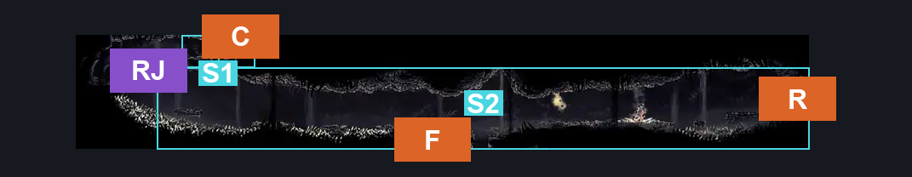
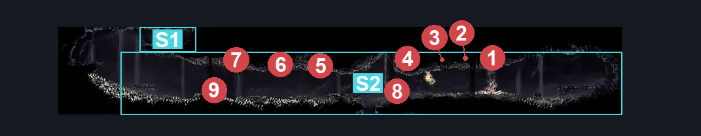
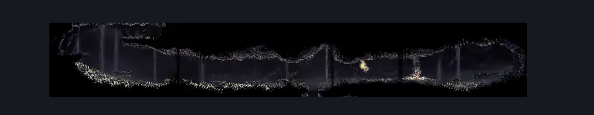

# Wormways Middle (Crawl_03b)

**Game ID:** Crawl_03b

**Contributors:** herounit, cry

## Subrooms

| No. | Subroom | Annotated |
| --- | --- | --- |
| S1 | wormways west scaffold | ✓ |
| S2 | main tunnel | ✓ |

## Room Transitions

| Alias | Name | From subroom | Destination | Destination alias | Requirements | TODO | Verification | Annotated | Notes |
| --- | --- | --- | --- | --- | --- | --- | --- | --- | --- |
| R | right | main tunnel | [Wormways Shaft (Crawl_02)](wormways-shaft.md) | LL | none |  | Verified | ✓ | simple key lock doesn't block this side at all |
| F | floor | main tunnel | [Wormways Lower East (Crawl_07)](wormways-lower-east.md) | C | none |  | Verified | ✓ |  |
| C | ceiling | wormways west scaffold | [Wormways Upper West (Crawl_03)](wormways-upper-west.md) | F | none |  | Verified | ✓ |  |

## Subroom Connections

| Alias | Name | Source | Destination | Requirements | TODO | Verification | Annotated | Notes |
| --- | --- | --- | --- | --- | --- | --- | --- | --- |
| RJ | running jump | main tunnel | wormways west scaffold | (ledge grab AND (run OR dash right OR faydown cloak OR drifter's cloak OR clawline right OR silk soar OR sharpdart OR flea brew)) OR (run OR dash both OR faydown cloak OR drifter's cloak OR clawline OR silk soar OR sharpdart) OR (cling grip both AND proficient movement AND (architect slash right OR easy shaman pogo OR flea brew OR easy naked pogo OR easy [voltvessels, flintslate, rune rage] stall)) OR easy beast pogo OR easy [beast, architect] needle strike |  | Verified | ✓ |  |
| RJ | running jump | wormways west scaffold | main tunnel | none (falling) |  | Verified | ✓ |  |

## Check Locations

| No. | Check | Subroom | Requirements | TODO | Verification | Location Type | Annotated | Notes |
| --- | --- | --- | --- | --- | --- | --- | --- | --- |
| 1 | Grom 1 | main tunnel | Normal World Spawn |  | Verified | enemy | ✓ |  |
| 2 | Grom 2 | main tunnel | Normal World Spawn |  | Verified | enemy | ✓ |  |
| 3 | Grom 3 | main tunnel | Normal World Spawn |  | Verified | enemy | ✓ |  |
| 4 | Grom 4 | main tunnel | Normal World Spawn |  | Verified | enemy | ✓ |  |
| 5 | Grom 5 | main tunnel | Normal World Spawn |  | Verified | enemy | ✓ |  |
| 6 | Grom 6 | main tunnel | Normal World Spawn |  | Verified | enemy | ✓ |  |
| 7 | Grom 7 | main tunnel | Normal World Spawn |  | Verified | enemy | ✓ |  |
| 8 | Plasmidas 1 | main tunnel | Black Thread World Spawn |  | Verified | enemy | ✓ |  |
| 9 | Plasmidas 2 | main tunnel | Black Thread World Spawn |  | Verified | enemy | ✓ |  |

## Room Images

### Connections

### Checks

### Scene

